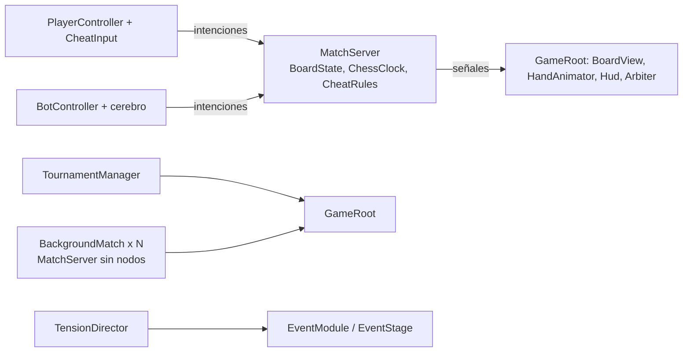
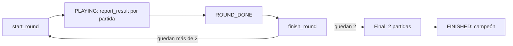

# Arquitectura e implementación actual

Este documento describe **lo que existe en `main`**: la arquitectura y todas las mecánicas implementadas. La fuente de verdad es el código (`src/`, `data/`, `tests/`, `web/`, `tools/`). Lo pendiente está en `ROADMAP.md`; las propuestas de diseño que aún no existen (otras trampas y eventos, multijugador, Stockfish) viven en `docs/documento-diseno.md` y `docs/documento-tecnico.md` y **no** se describen aquí como hechas.

Regla de mantenimiento: si una mecánica cambia, se corrige aquí en el mismo commit.

## 1. Resumen y reglas de arquitectura

Juego de Godot 4.6+ (GDScript) para un humano contra bots: torneo de ajedrez por eliminación (16 jugadores por defecto) en un salón oscuro, con trampas físicas, acusaciones, un árbitro y eventos de distracción. Se exporta a web.

| Regla | Cómo se cumple |
| --- | --- |
| **El servidor manda** | Todo lo que decide el resultado vive en `src/server/` (`MatchServer`). Cliente y bots envían solo intenciones: `submit_move`, `set_gaze`, `start_cheat`, `abort_cheat`, `accuse` (y `trigger_rival_event`). Dibujan lo que el servidor confirma por señales. Hoy corre todo en un proceso, pero no se cruza esa frontera. |
| **Tablero físico** | `BoardState` es lo que hay sobre la mesa, no lo que resultaría de jugadas legales. Las trampas lo alteran por fuera de las reglas; las jugadas se validan siempre sobre él. |
| **Bots = mismas entradas que un humano** | `BotController` usa las mismas intenciones y una cámara virtual para la mirada. Los cerebros devuelven una política `{uci: probabilidad}` que el bot muestrea. |
| **Web es el objetivo** | Renderer `gl_compatibility` (sin niebla volumétrica; solo la niebla simple del `Environment`), sin procesos externos (nada de `OS.execute`). Maia-3 corre en el navegador con onnxruntime-web. |
| **Decisiones abiertas en `MatchConfig`** | Reloj, pausa por acusación, advertencias, cono de mirada, etc. son opciones, no constantes en el código. |
| **Datos como `Resource`** | Trampas (`CheatDef`), eventos (`EventDef`) y personalidades (`BotPersonality`) son `.tres` en `data/`. |
| **Pruebas** | La lógica de servidor, bots y torneo es pura (sin nodos) y se prueba sin ventana. |



## 2. Mapa de carpetas y clases

### `src/server/` (autoridad, sin nodos)

| Clase | Ruta | Responsabilidad |
| --- | --- | --- |
| `MatchServer` | `src/server/match_server.gd` | Una partida: tablero, reloj, intenciones, trampas, acusaciones, eventos del rival, fin de partida y señales. |
| `MatchConfig` | `src/server/match_config.gd` | `Resource` con los parámetros de la partida (ver sección 5). |
| `PlayerSession` | `src/server/player_session.gd` | Datos que viven en el torneo: id, nombre, `is_bot`, advertencias, ayuda de principiantes (solo humanos). |
| `ChessClock` | `src/server/chess_clock.gd` | Reloj sin incremento; señal `flagged`. |
| `Gaze` | `src/server/gaze.gd` | Cono de mirada y dirección a partir de yaw/pitch. |
| `BeginnerHelper` | `src/server/beginner_helper.gd` | Detecta errores graves antes de aceptar una jugada. |
| `TensionDirector` | `src/server/tension_director.gd` | Sortea eventos globales y disuasivos; lógica pura. |
| `BoardState` | `src/server/chess/board_state.gd` | Tablero físico: casillas, desplazamientos finos, enroques, al paso, pilas de captura y piezas en la mano. FEN. |
| `ChessRules` | `src/server/chess/chess_rules.gd` | Jugadas legales, jaque, aplicar jugada, material insuficiente, perft. |
| `ChessPiece`, `ChessMove` | `src/server/chess/` | Codificación de piezas (tipo en 3 bits, color en el bit 3) y jugadas UCI. |
| `CheatDef` | `src/server/cheats/cheat_def.gd` | Definición de una trampa como datos. |
| `CheatRules` | `src/server/cheats/cheat_rules.gd` | Valida y aplica trampas sobre el tablero físico. |
| `EventDef` | `src/server/events/event_def.gd` | Definición de un evento como datos. |
| `TournamentManager` | `src/server/tournament/tournament_manager.gd` | Rondas, emparejamiento, descansos, final, campeón. |
| `TournamentGame` | `src/server/tournament/tournament_game.gd` | Una partida de la ronda: colores, mesa, resultado, tiempo sobrante. |
| `TournamentSession` | `src/server/tournament/tournament_session.gd` | Variables estáticas que sobreviven a la recarga de escena. |
| `BackgroundMatch` | `src/server/tournament/background_match.gd` | Partida bot contra bot barata para las mesas lejanas. |

### `src/bots/`

| Clase | Ruta | Responsabilidad |
| --- | --- | --- |
| `BotController` | `src/bots/bot_controller.gd` | `Node` del bot: mirada, juego, trampas, vigilancia, acusaciones, eventos. |
| `BotPersonality` | `src/bots/bot_personality.gd` | `Resource` con los parámetros de comportamiento. |
| `CheatPlanner` | `src/bots/cheat_planner.gd` | Lógica pura: cuándo y qué trampa hacer, probabilidades de abortar y acusar. |
| `ChessBrain` | `src/bots/chess_brain.gd` | Interfaz del cerebro; `sample` y `softmax`. |
| `FallbackBrain` | `src/bots/fallback_brain.gd` | Cerebro en GDScript (2 plies, material + tablas de casilla). También da la evaluación estática que usa el planificador. |
| `MaiaBrain` | `src/bots/maia_brain.gd` | Maia-3 5M en el navegador vía `JavaScriptBridge`; respaldo en `FallbackBrain`. |
| `MaiaEncoding` | `src/bots/maia_encoding.gd` | Port de la codificación de entrada de maia3 (vocabulario de 4352 jugadas). |
| `MaiaHistory` | `src/bots/maia_history.gd` | Reconstruye las 8 últimas posiciones físicas. |

### `src/client/` y `src/world/` (vista)

| Clase | Ruta | Responsabilidad |
| --- | --- | --- |
| `GameRoot` | `src/world/game_root.gd` | Raíz de la escena: arma torneo, partida, actores, módulos, mesas de fondo y flujo entre rondas. |
| `Hall` | `src/world/hall.gd` | Salón, mesa principal, 9 mesas decorativas, lámparas, figuras sentadas. |
| `BoardView` | `src/client/board_view.gd` | Tablero 3D, piezas, pilas, resaltados; reconcilia con el tablero físico (`sync`). |
| `PieceFactory` | `src/client/piece_factory.gd` | Piezas por perfiles de revolución (placeholders), alturas reales. |
| `ClockView` | `src/client/clock_view.gd` | Reloj 3D con dos pantallas y dos botones. |
| `PlayerController` | `src/client/player_controller.gd` | Cámara en primera persona, mirada, selección y envío de jugadas. |
| `OpponentAvatar` | `src/client/opponent_avatar.gd` | Figura del rival, cabeza que sigue la mirada del bot, tos y pieza caída. También fabrica las figuras sentadas de las mesas. |
| `HandRig` | `src/client/hand_rig.gd` | Brazo con `Skeleton3D` + `TwoBoneIK3D`, dedos y temblor. |
| `HandAnimator` | `src/client/hand_animator.gd` | Cola de animaciones de la mano por fases. |
| `Arbiter` | `src/client/arbiter.gd` | Figura del árbitro: camina, mira el tablero, gesto de veredicto, `pass_behind`. |
| `Hud` | `src/client/hud.gd` | Subtítulos, mensajes del árbitro, advertencias, ronda, cuadro, pantallas, viñeta. |
| `CheatModule` | `src/client/cheats/cheat_module.gd` | Módulo: conecta las señales de trampas con las manos; crea entrada, panel y árbitro; guiones de demostración. |
| `CheatInput`, `CheatArmState`, `CheatTargeting`, `CheatPanel` | `src/client/cheats/` | Entrada del jugador (teclas 1-4), máquina de estados, destinos válidos y panel. |
| `EventModule` | `src/client/events/event_module.gd` | Módulo: dueño del `TensionDirector`, avisa a los bots, maneja al árbitro disuasivo. |
| `EventStage` | `src/client/events/event_stage.gd` | Escenografía de eventos (apagón, banqueta, acusador, guardias, pieza caída). |
| `EventSounds` | `src/client/events/event_sounds.gd` | Sonidos sintetizados por código. |

### Otras carpetas

| Ruta | Contenido |
| --- | --- |
| `data/cheats/`, `data/events/`, `data/personalities/` | Recursos `.tres`. |
| `data/maia3/moves.json` | Vocabulario de Maia-3 (generado por `tools/export_maia3_onnx.py`). |
| `web/` | Ignorada por Godot (`.gdignore`): `maia_bridge.js`, `maia3_5m.onnx`, `ort/` (onnxruntime-web). |
| `tools/` | `build_web.sh`, `export_maia3_onnx.py`, `check_onnx.py`, `check_bridge.js`. |
| `tests/` | Pruebas propias (`extends TestCase`) y `fixtures/maia3_reference.json`. |
| `src/world/main.tscn` | Escena principal: `GameRoot` + `WorldEnvironment` ("Entorno": fondo casi negro, ambiente 0,2, niebla simple de densidad 0,07). |

## 3. Flujo de partida y de torneo

### Arranque de una escena (`GameRoot._ready`)

1. Lee los argumentos (`--clave=valor`) y fija semilla y escala de tiempo.
2. Crea `Hall` y ejecuta `_setup_tournament`: `TournamentSession.ensure()` crea el `TournamentManager` solo si no existe (sobrevive a las recargas). Si el torneo terminó, empieza uno nuevo; si la ronda estaba cerrada, la cierra (`finish_round`); si está en reposo, llama `start_round()`. Con `--start-round=N` simula las rondas previas dejando ganar al humano.
3. Obtiene la partida del humano (`tgame`), su color y su rival. Si descansa (`bye`), `tgame` es `null`.
4. Crea `BoardView` y `ClockView`; `_build_match` carga las 4 trampas de `data/cheats/` y crea el `MatchServer` con las **sesiones del torneo** (así las advertencias se arrastran).
5. `_build_actors`: `PlayerController`, `OpponentAvatar`, un `HandAnimator` por mano (`animators[color]`), el bot rival (`_make_bot`) y, con `--autoplay`, un segundo bot que juega por el humano.
6. Crea `Hud`, conecta señales (`_connect_signals`), instala los módulos, puebla el salón (`_populate_hall`), arranca las partidas de fondo (`_start_background`) y llama `server.start()`. Después emite `match_started(server)`.

### Módulos instalados (`GameRoot.MODULES`)

Cada módulo es un script cuyo `new()` da un `Node` con `install(root)`; `GameRoot` los añade como hijos tras armar la partida y antes de arrancar. Para añadir uno basta con agregar su ruta.

| Módulo | Instala |
| --- | --- |
| `cheat_module.gd` | `Arbiter`, `CheatPanel` y `CheatInput` (no se crean con `--autoplay`), conexión de señales de trampas con las manos. |
| `event_module.gd` | `TensionDirector`, `EventStage`, disuasivo del árbitro, eventos del rival, aviso a los bots. |

### Señales principales

| Emisor | Señal | Quién escucha |
| --- | --- | --- |
| `MatchServer` | `move_made(color, uci, info)` | `GameRoot` → `HandAnimator.enqueue_move` |
| | `state_changed` | `GameRoot` → `BoardView.sync` |
| | `beginner_warning(color, uci, text)` | `GameRoot` → subtítulo y titubeo de la mano |
| | `cheat_started / cheat_finished / cheat_aborted` | `CheatModule` → animación de trampa; `CheatInput`; |
| | `accusation_started / accusation_resolved(accuser, correct, warnings)` | `GameRoot` (HUD), `Arbiter`, `BotController` |
| | `game_over(winner, reason)` | `GameRoot`, `CheatInput` |
| | `rival_event(color, event_id)` | `EventModule` |
| `GameRoot` | `match_started(server)` | módulos |
| | `table_eliminated(table, position, seat)` | `EventModule` (guardias) |
| | `players_remaining_changed(remaining, total)` | `EventModule` → `TensionDirector` |
| `TensionDirector` | `event_triggered(id, origin, duration)` | `EventModule` |
| `BotController` | `looked(yaw, pitch)` | `OpponentAvatar` (gira la cabeza) |
| `HandAnimator` | `job_done(kind)`, `idle`, `phase_changed` | `GameRoot`, `CheatModule` |

### Fin de partida y recarga

1. `MatchServer.game_over` → `GameRoot._on_game_over` informa al `TournamentManager` (`report_result` con los segundos sobrantes) y espera 1,2 s para ver la última jugada.
2. Si el humano pierde y no es la final, muestra "Eliminado" 5 s y recarga con torneo nuevo (`_restart_tournament`, también con la tecla `R`). En la final, perder la primera partida no elimina.
3. Cuando todas las partidas terminaron y el humano ya "se asentó" (`_human_settled`), `_finish_round_flow` espera 1,5 s y llama `finish_round()`:
   - Torneo terminado: pantalla "Campeón" (12 s) o "Eliminado" por perder la final (5 s) y torneo nuevo.
   - Si no: `start_round()`, `_darken_for_next_round`, pantalla de ronda 4 s y `reload_current_scene()`.
4. La recarga destruye la escena; el torneo persiste en `TournamentSession` (variables estáticas). Todas las corrutinas (árbitro, manos, bots, eventos) comprueban `is_inside_tree()` o un contador de generación tras cada `await` y abandonan si la escena se recargó.

### Torneo (`TournamentManager`)



Detalles en la sección 4.12.

## 4. Mecánicas

### 4.1 Reglas de ajedrez y tablas (`chess_rules.gd`, `match_server.gd`)

- Reglas completas (enroque, al paso, coronación, jaque), validadas por perft en las pruebas. Se calculan sobre el tablero físico: si una trampa quitó una pieza, se juega como si nunca hubiera estado. El enroque exige la torre físicamente presente.
- `MatchServer.legal_moves()` cachea las jugadas de la posición actual y se invalida al jugar o al aplicar una trampa.
- Coronación sin elegir: si la jugada no indica pieza, se corona a dama (el jugador siempre corona a dama).
- **Cada partida tiene ganador: las tablas ganan las negras** (ahogado, triple repetición, 50 jugadas, material insuficiente). Mate gana el rival del que no tiene jugadas; tiempo agotado pierde quien cae.
- Repetición y 50 jugadas usan la posición física (`position_key`: piezas, turno, enroques, al paso). Toda trampa reinicia el contador de 50 jugadas (`halfmove_clock = 0`).
- Motivos de fin (`REASON_*`): `jaque mate`, `tiempo agotado`, `ahogado: las tablas ganan negras`, `triple repetición...`, `regla de 50 jugadas...`, `material insuficiente...`, `trampa descubierta`, `tercera acusación falsa`.
- La jugada se registra al soltar la pieza (clic); la animación es solo visual y no consume reloj.
- Tras una jugada o trampa se comprueba el fin de partida con el mismo método, así una trampa también puede provocar mate o tablas.

### 4.2 Reloj (`chess_clock.gd`)

- 180 s por jugador, sin incremento (`white_seconds` / `black_seconds`).
- `press(color)` pasa el turno al rival; `tick` descuenta solo del color que corre. Se detiene si `paused` (acusación pendiente) o al terminar.
- Al agotarse emite `flagged` y el servidor da la victoria al rival.
- Vista (`ClockView`): dos pantallas `Label3D` inclinadas 38° hacia cada jugador, dos botones que se hunden 8 mm; el lado que corre se ve encendido. La mano pulsa el botón al final de cada jugada.

### 4.3 Tablero físico y desplazamientos finos (`board_state.gd`, `board_view.gd`)

- `squares` (64 casillas, a1 = 0), `offsets` (desplazamiento fino por pieza, en fracciones de casilla), `captured[color]` (pila de lo capturado POR ese color) y `hand[color]` (piezas escondidas por trampas de robo).
- Cuando una trampa mueve o empuja una pieza, queda **descentrada** en una dirección aleatoria (`offset_amount` de la trampa). Es la evidencia visual. Una pieza que se mueve normalmente vuelve a su centro.
- `BoardView.sync(state)` reconcilia nodos con el tablero físico; mientras hay animaciones en curso solo anota el estado pendiente y lo aplica al terminar la última (`hold_sync` / `release_sync`). `sync_fixes` cuenta correcciones (en una partida sin trampas debe quedar en 0).
- Un cerrojo de movimiento (`acquire_motion` / `release_motion`) impide que las dos manos muevan piezas normales a la vez; las trampas no lo piden.
- Escala real: casilla 5,5 cm, tablero de 44 cm, mesa a 0,72 m; piezas de 4,5 cm (peón) a 9,5 cm (rey). Pilas de captura a +X (4 columnas).
- El tablero se gira para que el humano tenga sus piezas cerca.

### 4.4 Trampas (`data/cheats/`, `cheat_rules.gd`)

Hay **cuatro** trampas. Duración = `base_time + time_per_square × distancia`.

| Id | Tipo | Tecla | Qué hace | `base_time` | `time_per_square` | `max_distance` | `evidence` | `offset_amount` |
| --- | --- | --- | --- | --- | --- | --- | --- | --- |
| `nudge` Empujoncito | `NUDGE` | 1 | Avanza una pieza **propia** una casilla (hacia adelante) | 0,8 | 0,0 | 1 | 0,2 | 0,18 |
| `slide` Deslizar | `SLIDE` | 2 | Mueve una pieza **propia** en línea (recta o diagonal) sin piezas en medio | 1,0 | 0,35 | 4 | 0,5 | 0,12 |
| `steal` Robar | `STEAL` | 3 | Quita una pieza **enemiga** y la esconde en la mano (`hand[color]`) | 1,6 | 0,0 | sin límite | 0,9 | 0,0 |
| `move_enemy` Mover pieza enemiga | `MOVE_ENEMY` | 4 | Mueve una pieza **enemiga** a una casilla vacía (distancia de rey ≤ 3) | 1,2 | 0,4 | 3 | 0,5 | 0,12 |

Reglas de validación (`CheatRules.validate`, el mismo código para el servidor, los bots y la entrada del jugador):

- Nunca se toca un rey. La casilla de origen debe tener pieza; el destino debe estar vacío.
- Un peón no puede quedar en la primera ni en la última fila.
- No se permite una trampa que deje en jaque al rey del tramposo, ni al bando al que no le toca mover (posición imposible).
- Si el servidor encuentra el tablero distinto al terminar el tiempo, la valida de nuevo; si ya no es válida se aborta (`cheat_aborted`).
- La trampa se puede hacer en cualquier turno (propio o ajeno). **Una sola mano**: mientras hay una trampa activa no se puede jugar, acusar ni empezar otra; un evento `drop_piece` también se rechaza. El reloj de quien mueve sigue corriendo mientras tanto.
- Cada trampa se registra en `cheat_log` con `{color, cheat_id, from, to, start, end, ply, seen, status}`; `status` es `active`, `done` o `aborted`.
- Al aplicarse se actualizan los derechos de enroque de las casillas tocadas.
- Si la partida termina con una trampa en curso, el servidor la marca `aborted` y emite `cheat_aborted` para que la vista suelte la mano.

**Entrada del jugador** (`CheatInput` + `CheatArmState`):

- Teclas `1`-`4` arman una trampa (otra vez la misma la desarma). Clic en la pieza y luego en el destino (el robo solo necesita la pieza). Los destinos válidos se resaltan en el tablero. Clic derecho: un paso atrás; `Esc`: cancelar; `X`: abortar la trampa en curso.
- Mientras hay una trampa armada, los clics del tablero se consumen allí y no disparan una jugada normal.
- Rechazos con subtítulo ("...no, eso no: motivo"). Si la mano está ocupada: "...tengo la mano ocupada".
- `CheatPanel` ("Bajo la mesa", abajo a la derecha) lista las cuatro con su tecla.

### 4.5 Exposición y mirada (`gaze.gd`, `match_server.gd`)

- **Cono de mirada:** se mira el tablero si el producto punto entre la dirección de la cámara y la dirección al centro del tablero es ≥ `gaze_cos_threshold` (0,82, ≈ 35°). El centro es `BoardView.CENTER`.
- El humano manda su cámara cada 0,1 s (`PlayerController`); el bot manda la de su cabeza virtual cada 0,1 s. El servidor guarda `_looking[color]`.
- **Exposición:** `cheat.seen` se marca al empezar si el rival mira (o el árbitro está cerca) y se actualiza en cada `tick` mientras la trampa dura. Una trampa "vista" no acusa sola: el rival aún debe acusar.
- Con `set_arbiter_near(true)` toda trampa en curso cuenta como vista (ver 4.9).
- Jugador: ratón capturado (clic para capturar, `Esc` suelta), sensibilidad 0,0022, giro ±120°, inclinación −80° a +55°, FOV 62°. Los ojos están en (0; 1,13; 0,52).

### 4.6 Abortar

- `abort_cheat(color)`: el tablero no cambia, la trampa pasa a `aborted` y **no cuenta** para una acusación posterior. La animación de regreso es visible y toma tiempo.
- El humano aborta con `X`; el bot decide por `CheatPlanner.abort_probability` cuando el rival empieza a mirar (ver 4.11).
- La vista deshace el gesto: si la mano llevaba la pieza en el aire, la devuelve a su casilla (`_cheat_return_piece`).

### 4.7 Acusaciones y advertencias (`match_server.gd`)

- `accuse(color)` (tecla `A` para el humano): se rechaza si la mano está ocupada o ya hay una acusación pendiente.
- **Ventana:** la acusación es correcta si el rival tiene una trampa con `status != "aborted"` cuyo `start` es ≥ la hora de la última jugada del acusador. La trampa en curso cuenta.
- El servidor decide al instante, pero la resolución se retrasa `arbiter_delay` (3 s) para el suspenso. Durante ese tiempo el reloj y las trampas en curso se congelan (`pause_clock_on_accusation = true`) y no se acepta ninguna otra intención.
- **Correcta:** `accusation_resolved(accuser, true, ...)` y gana el acusador (`trampa descubierta`). Con `correct_accusation_clears_warning` (desactivado) borraría una advertencia.
- **Falsa:** el acusador recibe una advertencia en su `PlayerSession`; la ventana de su siguiente acusación empieza ahora (no se repite sobre lo mismo). A la tercera (`false_accusations_to_eliminate = 3`) pierde la partida (`tercera acusación falsa`).
- Las advertencias viven en `PlayerSession`, no en la partida: se arrastran entre partidas y se reinician con `reset_for_tournament()` al empezar un torneo nuevo.
- HUD: contador de advertencias arriba a la izquierda; mensaje del árbitro con el veredicto.

### 4.8 Árbitro (`arbiter.gd`)

- Figura de pie que espera en la penumbra (`HOME` = (−1,6; 0; −4,6)). Es puramente visual; el veredicto es del servidor.
- Al empezar una acusación camina a la mesa (`TABLE_SPOT`, velocidad 1,35 m/s) llegando ~0,4 s antes de la resolución, se planta y baja la cabeza hacia el tablero.
- Al resolver: subtítulo ("Hubo trampa. Las blancas quedan descalificadas." / "No veo nada irregular. Advertencia N de 3 para las ...") y gesto (si hubo trampa señala al acusado con sacudida seca; si no, extiende la palma y niega con la cabeza). Después vuelve a su sitio.
- `pass_behind(target, seconds)`: pasa despacio por detrás de la silla del jugador (se ignora si está ocupado con una acusación) y vuelve rodeando la mesa. `is_near(point, radius)` lo consulta el `EventModule`.

### 4.9 Eventos y director de tensión

**Director** (`tension_director.gd`, lógica pura con semilla):

- Primer evento no antes de `first_delay` = 20 s (±20 %). Intervalo medio entre `interval_full` = 55 s (salón lleno) y `interval_final` = 16 s (quedan los últimos); separación mínima 10 s.
- `tension()` va de 0 (todos) a 1 (quedan 2); con ≤ 2 jugadores en total (partida 1v1 suelta) vale 0,5. El intervalo se interpola con ella.
- Sortea entre eventos `GLOBAL` y `DETERRENT`, ponderando por `weight`, sin repetir el mismo dos veces seguidas, respetando el `cooldown` de cada uno y su `min_tension`. Si nada está disponible, reintenta a los 2 s.
- `fire(id, origin)` dispara uno ya (lo usa la eliminación real de otra mesa y los argumentos de depuración). El origen según `Origin`: `TABLE` (una mesa decorativa con alguien sentado), `BEHIND` (2,5-5 m detrás del jugador, con desvío lateral, dentro del salón) o `CENTER`.
- El `EventModule` lo pausa durante una acusación y le informa cuántos jugadores quedan (`players_left()`).

**Eventos definidos** (`data/events/`):

| Id | Tipo | Origen | Duración | Peso | Espera | Intensidad | Tensión mín. | Sonido | Qué ocurre |
| --- | --- | --- | --- | --- | --- | --- | --- | --- | --- |
| `apagon` | Global | Centro | 4,5 | 1,0 | 60 | 0,9 | 0 | `bulb_pop` | Todas las luces, emisivos, conos y ambiente parpadean, se apagan y vuelven (`blackout`). |
| `ruido_detras` | Global | Detrás | 2,0 | 1,4 | 25 | 1,0 | 0 | `slam` | Una banqueta cae y rueda a las espaldas del jugador. |
| `acusacion_ajena` | Global | Mesa | 3,5 | 1,2 | 35 | 0,7 | 0 | `shout` | Alguien de otra mesa se levanta, señala al jugador y grita; subtítulo "¡Trampa!". |
| `eliminacion` | Global | Mesa | 9,0 | 0,6 | 70 | 0,8 | 0,3 | `struggle` | Dos guardias sujetan a la figura y se la llevan a rastras. Es también la salida real de los eliminados de las mesas de fondo. |
| `arbitro_pasa` | Disuasivo | Detrás | 8,0 | 1,0 | 45 | 0,3 | 0 | `steps` | El árbitro pasa detrás del jugador (ver abajo). |
| `cough` | Rival | Centro | 1,2 | 1,0 | 20 | 0,5 | 0 | `cough` | El personaje tose (cabeza y torso se doblan). |
| `drop_piece` | Rival | Centro | 1,6 | 1,0 | 25 | 0,6 | 0 | `clack` | Una pieza cae sobre la mesa, rueda y cae al suelo; el personaje mira abajo. |

**Eventos del rival:** `cough` y `drop_piece` no los sortea el director; los provoca un jugador sobre sí mismo con `MatchServer.trigger_rival_event(color, id)`. Espera por color y evento: `rival_event_cooldown` = 20 s. Rechazado si hay acusación pendiente, la partida no empieza/terminó o (`drop_piece`) la mano está ocupada. `rival_event_wait()` informa la espera restante. Son sospechosos en sí mismos. Solo los provocan los bots; el humano no tiene tecla para ello.

**Disuasivo:** mientras el árbitro esté a menos de 1,5 m del centro de la mesa (`ARBITER_NEAR_RADIUS`), `EventModule` llama `server.set_arbiter_near(true)` y toda trampa en curso (también las que empiecen entonces) queda marcada como vista.

**Bots ante los eventos:** cada evento llama `BotController.notice_event(pos, intensity)`; el bot voltea con probabilidad `turn_to_event_chance × intensity` tras 0,15-0,45 s. `arbitro_pasa` no hace voltear (intensidad 0).

**Sonido** (`event_sounds.gd`): todo sintetizado por código, `AudioStreamWAV` mono de 16 bits a 22 050 Hz, generado la primera vez y guardado en caché. Claves: `slam`, `thud`, `cough`, `shout`, `clack`, `bulb_pop`, `struggle`, `steps`, `swoosh`. Se reproducen con `AudioStreamPlayer3D` en el origen del evento.

### 4.10 Ayuda para principiantes (`beginner_helper.gd`)

- Solo para sesiones humanas (`PlayerSession.beginner_help`) y con `config.beginner_help`. Los bots no la usan; `--autoplay` la desactiva.
- Antes de aceptar la jugada, `check_move` evalúa sobre el tablero físico: para cada jugada, el peor caso tras la mejor respuesta rival (más la mejor recaptura estimada), con material en centipeones.
- Bloquea si la jugada **permite mate en 1** ("...espera, eso permite mate.") o si pierde al menos `blunder_threshold_cp` = 300 centipeones frente a la mejor alternativa ("...no, eso deja la dama colgada." según la pieza; "...mmm, no. Eso pierde material." si no hay pieza concreta). No avisa si solo hay una jugada legal. Nunca sugiere la mejor.
- Solo la primera vez por posición y jugada (`_warned`): al repetir la misma, se permite. Emite `beginner_warning`; la vista muestra el subtítulo y la mano titubea (`enqueue_hesitate`: se acerca a la pieza y se detiene ~1 s). `submit_move` devuelve `reason = "advertencia"`.

### 4.11 Bots

**Personalidades** (`data/personalities/`; `BotPersonality`):

| Parámetro | honesto | paranoico | tramposo_nervioso |
| --- | --- | --- | --- |
| `display_name` | El honesto | El paranoico | El tramposo nervioso |
| `elo` (base; el torneo lo sustituye) | 1300 | 1200 | 1100 |
| `temperature` | 1,0 | 1,0 | 1,1 |
| `think_time_scale` | 1,0 | 1,2 | 0,8 |
| `turn_to_event_chance` | 0,5 | 0,3 | 0,8 |
| `idle_glances_per_minute` | 2 | 1 | 6 |
| `cheat_chance` | 0,04 | 0,08 | 0,35 |
| `detect_chance` | 0,6 | 0,9 | 0,5 |
| `false_accuse_chance` | 0,004 | 0,012 | 0,006 |
| `abort_chance` | 0,3 | 0,5 | 0,85 |
| `risk_appetite` | 0,2 | 0,35 | 0,7 |

Otros valores por defecto de `BotPersonality`: `look_away_seconds` = (1, 3) s, `head_turn_speed` = 3,5 rad/s. `GameRoot._make_bot` elige una personalidad al azar y, para jugadores del torneo, la duplica y fija `elo = manager.elo[id]` (bots 900-1700; el humano 1300).

**Mirada y atención** (`BotController`): estados `WATCH` (mira el tablero) y `DISTRACTED` (mira un punto del salón entre `look_away_seconds`). Vistazos espontáneos a `idle_glances_per_minute` (30 % de esa tasa mientras piensa). Al pensar su jugada, la vista vuelve al tablero. La cabeza gira hacia el objetivo a `head_turn_speed` y manda su orientación al servidor cada 0,1 s.

**Jugar:** `think_time()` calcula pausas log-normales según jugadas legales, jaque y reloj (de 1,2 + 0,06·n s; la mitad en las 6 primeras jugadas; 0,4-0,9 s con jugada forzada; acotado a 0,3-12 s y a una fracción del reloj restante), multiplicadas por `think_time_scale`. Pide la política al cerebro, espera el tiempo de pensar y muestrea con `ChessBrain.sample(policy, temperature)`. Si la mano está ocupada (trampa) o hay una acusación, espera. Si el tablero cambió mientras pensaba (trampa, acusación), descarta la jugada.

**Planificador de trampas** (`CheatPlanner`):

- Enumera con `CheatRules.validate` todas las trampas posibles (máx. 24 candidatas por tipo, barajadas) y puntúa: `1,6·ln(1 + ganancia/100)` menos riesgo; el riesgo es `3·evidencia + 0,5·duración + 0,45·(valor de la pieza robada en peones)`, multiplicado entre 1,6 (prudente) y 0,6 (audaz) según `risk_appetite`. La ganancia es la diferencia de `FallbackBrain.evaluate`, con mínimo de 15 cp.
- Elige en dos pasos: primero el **tipo** de trampa (ponderado por su mejor puntaje, sin que pese cuántas variantes tenga) y luego la candidata dentro del tipo (softmax, temperatura 1,2). Así hay variedad y no solo robar.
- Probabilidad de intentar por evaluación (cada 0,5 s): `cheat_chance × 0,2`, más cuanto más pierde (hasta ×3) y con poco reloj (<40 s, hasta ×2), limitada a 0,5. Es 0 si el rival mira el tablero.
- Reglas del bot: no hace trampa en los primeros 6 s ni antes de su espera (8-16 s tras una trampa, 12 s tras ser descubierto). En su turno solo empieza una trampa si le sobra tiempo antes de entregar la jugada (duración + 0,4 s). Si el rival deja de mirar, adelanta su próxima evaluación (0,15-0,4 s).
- **Abortar:** si el rival empieza a mirar a mitad de una trampa, aborta con probabilidad `abort_chance × lerp(0,7; 1,0; evidencia)` tras 0,2-0,6 s.
- **Distracciones con intención:** si el rival lleva ≥ 10 s mirando, el bot quiere hacer trampa y tendría una que valga la pena, usa `cough` (60 %) o `drop_piece`. Primer uso entre 40 y 80 s; espera entre usos de 55 a 100 s (según `risk_appetite`) × 1,0-1,4.

**Vigilancia y acusaciones:**

- Si el bot mira el tablero durante una trampa rival en curso, la juzga una vez: acusa con probabilidad `detect_chance × evidencia` tras 0,3-1,0 s, solo si la vio (`seen`) y el rival no abortó.
- Al terminar una trampa que fue vista y no juzgada: acusa con probabilidad `detect_chance × lerp(0,5; 1,0; evidencia)` tras 0,5-1,5 s.
- Acusación a ciegas tras cada jugada rival: `false_accuse_chance × 0,25^advertencias` (0 con 2 o más advertencias), tras 0,8-2,0 s.
- Tras una acusación correcta contra otro, espera 12 s antes de volver a intentar.

### 4.12 Cerebros

- **Interfaz** (`ChessBrain`): `get_policy(board, elo_self, elo_oppo)` es una corrutina que devuelve `{uci: probabilidad}`; `sample` aplica temperatura; `softmax` convierte puntajes en centipeones.
- **`FallbackBrain`** (editor, escritorio y respaldo): para cada jugada, mínimo de la evaluación a 2 plies (material + tablas de casilla de peón, caballo, alfil/dama y rey), con mate y ahogado especiales (las tablas favorecen a las negras). Softmax con temperatura entre 220 cp (Elo 600) y 25 cp (Elo 2200).
- **`MaiaBrain`** (web): usa `window.MaiaBridge` (`web/maia_bridge.js`) por `JavaScriptBridge`. Envía las 8 últimas posiciones codificadas (64 casillas × 12 canales × 8), Elo propio y del rival como número continuo (0-5000) y los índices de las jugadas legales; recibe un softmax **solo sobre las legales**. Si el puente no está listo (`isReady()`), falla o tarda más de 3 s, usa `FallbackBrain`. Fuera del navegador (`OS.has_feature("web")` falso) siempre usa el respaldo.
- **`MaiaEncoding`**: port exacto de la codificación de maia3: posición vista desde quien mueve (tablero espejado si juegan negras), vocabulario de 4352 jugadas (con coronaciones), Elo continuo.
- **`MaiaHistory`**: el cerebro solo recibe el tablero actual y el bot pide en su turno, así que entre dos peticiones pasan dos jugadas. La posición intermedia se deduce buscando la pareja de jugadas legales que lleva de la posición anterior a la actual (se prueba desde las 4 últimas instantáneas). Si una trampa alteró el tablero y no hay explicación, se anota la actual sin hueco. Al empezar la partida se rellena con la posición más antigua, como maia3. Un cerebro compartido por ambos bandos funciona.
- **`web/maia_bridge.js`**: carga `ort/ort.wasm.min.js` (relativo a la página, sin CDN), crea la sesión con el modelo `maia3_5m.onnx` (wasm, 1 hilo, sin COOP/COEP), encola las peticiones y devuelve JSON `{id, probs}` o `{id, error}`.
- Nota: `BotController.opponent_elo` vale 1200 siempre (nadie lo asigna): Maia recibe el Elo propio real pero un Elo de rival fijo.

### 4.13 Torneo (`tournament_manager.gd`, `background_match.gd`, `game_root.gd`)

- **Jugadores:** `player_count` (16 por defecto, `--players=N`, mínimo 2). El humano es el id 0 ("Tú", Elo 1300); los bots toman nombres de una lista de 24 mezclada (con sufijo numérico si hay más) y Elo aleatorio 900-1700.
- **Rondas sincronizadas:** `start_round()` baraja a los vivos y los empareja; los colores de cada partida son aleatorios (50 %). La siguiente ronda empieza cuando termina la última partida (`report_result` pasa a `ROUND_DONE`).
- **Impares:** si sobra uno, descansa (`byes`; pasa sin jugar) el que menos veces haya descansado. Si es el humano, se queda en la mesa principal sin rival ("Pasas a la siguiente ronda sin jugar").
- **Eliminación:** `finish_round()` elimina a los perdedores (`eliminated_log` con ronda, mesa y motivo).
- **Final:** cuando quedan 2, se juega a dos partidas; la segunda con colores invertidos. Gana quien tenga más victorias; con 1-1, quien sume más tiempo sobrante en el reloj; si empatan también, al azar. La primera partida perdida por el humano no lo elimina. Etiquetas: "Ronda N", "Ronda N · Semifinales" (≤ 4 jugadores) y "Final · partida X de 2".
- **Mesas:** el humano siempre en la mesa principal; el resto de partidas (y descansos) toman las mesas decorativas en orden `Hall.decor_order()` (de más cerca a más lejos). Si hay más partidas que mesas, la partida va a `TABLE_NONE` (sin mesa visible).
- **Partidas de fondo** (`BackgroundMatch`): un `MatchServer` real (mismas reglas, reloj y finales; sin ayuda ni trampas) por cada partida que no es la del humano. La política es de una jugada de profundidad (`choose_move`: valor de captura/coronación, castigo por dejar la pieza atacada, preferencia por el centro y el desarrollo, muestreo con temperatura de 220 a 45 según el Elo). Piensa entre 1 y 6 s simulados (más rápido a más Elo; ×0,4 con menos de 30 s de reloj). `GameRoot` avanza todas con `tick` y permite como máximo `BG_MOVES_PER_FRAME` = 1 jugada por fotograma, rotando el orden.
- **Salón que se oscurece:** `_populate_hall` enciende (sin animación) solo las lámparas de las mesas usadas esta ronda y pone 2 figuras (1 si es descanso). Al terminar la ronda, `_darken_for_next_round` apaga con atenuación de 1,4 s las lámparas de las mesas que la siguiente ronda no usa y retira sus figuras.
- **Eliminaciones en otras mesas:** al terminar una partida de fondo con mesa visible, `GameRoot` emite `table_eliminated(mesa, posición, asiento_del_perdedor)`. Si el `EventModule` escucha, dispara el evento `eliminacion` (guardias que se llevan a la figura, ~9 s); si no, la figura se levanta y camina a la oscuridad (`Hall.remove_occupant`).
- **Advertencias:** viven en la `PlayerSession` del torneo; se arrastran entre partidas y se reinician con `new_tournament()`.
- **Cola automática:** al ser eliminado (o perder la final) se muestra "Eliminado" y tras 5 s (o con `R`) se recarga con `new_tournament()`: mismos jugadores, advertencias a cero.
- **Pantallas** (`Hud.show_screen`): entre rondas ("Quedan N jugadores", rival y color), "Eliminado" y "¡Campeón!" con el marcador de la final. HUD del torneo: ronda y jugadores restantes arriba a la derecha y cuadro de las partidas de la ronda (el humano marcado con `»`).
- **Simulación:** `simulate_result` / `simulate_round` resuelven partidas por probabilidad logística del Elo (pruebas y saltos de depuración).

### 4.14 Cliente 3D

**Salón (`Hall`):** habitación de 22 × 26 m con paredes y columnas oscuras, mesa principal de 1,30 × 0,90 m con dos sillas y 9 mesas decorativas con sillas y siluetas sentadas (`DECOR_TABLES`: posición, giro y ocupantes iniciales). Sin niebla volumétrica: la niebla es la simple del `Environment`.

**Lámparas:** la principal es un `SpotLight3D` a 1,95 m (ángulo 31°, rango 4 m, energía 1,4, con sombras; `--no-shadows` las quita) más un cono falso aditivo (shader sin iluminación) para el haz, y dos `OmniLight3D` de relleno a los lados del tablero para leer los costados de las piezas. Cada mesa decorativa tiene su propio foco (energía 2,2) y bombilla; `set_table_active` los enciende y apaga con o sin atenuación (1,4 s).

**Cámara:** primera persona sentada (ver 4.5), `Camera3D` hija de una cabeza que gira por yaw/pitch. Una retícula aparece al capturar el ratón; el resaltado muestra la casilla bajo el centro, la selección y los destinos legales (captura distinta).

**Jugar:** clic en pieza propia resalta destinos legales; clic en destino → `submit_move`. Solo se puede si es tu turno, tu mano está libre y no hay animación en curso. Coronación siempre a dama.

**Mano (`HandRig` + `HandAnimator`):**

- Brazo de dos huesos (brazo 0,40 m, antebrazo 0,38 m) en un `Skeleton3D` armado por código; un `TwoBoneIK3D` lleva la muñeca a un `Marker3D`, con un marcador de polo detrás del codo. La mano (palma y dedos de cajas) cuelga del objetivo. Poses de dedos: abierta, pinza, agarre (mezcladas por curvaturas en código, sin `AnimationTree`). La pieza sujeta cuelga de un ancla en el punto de pinza y se mantiene derecha.
- El humano usa el brazo derecho; el rival el izquierdo (queda del mismo lado que el reloj y su pila de capturas).
- **Temblor** que crece con el **estrés** (0 a 1 según el tiempo restante: `1 − restante/45`); además, más estrés = animaciones hasta 40 % más rápidas.
- **Cola de animaciones** por mano y **fases** (`phase`): `idle`, `reach`, `grab`, `carry`, `release`, `press`, `return`, `hesitate` y `cheat`. Trayectorias en arcos de Bézier (`bezier_interpolate`) con holgura sobre el rey. Cada jugada varía de velocidad (×0,85-1,25) y se acelera si hay animaciones atrasadas.
- **Jugada normal:** alcanzar, agarrar, trasladar, soltar, pulsar el reloj y volver. **Captura:** primero la pieza rival va a la pila propia. **Enroque:** rey y luego torre. **Coronación:** se cambia la pieza al llegar. **Titubeo:** ver 4.10.
- **Trampas** (con la duración exacta del servidor; no piden el cerrojo de movimiento): empujoncito (la mano empuja la pieza sin levantarla), deslizar (arrastre bajo sobre el tablero), mover pieza enemiga (se levanta y se lleva en arco), robar (pinza, levanta, la lleva al borde y al regazo bajo la mesa, y la pieza desaparece en el puño cerrado). La mano espera a que el servidor cierre la trampa para soltar la pieza con su descentrado definitivo; si se aborta, deshace el gesto. La vuelta al reposo es visible (con el puño cerrado tras un robo).
- Al terminar la trampa, la vista se reconcilia con el tablero físico del servidor.

**Rival (`OpponentAvatar`):** figura sentada con cabeza esférica, ojos y nariz visibles; la cabeza gira con la cámara virtual del bot para que el jugador lea hacia dónde mira. Animaciones de tos y de pieza caída.

**HUD (`Hud`):** subtítulos del personaje (abajo), mensajes del árbitro (arriba), contador de advertencias, pista de controles ("Clic: elegir y mover · A: acusar · Esc: soltar el ratón"), aviso para capturar el ratón, ronda y restantes, cuadro de la ronda, estado de espera, pantallas completas y viñeta oscura. El panel de trampas es aparte (`CheatPanel`).

**Sonidos:** solo sintetizados (ver 4.9). No hay audio ambiente ni música.

## 5. Configuración

### `MatchConfig` (`src/server/match_config.gd`)

| Campo | Valor por defecto | Significado |
| --- | --- | --- |
| `white_seconds`, `black_seconds` | 180 | Tiempo por jugador (Armageddon: 180 / 150). |
| `pause_clock_on_accusation` | `true` | El reloj se detiene mientras llega el árbitro. |
| `arbiter_delay` | 3,0 s | Suspenso antes del veredicto. |
| `false_accusations_to_eliminate` | 3 | La tercera acusación falsa elimina. |
| `correct_accusation_clears_warning` | `false` | Una acusación correcta no borra advertencias. |
| `beginner_help` | `true` | Ayuda para principiantes (además requiere sesión humana). |
| `blunder_threshold_cp` | 300 | Umbral de la ayuda. |
| `gaze_cos_threshold` | 0,82 | Coseno del medio ángulo del cono (≈ 35°). |
| `board_center` | `Vector3.ZERO` (`GameRoot` pone `BoardView.CENTER`) | Centro del tablero para la mirada. |
| `cheats` | `[]` (`GameRoot` carga las 4) | Trampas disponibles. |
| `rival_event_cooldown` | 20 s | Espera por color y evento del rival. |

`MatchServer._init(config, white, black, start_fen, seed_value)` acepta una posición inicial y una semilla (para el descentrado de las trampas).

### Argumentos de línea de comandos (después de `--`)

Se leen como `--clave` o `--clave=valor` en `GameRoot._parse_args`; `get_args()` los expone a los módulos.

| Argumento | Efecto |
| --- | --- |
| `--autoplay` | Un segundo bot juega por el humano; sin entrada de trampas ni panel; desactiva su ayuda; implica `--verbose`. |
| `--human=white\|black` | Fuerza el color del humano en su partida. |
| `--seed=N` | Semilla del azar de la partida, del torneo y del director. |
| `--speed=X` | `Engine.time_scale`. |
| `--quit-after=S` | Termina tras S segundos (acumulados entre recargas) e imprime un resumen. |
| `--players=N` | Jugadores del torneo (16). |
| `--clock=S` | Segundos por jugador (180). |
| `--start-round=N` | Salta a la ronda N (el humano gana las anteriores, simuladas). |
| `--fen="..."` | Posición inicial distinta. |
| `--no-shadows` | Sin sombras de la lámpara principal. |
| `--verbose` | Imprime el desarrollo de la partida. |
| `--screenshot=ruta`, `--shot-delay=S`, `--shot-look=yaw,pitch`, `--shot-when=rival_carry\|player_carry`, `--shot-after=S`, `--shot-select=e2` | Capturas de depuración. |
| `--demo-screen=between\|champion\|eliminated` | Muestra esa pantalla al arrancar. |
| `--cheat-demo=steal\|slide\|nudge\|move\|abort\|accuse\|both\|input\|all` | Guion automático de trampas (`CheatModule`); conviene `--fen` y `--human=white`. |
| `--event=apagon\|ruido\|acusacion\|eliminacion\|arbitro\|toser\|pieza`, `--event-at=S`, `--event-table=N`, `--event-side=human` | Fuerza un evento (`EventModule`); en la demostración el director automático se desactiva. |
| `--no-events` | Sin eventos automáticos. |

Controles del jugador (`project.godot`): clic izquierdo (capturar ratón / elegir / mover), `A` acusar, `1`-`4` armar trampa, `X` abortar, clic derecho (atrás), `Esc` (soltar ratón o cancelar), `R` reiniciar torneo.

## 6. Pruebas y exportación web

### Cómo correr las pruebas

```
godot --headless --path . --import                                   # tras crear scripts con class_name
godot --headless --path . --script res://tests/run_tests.gd          # todas
godot --headless --path . --script res://tests/run_tests.gd -- --filter=cheats
```

`tests/run_tests.gd` ejecuta los métodos `test_*` de cada archivo listado en `TEST_FILES` (los que no existen se omiten sin avisar) y sale con código 1 si algo falla. `TestCase` ofrece `check` y `check_eq`.

### Qué cubre cada archivo

| Archivo | Cubre |
| --- | --- |
| `test_chess_rules.gd` | FEN, perft (inicial, Kiwipete, posiciones 3-5), al paso y pila de capturas, enroque (por jaque y sin torre), coronación a dama, material insuficiente, nunca capturar rey. |
| `test_match_server.gd` | Turnos y reloj, tiempo agotado, mate, ahogado y repetición (ganan negras), material insuficiente, ayuda para principiantes (aviso y luego permitida; apagada para bots). |
| `test_cheats.gd` | Reyes intocables, límites de cada trampa, jaques ilegales, robo y duración, mano ocupada, revalidación al final, acusaciones (correcta, ventana, tres falsas, trampa abortada), exposición, reinicio de 50 jugadas, `cheat_aborted` al terminar la partida, caché de jugadas legales. |
| `test_cheat_input.gd` | Destinos válidos por trampa, motivos de rechazo, armar/desarmar, flujo de clics en dos pasos, cambio de selección, robo en un clic, trampa aceptada por el servidor, cercanía del árbitro. |
| `test_gaze.gd` | Cono de mirada y dirección desde ángulos. |
| `test_bots.gd` | Muestreo de política, `FallbackBrain` (toma la dama colgada; el débil es más aleatorio), límites del tiempo de pensar. |
| `test_bot_cheats.gd` | Candidatas siempre válidas (incluido fuzz), mezcla de tipos y robos grandes raros, puntaje, bot audaz vs prudente, acusación a ciegas por advertencias, espera de eventos, aleatoriedad, probabilidades de intentar y abortar, flujo servidor-planificador. |
| `test_maia_encoding.gd` | Vocabulario, Elo continuo, codificación idéntica al fixture de PyTorch, índices de jugadas legales, espejado, reconstrucción del historial (captura, al paso, enroque, cambios por trampa, cerebro compartido) y respaldo sin web. |
| `test_tension_director.gd` | Carga de definiciones, primer evento, separación y no repetición, frecuencia según jugadores, misma semilla, esperas, orígenes, disparo forzado, desactivado. |
| `test_rival_events.gd` | Señal de evento del rival, esperas por color y evento, rechazo durante acusación y con mano ocupada, árbitro cerca marca trampas como vistas. |
| `test_tournament.gd` | Emparejamiento de 16, colores aleatorios, descansos (también del humano), progresión de rondas, espera de todas las partidas, final con colores invertidos y desempate, advertencias que persisten y se reinician, eliminación del humano y torneo nuevo, torneos completos simulados con un solo campeón, `BackgroundMatch` y su política. |

No hay pruebas de la vista 3D (manos, salón, HUD): esos cambios se verifican con capturas (`--screenshot`) y los guiones `--cheat-demo` / `--event`. Tampoco hay pruebas de `BeginnerHelper` aparte de las de `test_match_server.gd`.

### Exportación web

- Preset "Web" en `export_presets.cfg`: sin hilos, filtro `tests/*, tools/*, web/*, docs/*, build/*` excluido, `html/head_include` carga `maia_bridge.js`.
- `GODOT=/ruta/a/godot tools/build_web.sh`: comprueba las plantillas de exportación (4.6, `web_nothreads_*`) y los archivos de `web/`, importa, exporta a `build/web/index.html` y copia junto a él `maia_bridge.js`, `maia3_5m.onnx` y `ort/`. Se prueba con `python3 -m http.server -d build/web 8000`.
- **Todo es local, sin CDN**: onnxruntime-web 1.20.1 mínimo (wasm de 1 hilo, no necesita COOP/COEP) y el modelo Maia-3 5M (fp16 con cálculo fp32, ~10,7 MB). Descarga total sin el motor ~22 MB (~12,4 MB con gzip).
- **Regenerar el modelo:** `tools/export_maia3_onnx.py` (descarga `maia3-5m.pt` de Hugging Face, exporta el ONNX, `data/maia3/moves.json` y el fixture), `tools/check_onnx.py` (ONNX vs PyTorch sobre el fixture) y `tools/check_bridge.js` (puente JS + onnxruntime vs el fixture). Detalle en `README.md`.
- Licencia: AGPL-3.0 por los derivados de Maia-3 (CSSLab); onnxruntime-web, MIT.
