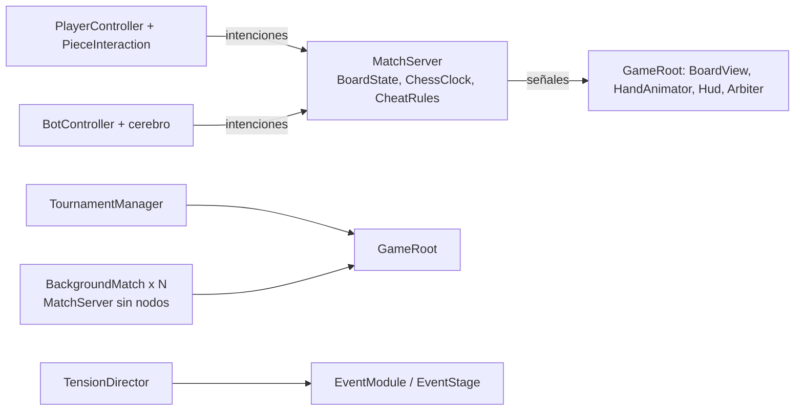
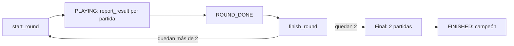

# Arquitectura e implementación actual

Este documento describe **lo que existe en `main`**: la arquitectura y todas las mecánicas implementadas. La fuente de verdad es el código (`src/`, `data/`, `tests/`, `web/`, `tools/`). Lo pendiente está en `ROADMAP.md`; las propuestas de diseño que aún no existen (otras trampas y eventos, multijugador, Stockfish) viven en `docs/documento-diseno.md` y `docs/documento-tecnico.md` y **no** se describen aquí como hechas.

Regla de mantenimiento: si una mecánica cambia, se corrige aquí en el mismo commit.

## 1. Resumen y reglas de arquitectura

Juego de Godot 4.6+ (GDScript; el proyecto declara la feature 4.7) para un humano contra bots: torneo de ajedrez por eliminación (32 jugadores por defecto) en un salón oscuro, con trampas físicas, acusaciones, un árbitro, eventos de distracción, estrés del jugador y un monólogo interior. Se exporta a web.

| Regla | Cómo se cumple |
| --- | --- |
| **El servidor manda** | Todo lo que decide el resultado vive en `src/server/` (`MatchServer`). Cliente y bots envían solo intenciones: `submit_move`, `press_clock`, `set_gaze`, `start_cheat`, `abort_cheat`, `accuse` (y `trigger_rival_event`). Dibujan lo que el servidor confirma por señales. Hoy corre todo en un proceso, pero no se cruza esa frontera. |
| **Tablero físico** | `BoardState` es lo que hay sobre la mesa, no lo que resultaría de jugadas legales. Las trampas lo alteran por fuera de las reglas; las jugadas se validan siempre sobre él. |
| **Bots = mismas entradas que un humano** | `BotController` usa las mismas intenciones y una cámara virtual para la mirada. Los cerebros devuelven una política `{uci: probabilidad}` que el bot muestrea. |
| **Web es el objetivo** | Renderer `gl_compatibility` (sin niebla volumétrica; solo la niebla simple del `Environment`), sin procesos externos (nada de `OS.execute`). Maia-3 corre en el navegador con onnxruntime-web. |
| **Decisiones abiertas en `MatchConfig`** | Reloj, pausa por acusación, advertencias, cono de mirada, etc. son opciones, no constantes en el código. |
| **Datos como `Resource`** | Trampas (`CheatDef`), eventos (`EventDef`) y personalidades (`BotPersonality`) son `.tres` en `data/`. |
| **Pruebas** | La lógica de servidor, bots y torneo es pura (sin nodos) y se prueba sin ventana. |



## 2. Mapa de carpetas y clases

### `src/server/` (autoridad, sin nodos)

| Clase | Ruta | Responsabilidad |
| --- | --- | --- |
| `MatchServer` | `src/server/match_server.gd` | Una partida: tablero, reloj (y su pulsación), planillas, intenciones, trampas, acusaciones, eventos del rival, apagón, fin de partida y señales. |
| `MatchConfig` | `src/server/match_config.gd` | `Resource` con los parámetros de la partida (ver sección 5). |
| `PlayerSession` | `src/server/player_session.gd` | Datos que viven en el torneo: id, nombre, `is_bot`, advertencias, ayuda de principiantes (solo humanos). |
| `ChessClock` | `src/server/chess_clock.gd` | Reloj con incremento Fischer (`increment`); señal `flagged`. |
| `Gaze` | `src/server/gaze.gd` | Cono de mirada y dirección a partir de yaw/pitch. |
| `BeginnerHelper` | `src/server/beginner_helper.gd` | Detecta errores graves antes de aceptar una jugada. |
| `TensionDirector` | `src/server/tension_director.gd` | Sortea eventos globales y disuasivos; lógica pura. |
| `BoardState` | `src/server/chess/board_state.gd` | Tablero físico: casillas, desplazamientos finos, enroques, al paso, pilas de captura y piezas en la mano. FEN. |
| `ChessRules` | `src/server/chess/chess_rules.gd` | Jugadas legales, jaque, aplicar jugada, material insuficiente, perft. |
| `ChessPiece`, `ChessMove` | `src/server/chess/` | Codificación de piezas (tipo en 3 bits, color en el bit 3) y jugadas UCI. |
| `San` | `src/server/chess/san.gd` | Notación algebraica (SAN) de una jugada, calculada antes de aplicarla (para las planillas). |
| `CheatDef` | `src/server/cheats/cheat_def.gd` | Definición de una trampa como datos. |
| `CheatRules` | `src/server/cheats/cheat_rules.gd` | Valida y aplica trampas sobre el tablero físico. |
| `EventDef` | `src/server/events/event_def.gd` | Definición de un evento como datos. |
| `Distraction` | `src/server/events/distraction.gd` | Tabla de tipos de distracción (probabilidad de voltear, duración de la mirada, respingo, radio) y su sorteo; ver 4.9. |
| `TournamentManager` | `src/server/tournament/tournament_manager.gd` | Rondas, emparejamiento, descansos, final, campeón. |
| `HallLayout` | `src/server/tournament/hall_layout.gd` | Disposición fija de las 16 mesas (numeración, podio, riqueza, desplazamiento del salón); ver 4.13. |
| `RoundCut` | `src/server/tournament/round_cut.gd` | Lógica pura del corte de ronda: espera (`DELAY`) y reparto entre "última mesa" y mesas en silencio. |
| `TournamentGame` | `src/server/tournament/tournament_game.gd` | Una partida de la ronda: colores, mesa, resultado, tiempo sobrante. |
| `TournamentSession` | `src/server/tournament/tournament_session.gd` | Variables estáticas que sobreviven a la recarga de escena. |
| `BackgroundMatch` | `src/server/tournament/background_match.gd` | Partida bot contra bot barata para las mesas lejanas. |

### `src/bots/`

| Clase | Ruta | Responsabilidad |
| --- | --- | --- |
| `BotController` | `src/bots/bot_controller.gd` | `Node` del bot: mirada, juego, trampas, vigilancia, acusaciones, eventos. |
| `BotPersonality` | `src/bots/bot_personality.gd` | `Resource` con los parámetros de comportamiento. |
| `CheatPlanner` | `src/bots/cheat_planner.gd` | Lógica pura: cuándo y qué trampa hacer, probabilidades de abortar y acusar. |
| `ChessBrain` | `src/bots/chess_brain.gd` | Interfaz del cerebro; `sample` y `softmax`. |
| `FallbackBrain` | `src/bots/fallback_brain.gd` | Cerebro en GDScript (2 plies, material + tablas de casilla). También da la evaluación estática que usa el planificador. |
| `MaiaBrain` | `src/bots/maia_brain.gd` | Maia-3 5M en el navegador vía `JavaScriptBridge`; respaldo en `FallbackBrain`. |
| `MaiaEncoding` | `src/bots/maia_encoding.gd` | Port de la codificación de entrada de maia3 (vocabulario de 4352 jugadas). |
| `MaiaHistory` | `src/bots/maia_history.gd` | Reconstruye las 8 últimas posiciones físicas. |

### `src/client/` y `src/world/` (vista)

| Clase | Ruta | Responsabilidad |
| --- | --- | --- |
| `GameRoot` | `src/world/game_root.gd` | Raíz de la escena: arma torneo, partida, actores, módulos, mesas de fondo y flujo entre rondas. |
| `Hall` | `src/world/hall.gd` | Salón de 18 × 19 m con las 16 mesas de `HallLayout` (la del humano y 15 decorativas), lámparas, podio, mesas con lujo por tramos. Las figuras sentadas no son suyas: las crea `BackgroundTable`. |
| `BoardView` | `src/client/board_view.gd` | Tablero 3D, piezas, pilas, resaltados; reconcilia con el tablero físico (`sync`). |
| `PieceFactory` | `src/client/piece_factory.gd` | Piezas desde los `.glb` de Blender (una malla por tipo, recoloreada marfil / madera oscura), alturas reales y datos de agarre por tipo (`GRASPS`). |
| `ClockView` | `src/client/clock_view.gd` | Reloj digital 3D: LCD de 7 segmentos y balancín. |
| `PlayerController` | `src/client/player_controller.gd` | Cámara en primera persona, mirada, selección y envío de jugadas. |
| `OpponentAvatar` | `src/client/opponent_avatar.gd` | Figura del rival, cabeza que sigue la mirada del bot, y tos. También fabrica las figuras sentadas de las mesas. |
| `HandRig` | `src/client/hand_rig.gd` | Brazo con `Skeleton3D` + `TwoBoneIK3D`, dedos y temblor. |
| `HandAnimator` | `src/client/hand_animator.gd` | Cola de animaciones de la mano por fases. |
| `Arbiter` | `src/client/arbiter.gd` | Figura del árbitro: camina, mira el tablero, gesto de veredicto, `pass_behind`. |
| `Hud` | `src/client/hud.gd` | Subtítulos y mensajes del árbitro (`DialogueBox`), advertencias, ronda, estado de espera, rótulo del paseo, pantallas completas, viñeta (también la del estrés), punto de mira central (solo con el ratón capturado) y panel de diagnóstico con F3 (FPS, estado del ratón y, en web, tamaño del lienzo). |
| `DialogueBox`, `DialogueText` | `src/client/` | Texto de diálogo con bbcode, máquina de escribir sincronizada con la voz y división en trozos de dos filas (ver 4.22). |
| `CheatModule` | `src/client/cheats/cheat_module.gd` | Módulo: conecta las señales de trampas con las manos (también la pulsación tras una trampa-jugada) y corre los guiones `--cheat-demo`. La entrada del jugador vive en `PlayerController` y `PieceInteraction`. |
| `PieceInteraction` | `src/client/cheats/piece_interaction.gd` | Selección de cualquier pieza, mapa de calor y enrutado del clic (jugada o trampa). |
| `EventModule` | `src/client/events/event_module.gd` | Módulo: dueño del `TensionDirector`, avisa a los bots, maneja al árbitro disuasivo. |
| `EventStage` | `src/client/events/event_stage.gd` | Escenografía de eventos (apagón, banqueta, acusador). |
| `EventSounds` | `src/client/events/event_sounds.gd` | Sonidos sintetizados por código. |
| `ChairFollow` | `src/client/events/chair_follow.gd` | Retirada de la silla calculada con la pose real de la figura (ver 4.18). |
| `ArbiterModule` | `src/client/arbiter_module.gd` | Módulo: crea el `Arbiter`, avisa `set_arbiter_near`, las distracciones `arbiter_pass`, las mesas activas de su patrulla y los argumentos de depuración del árbitro (ver 4.8). |
| `ArbiterRoutes` | `src/client/arbiter_routes.gd` | Lógica pura de pasillos y rutas (patrulla, ejecuciones, paseo del jugador); las rutas nunca cruzan una mesa. |
| `ExecutionQueue` | `src/client/execution_queue.gd` | Lógica pura de la cola de ejecuciones del árbitro. |
| `Condemned` | `src/client/condemned.gd` | Reacción del condenado (suplicar, llorar, paralizarse) y su muerte; cuelga de la figura. |
| `ScoresheetView` | `src/client/scoresheet_view.gd` | Las dos planillas con su pluma; muestra cada `sheet_entry` (11 renglones por hoja). |
| `SeatedFigure` | `src/client/seated_figure.gd` | `CharacterFigure` sentada con inclinación del tronco (`TorsoLeanModifier`) y `ArmPoseModifier`; cuerpo del jugador y del rival. |
| `FigureBase`, `CharacterFigure`, `ArbiterFigure` | `src/client/character/` | Figuras del `.glb` (ver 4.18); `AnimRoles` (contrato de roles de animación) y `FigureLookModifier` (mirada aditiva). |
| `ArmPoseModifier`, `TorsoLeanModifier` | `src/client/` | `SkeletonModifier3D` de la mano (dedo por dedo) y de la inclinación del tronco (ver 4.14 y 4.20). |
| `BlinkOverlay` | `src/client/blink_overlay.gd` | Párpados negros (`close`, `open`, `blink`) para esconder el corte de la recarga entre rondas. |
| `StressModule`, `StressModel` | `src/client/stress/` | Estrés del jugador y sus efectos (ver 4.21). |
| `IntroModule`, `InnerVoice`, `VoiceLines`, `VoiceQueue`, `VoiceRules` | `src/client/voice/` | Discurso del árbitro y monólogo interior (ver 4.22). |
| `RoundWalk`, `HallWalk` | `src/world/` | Paseo en primera persona a la mesa de la ronda siguiente y su ruta pura (ver 4.13). |
| `BackgroundTable` | `src/world/background_table.gd` | Vida de una mesa de fondo: dos figuras, tablero y relojes (ver 4.19). |
| `HallMemory` | `src/world/hall_memory.gd` | Memoria visual del salón entre recargas (ver 4.19). |
| `MeshBaker`, `StaticBoard` | `src/world/` | Fusión de mallas por material y tablero decorativo fusionado en dos superficies. |

### Menús y autoloads

| Clase / autoload | Ruta | Responsabilidad |
| --- | --- | --- |
| `MainMenu` | `src/ui/main_menu.gd` | Escena principal (`main_menu.tscn`): título, Play, Settings y Quit (Quit no sale en web). |
| `PauseMenu` | `src/ui/pause_menu.gd` | Pausa con Esc: Resume, Settings, Main menu (ver 4.16). |
| `SettingsPanel` | `src/ui/settings_panel.gd` | Ajustes superpuestos: volumen de Master / Music / SFX, sensibilidad del ratón y pantalla completa. |
| `UiTheme` | `src/ui/ui_theme.gd` | Tema de los menús construido en código (negro, rojo apagado, fuente IM Fell Double Pica SC). |
| `GameSettings`, `SceneSwitcher`, `AudioManager`, `UiSounds`, `UiIntro` | `autoloads/` | Autoloads de `project.godot` (ver 4.16). |

### Otras carpetas

| Ruta | Contenido |
| --- | --- |
| `data/cheats/`, `data/events/`, `data/personalities/` | Recursos `.tres`. |
| `data/maia3/moves.json` | Vocabulario de Maia-3 (generado por `tools/export_maia3_onnx.py`). |
| `web/` | Ignorada por Godot (`.gdignore`): `maia_bridge.js`, `maia3_5m.onnx`, `ort/` (onnxruntime-web). |
| `tools/` | `.gdignore`. Exportación web y Maia: `build_web.sh`, `export_maia3_onnx.py`, `check_onnx.py`, `check_bridge.js`. Arte: `export_models.sh` (reexporta los `.blend` a `.glb`), `check_props.gd` (nodos y medidas de la utilería), `check_characters.gd` (huesos, materiales y animaciones de los personajes), `anim_preview.gd` (captura un rol sentado en una mesa real; necesita pantalla). Medición y rendimiento: `check_arm_clearance.gd`, `measure_posture.gd`, `bench_turn.gd`, `bench_background.gd`. Audio: `gen_sfx.py` (sintetiza `assets/audio/sfx/`). Los `.gd` se corren con `godot --headless --path . --script res://tools/<archivo>`. |
| `art/` | `.blend` editables y scripts de Blender (ver 4.15); `.gdignore`. |
| `assets/` | `models/` (`.glb` exportados), `audio/sfx/` (sintetizados, ver su `CREDITS.md`), `audio/ui/` (clic y hover), `shaders/` (`iris`, `menu_background`, `stress_blur`), `fonts/` (IM Fell, OFL) y `CREDITS.md`. |
| `docs/` | Este documento, `documento-diseno.md`, `documento-tecnico.md` y `contrato-arte.md` (roles de animación). |
| `default_bus_layout.tres`, `export_presets.cfg` | Buses `Master` / `SFX` / `Music` y preset de exportación "Web". |
| `tests/` | Pruebas propias (`extends TestCase`) y `fixtures/maia3_reference.json`. |
| `src/world/main.tscn` | Escena principal: `GameRoot` + `WorldEnvironment` ("Entorno": fondo casi negro, ambiente 0,2, niebla simple de densidad 0,07). |

## 3. Flujo de partida y de torneo

### Arranque de una escena (`GameRoot._ready`)

1. Lee los argumentos (`--clave=valor`) y fija semilla y escala de tiempo.
2. Ejecuta `_setup_tournament`: `TournamentSession.ensure()` crea el `TournamentManager` solo si no existe (sobrevive a las recargas). Si el torneo terminó, empieza uno nuevo; si la ronda estaba cerrada, la cierra (`finish_round`); si está en reposo, llama `start_round()`. Con `--start-round=N` simula las rondas previas dejando ganar al humano. Después fija `HallLayout.set_human_table(manager.human_table())` y recién entonces crea y arma el `Hall` (el salón se desplaza para dejar la mesa del humano en el origen).
3. Obtiene la partida del humano (`tgame`), su color y su rival. Si descansa (`bye`), `tgame` es `null` (la mesa queda sin partida, el avatar oculto y el estado "You advance to the next round without playing").
4. Crea `BoardView` y `ClockView`; `_build_match` carga las 3 trampas de `data/cheats/` (`own`, `enemy`, `steal`), fija `require_clock_press = true` y crea el `MatchServer` con las **sesiones del torneo** (así las advertencias se arrastran).
5. `_build_actors`: `PlayerController`, `OpponentAvatar`, un `HandAnimator` por mano (`animators[color]`), el bot rival (`_make_bot`) y, con `--autoplay`, un segundo bot que juega por el humano.
6. Crea `Hud` y `PauseMenu`, conecta señales (`_connect_signals`), instala los módulos, puebla el salón (`_populate_hall`) y arranca las partidas de fondo (`_start_background`). Si ningún módulo retiene el arranque (`hold_start` / `release_start`, ver abajo), llama `_begin_match()`: `server.start()` y emite `match_started(server)`. `GameRoot._process` avanza las partidas de fondo, las mesas de fondo (`BackgroundTable.tick`), el servidor, el corte de ronda y el cierre de ronda; con `--quit-after` imprime un resumen (`[resumen]`: jugadas, rendimiento de las mesas de fondo, FPS, torneo, correcciones de sincronía, FEN y relojes).

### Módulos instalados (`GameRoot.MODULES`)

Cada módulo es un script cuyo `new()` da un `Node` con `install(root)`; `GameRoot` los añade como hijos tras armar la partida y antes de arrancar. Para añadir uno basta con agregar su ruta. Un módulo puede retener el arranque con `hold_start()` (solo durante `install`) y soltarlo con `release_start()`; `match_begun()` informa si ya arrancó.

| Módulo | Instala |
| --- | --- |
| `cheats/cheat_module.gd` | Conexión de señales de trampas con las manos (también la pulsación tras una trampa-jugada) y guiones `--cheat-demo`. |
| `arbiter_module.gd` | Crea el `Arbiter` (`root.arbiter`), `set_arbiter_near`, mesas activas de la patrulla, aviso `arbiter_pass` y argumentos de depuración del árbitro. Ver 4.8. |
| `events/event_module.gd` | `TensionDirector`, `EventStage`, eventos del rival, reparto de distracciones a los bots y mesas de fondo. |
| `voice/intro_module.gd` | Discurso del árbitro al empezar el torneo (retiene el arranque con `hold_start`); ver 4.22. |
| `voice/inner_voice.gd` | Monólogo interior del jugador (subtítulos según lo que ocurre); ver 4.22. |
| `stress/stress_module.gd` | `StressModel` del humano y sus efectos (cámara, desenfoque, viñeta, audio). Ver 4.21. |

### Señales principales

| Emisor | Señal | Quién escucha |
| --- | --- | --- |
| `MatchServer` | `move_made(color, uci, info)` | `GameRoot` → `HandAnimator.enqueue_move` |
| | `state_changed` | `GameRoot` → `BoardView.sync` |
| | `beginner_warning(color, uci, text)` | `GameRoot` → subtítulo y titubeo de la mano |
| | `cheat_started / cheat_finished / cheat_aborted` | `CheatModule` → animación de trampa; `PieceInteraction` |
| | `clock_pressed(color)` | (nadie en el juego; la usan las pruebas) |
| | `sheet_entry(color, move_number, san)` | `GameRoot` → `ScoresheetView.add_entry` |
| | `accusation_started / accusation_resolved(accuser, correct, warnings)` | `GameRoot` (HUD), `Arbiter`, `BotController` |
| | `game_over(winner, reason)` | `GameRoot` |
| | `rival_event(color, event_id)` | `EventModule` |
| `GameRoot` | `match_started(server)` | módulos |
| | `table_eliminated(table, position, seat)` | `ArbiterModule` (encola la ejecución) |
| | `players_remaining_changed(remaining, total)` | `EventModule` → `TensionDirector` |
| | `round_cut(last_table)`, `last_execution_done(table)` | `InnerVoice` (corte de ronda, ver sección 3) |
| | `human_condemned` | `InnerVoice`, `StressModule` |
| | `champion_crowned` | `InnerVoice` |
| `Arbiter` | `executed(table, seat)` | `GameRoot` (lámpara y `last_execution_done`), `InnerVoice` |
| | `accusation_done` | `GameRoot._on_game_over` (espera el veredicto) |
| | `player_executed` | (la espera `execute_player`) |
| `TensionDirector` | `event_triggered(id, origin, duration)` | `EventModule` |
| `BotController` | `looked(yaw, pitch)` | `OpponentAvatar` (gira la cabeza) |
| | `startled(world_pos)` | `OpponentAvatar` (respingo `sit_startle`) |
| `HandAnimator` | `clock_hit(color)` | `GameRoot` → `server.press_clock` (se reintenta si la mano está en una trampa) |
| | `job_done(kind)`, `idle`, `phase_changed` | `GameRoot`, `CheatModule`, `OpponentAvatar` |

### Fin de partida y recarga

1. `MatchServer.game_over` → `GameRoot._on_game_over` informa al `TournamentManager` (`report_result` con los segundos sobrantes), espera 1,2 s para ver la última jugada y, si el árbitro aún da el veredicto de una acusación, espera `accusation_done`. Si el humano gana muestra el subtítulo "You won: motivo" (3 s) y el árbitro ejecuta al rival en su mesa; en la final solo al decidirse la serie.
2. Si el humano pierde y no es la final (`_human_eliminated`): ejecución en primera persona (`Arbiter.execute_player`), pantalla "Eliminated" con el motivo y "Entering a new tournament..." y, a los 5 s (3 s con `--autoplay`), recarga con torneo nuevo (`_restart_tournament`, también con la tecla `R`). En la final, perder la primera partida no elimina (subtítulo "You lost this game of the final"). Mientras faltan otras mesas, el HUD muestra "Waiting for the other tables...".
3. **Corte de ronda:** al quedar `_human_settled` (y no `_ending`) arranca una espera aleatoria de 10-20 s (`RoundCut.DELAY`; `--round-cut=S` la fija). Si la ronda se completa sola antes, sigue sin corte. Al vencer (`GameRoot._do_round_cut`, solo con árbitro) `RoundCut.plan` (estática pura) elige UNA "última mesa" cuya ejecución se verá: la que el árbitro ejecuta ahora (`queue.current`); si no, la que tomaría de la cola (`ExecutionQueue.peek_next`); si no, la partida de fondo sin terminar más cercana al árbitro, que se cierra con `BackgroundMatch.force_end` (resultado simulado) y se ejecuta normal; si no queda nada, `-1`. Las demás partidas de fondo sin terminar se cierran con `force_end` y se reportan al torneo, pero sus perdedores se resuelven "en silencio" (`Arbiter.resolve_silently`, sin `table_eliminated` ni ejecución); las demás entradas de la cola se descartan con `Arbiter.skip_pending(última_mesa)` (`ExecutionQueue.skip_pending`: quedan como hechas, su `Condemned` calla con `silence()`). Esas mesas quedan apuntadas en `_silent_tables` (solo para el registro); sus cadáveres, como todos, desaparecen en el primer parpadeo del paseo (`clear_tables_for_next_round()`). Señales: `round_cut(last_table)` al cortar y `last_execution_done(table)` cuando el árbitro termina esa ejecución (`Arbiter.executed`). Después el flujo sigue igual, sin trabajo pendiente. Si el humano fue eliminado no hay corte.
4. Cuando todas las partidas terminaron y el humano ya "se asentó" (`_human_settled`), `_finish_round_flow` espera 1,5 s, apunta en `HallMemory` el estado final de las mesas (`_remember_round()`, ver 4.19) y llama `finish_round()`:
   - Torneo terminado: si el humano es campeón (`champion_crowned`), el árbitro dice "Your debt is settled." (3,5 s) y "The House is always in need of a new arbiter." (4,5 s) con `hud.show_arbiter` y sigue la pantalla "Champion!" (12 s, 4 s con `--autoplay`; "You won the N-player tournament", "Final a-b", "Your debt is paid. The mask is yours now."); si pierde la final, "Eliminated" ("<campeón> won the final", 5 s). Después, torneo nuevo.
   - Si no: `start_round()`. Si la mesa del humano cambia, **paseo en primera persona** (`RoundWalk`, ver 4.13) y, al sentarse, `reload_current_scene()`; la escena nueva monta el salón desplazado a la mesa nueva con la cámara en la misma pose. El paseo termina con un parpadeo (`BlinkOverlay`, ver 4.13) y la escena nueva abre los ojos (`BlinkOverlay.resume_if_pending`), así que el corte no se nota. Si no cambia (segunda partida de la final, en la mesa 1): pantalla de ronda ("Final · game 2 of 2", con el resultado de la primera partida) 4 s y recarga.
5. La recarga destruye la escena; el torneo persiste en `TournamentSession` y la memoria visual del salón en `HallMemory` (variables estáticas; `_restart_tournament` borra esta última). Al cerrar la ronda (sin trabajo pendiente del árbitro, antes de `finish_round()`) `_remember_round()` guarda por mesa solo las piezas (los cadáveres no se recuerdan); `_populate_hall` de la escena nueva las restaura. Todas las corrutinas (árbitro, manos, bots, eventos) comprueban `is_inside_tree()` o un contador de generación tras cada `await` y abandonan si la escena se recargó.

### Torneo (`TournamentManager`)



Detalles en la sección 4.12.

## 4. Mecánicas

### 4.1 Reglas de ajedrez y tablas (`chess_rules.gd`, `match_server.gd`)

- Reglas completas (enroque, al paso, coronación, jaque), validadas por perft en las pruebas. Se calculan sobre el tablero físico: si una trampa quitó una pieza, se juega como si nunca hubiera estado. El enroque exige la torre físicamente presente.
- `MatchServer.legal_moves()` cachea las jugadas de la posición actual y se invalida al jugar o al aplicar una trampa.
- Coronación sin elegir: si la jugada no indica pieza, se corona a dama (el jugador siempre corona a dama).
- **Cada partida tiene ganador: las tablas ganan las negras** (ahogado, triple repetición, 50 jugadas, material insuficiente). Mate gana el rival del que no tiene jugadas; tiempo agotado pierde quien cae.
- Repetición y 50 jugadas usan la posición física (`position_key`: piezas, turno, enroques, al paso). Toda trampa reinicia el contador de 50 jugadas (`halfmove_clock = 0`).
- Motivos de fin (`MatchServer.REASON_*`, en inglés porque el jugador los lee): `checkmate`, `time ran out`, `stalemate: draws go to Black`, `threefold repetition: draws go to Black`, `fifty-move rule: draws go to Black`, `insufficient material: draws go to Black`, `cheating caught`, `third false accusation` y `resignation` (solo las partidas de fondo simuladas, `force_end`).
- La jugada se registra al soltar la pieza (clic); la animación es solo visual y no consume reloj.
- Tras una jugada o trampa se comprueba el fin de partida con el mismo método, así una trampa también puede provocar mate o tablas.

### 4.2 Reloj (`chess_clock.gd`)

- 3+2: 180 s por jugador (`white_seconds` / `black_seconds`) y 2 s de incremento (`increment_seconds`) que gana quien pulsa; `--clock=S` cambia los segundos.
- `press(color)` suma el incremento y pasa el turno al rival; `tick` descuenta solo del color que corre. Se detiene si `paused` (acusación pendiente) o al terminar.
- Al agotarse emite `flagged` y el servidor da la victoria al rival.
- **Pulsar el reloj** (`MatchConfig.require_clock_press`: `false` por defecto, pero `GameRoot` lo pone en `true` y la mano pulsa al final de cada jugada; las partidas de fondo y las pruebas usan `false`): `submit_move` aplica la jugada pero no pulsa; `pending_press` / `awaiting_press(color)` marcan que falta pulsar, el reloj de quien movió sigue corriendo y el rival no puede mover ("opponent has not pressed the clock"). `press_clock(color)` pulsa y emite `clock_pressed`. Si la jugada termina la partida no se espera la pulsación; si cae la bandera antes de pulsar, pierde por tiempo. Una pulsación con la mano ocupada en una trampa se rechaza ("your hand is busy") y `GameRoot` la reintenta al terminar o abortar la trampa (`_press_retry`). Con `false`, se pulsa dentro de `submit_move`.
- **Planillas:** cada color anota en SAN (`San.of`, calculada antes de aplicar; desambiguación, enroque, coronación, `+`/`#`) solo sus jugadas legales, al pulsar. `scoresheet(color)` y la señal `sheet_entry(color, move_number, san)`. Las trampas nunca se anotan. Las partidas de fondo no llevan planilla (`keep_scoresheet = false`). La acusación sigue usando la ventana desde la última jugada; las planillas son para la revisión visual del árbitro.
- Vista: ver 4.16. La mano pulsa su lado del balancín al final de cada jugada.

### 4.3 Tablero físico y desplazamientos finos (`board_state.gd`, `board_view.gd`)

- `squares` (64 casillas, a1 = 0), `offsets` (desplazamiento fino por pieza, en fracciones de casilla), `captured[color]` (pila de lo capturado POR ese color; también recibe los robos) y `hand[color]` (sin uso desde que el robo va a la pila).
- Cuando una trampa mueve o empuja una pieza, queda **descentrada** en una dirección aleatoria (`offset_amount` de la trampa). Es la evidencia visual. Una pieza que se mueve normalmente vuelve a su centro.
- `BoardView.sync(state)` reconcilia nodos con el tablero físico; mientras hay animaciones en curso solo anota el estado pendiente y lo aplica al terminar la última (`hold_sync` / `release_sync`). `sync_fixes` cuenta correcciones (en una partida sin trampas debe quedar en 0).
- Un cerrojo de movimiento (`acquire_motion` / `release_motion`) impide que las dos manos muevan piezas normales a la vez; las trampas no lo piden.
- Escala real: casilla 5,5 cm, tablero de 44 cm, mesa a 0,72 m; piezas de 4,5 cm (peón) a 9,5 cm (rey). Pilas de captura a +X (4 columnas).
- El tablero se gira para que el humano tenga sus piezas cerca.

### 4.4 Trampas (`data/cheats/`, `cheat_rules.gd`, `piece_interaction.gd`)

No se elige la trampa: el jugador agarra **cualquier pieza, reyes incluidos**, propia o rival, en cualquier turno, y la suelta donde quiera. El **servidor clasifica** la acción y su nivel de sospecha (`CheatRules`). Hay tres clases (`CheatDef.Kind`, un `.tres` cada una):

| Id | Kind | Qué hace | `base_time` | `time_per_square` | `evidence_by_level` (índice = nivel) | `offset_amount` |
| --- | --- | --- | --- | --- | --- | --- |
| `own` | `OWN_MOVE` | Pieza **propia** a una casilla vacía que no es jugada legal | 0,8 | 0,3 | 0 / 0,2 / 0,45 / 0,65 / 0,8 | 0,15 |
| `enemy` | `MOVE_ENEMY` | Pieza **rival** a otra casilla vacía | 1,2 | 0,3 | 0 / 0,3 / 0,55 / 0,75 / 0,9 | 0,12 |
| `steal` | `STEAL` | Quita una pieza rival y la deja en la **pila de capturas propia** (`captured[color]`, visible) | 1,6 | 0,0 | 0 / 0,9 | 0 |

Duración = `base_time + time_per_square × distancia de rey recorrida` (el robo cuenta 0). La evidencia sale de la curva de la clase según el nivel (los niveles altos usan el último valor) y es la que usan los bots para acusar.

**Nivel de sospecha** (`CheatRules.level`, estática y pura; -1 si es inválido):
- **Pieza propia:** S = destinos legales de esa pieza como si fuera el turno de su color; d = distancia de rey mínima del destino a S (si S está vacío, a la casilla de origen). **En tu turno** nivel = d, y d = 0 es una jugada legal (no es trampa: va por `submit_move`; `start_cheat` la rechaza). **Fuera de tu turno** nivel = d + 1. Mientras el rival no ha pulsado el reloj tampoco te toca (`turn_ready_for`).
- **Pieza rival:** distancia de rey entre origen y destino.
- **A la pila** (`CheatRules.TO_PILE = -2`): `CheatRules.PILE_LEVEL` (5).

**Validación** (`CheatRules.validate`, el mismo código para servidor, bots y jugador): el rey rival no puede ir a la pila ("you cannot take the king"); destino vacío; un peón no queda en la primera ni en la última fila; no puede dejar en jaque al rey del tramposo ni al bando al que no le toca (posición imposible); la pila solo admite piezas rivales. Motivos de rechazo en inglés.

**Reyes:** se agarran como cualquier pieza. El propio tiene sus jugadas legales (enroque incluido) a nivel 0 en tu turno y cualquier otro destino es trampa con los niveles de siempre; el rival se mueve con `MOVE_ENEMY` (nivel = distancia de rey). `ChessRules.in_check` cuenta el ataque del rey contrario, así que dos reyes nunca quedan pegados, y `CheatRules.apply` quita el enroque al mover un rey o una torre desde su casilla inicial. Los bots usan las mismas reglas, pero `CheatPlanner.candidates` deja los reyes al final de las piezas candidatas.

**Trampa como jugada (`as_move`):** una pieza propia a una casilla no legal **en tu turno** cuenta como tu jugada. Al terminar la trampa el turno pasa como en `submit_move` (`side_to_move`, al paso, `fullmove_number`, `ply`, `move_log` con `{color, uci: "", time, cheat: true}`, que cuenta para la ventana de acusación) y, con `require_clock_press`, queda `pending_press = color`: la mano pulsa después. No hay entrada de planilla. Se comprueba el fin de partida (puede dar mate; aquí sí se permite dar jaque al rival). Las trampas sobre piezas rivales, a la pila o con pieza propia fuera de turno **nunca** pasan el turno. Si mientras dura deja de ser válida, se aborta.

**API del servidor:** `cheat_preview(color, from) -> {casilla: nivel}` (+ `TO_PILE` si es rival y no es rey; `{}` si está vacía; una copia del tablero y las 64 casillas, 0,4-3 ms); `start_cheat(color, from, to) -> {ok, reason, duration, level, kind_id, as_move}`; señales `cheat_started(color, cheat_id, from, to, duration)` (`cheat_id` = `own|enemy|steal`, `to = TO_PILE` en el robo), `cheat_finished`, `cheat_aborted`.

**Reglas que se mantienen:** una sola mano (con una trampa activa no se juega, ni acusa, ni empieza otra); el reloj de quien mueve sigue corriendo; se actualizan los derechos de enroque y se reinicia la regla de 50 jugadas; el servidor revalida al terminar y aborta si ya no vale; la pieza queda **descentrada** (`offset_amount`, evidencia visual); si la partida termina con una trampa en curso, se marca `aborted`. `cheat_log` guarda `{color, cheat_id, from, to, start, end, ply, seen, status, level, evidence, as_move, dark}` (`dark`: estuvo en curso durante un apagón sin haber sido vista; ver 4.5).

**Entrada del jugador** (`PlayerController` + `PieceInteraction`): no hay teclas de trampa ni panel. Clic izquierdo sobre cualquier pieza (también un rey) la selecciona si la mano está libre (anotar no cuenta); `PieceInteraction` pide `cheat_preview` y le suma como nivel 0 las jugadas legales. `BoardView.set_heatmap` pinta en cada casilla un disco de borde suave (0,72 de la casilla, shader sin iluminación `assets/shaders/heat_disc.gdshader`, `HEAT_LIFT` 1,4 mm sobre el tablero) por nivel: 0 verde, 1 naranja, 2 rojo, 3 carmesí, 4+ magenta, saturados, con opacidad base 0,95 a 0,85 que cae con la distancia a la pieza (`heat_alpha(nivel, d)` = base / (1 + k·d²), `d` en casillas con `square_distance`; k = 1 en trampas y 0,12 en jugadas legales, así los destinos legales lejanos siguen viéndose); por debajo de `HEAT_MIN_ALPHA` (0,06) no se dibuja; contorno claro en la casilla elegida y en la del cursor; anillo en las capturas legales. Con una pieza rival elegida se ilumina la zona de la pila propia (elipse roja con el mismo shader, `PILE_ZONE_LIFT` 9,5 mm sobre la mesa para quedar por encima del mantel de 6 mm de las mesas de ronda ≥ 2) y el clic sobre ella es `TO_PILE`. Clic en destino: nivel 0 → `submit_move`; otro → `start_cheat`. Otra pieza cambia la selección; la misma pieza o el clic derecho la sueltan (`Esc` abre la pausa: `PauseMenu` consume la acción antes que el jugador); con el rey rival elegido, el clic en la pila la suelta; un destino rechazado, "...no, not that: motivo". `X` aborta la trampa en curso; `A` acusa.

### 4.5 Exposición y mirada (`gaze.gd`, `match_server.gd`)

- **Cono de mirada:** se mira el tablero si el producto punto entre la dirección de la cámara y la dirección al centro del tablero es ≥ `gaze_cos_threshold` (0,82, ≈ 35°). El centro es `BoardView.CENTER`.
- El humano manda su cámara cada 0,1 s (`PlayerController`); el bot manda la de su cabeza virtual cada 0,1 s. El servidor guarda `_looking[color]`.
- **Exposición:** `cheat.seen` se marca al empezar si el rival mira (o el árbitro está cerca) y se actualiza en cada `tick` mientras la trampa dura. Una trampa "vista" no acusa sola: el rival aún debe acusar.
- Con `set_arbiter_near(true)` toda trampa en curso cuenta como vista (ver 4.9).
- **Apagón** (`MatchConfig.blackout_hides_cheats`, por defecto sí): `set_blackout(dark)` / `is_blackout()` los llama `EventModule` (el cliente solo informa). Mientras está oscuro ninguna trampa se marca `seen` (ni por mirada ni por árbitro cerca). Toda entrada que esté en curso durante la oscuridad sin haber sido vista antes lleva `dark = true`; si al volver la luz sigue en curso y alguien mira, pasa a `seen = true` y `dark = false` (se la ve terminar). Una trampa vista antes del apagón sigue vista. En `accuse`, una entrada `dark` no cuenta para que la acusación sea correcta; los bots solo acusan con `entry.seen` y no juzgan trampas `dark`. Con la opción en `false` el apagón no cambia nada.
- Jugador: ratón capturado (clic para capturar, `Esc` abre la pausa y lo suelta; si el navegador suelta el puntero solo, el HUD vuelve a pedir el clic; como en web el bloqueo llega con retraso, solo cuenta como perdido si ya se vio activo), sensibilidad 0,0022 rad por píxel de pantalla (`screen_relative`, no `relative`, para que no dependa del tamaño del lienzo) por el ajuste de Settings (25 %–500 %); saltos de más de 400 px en un evento se descartan (fallo del bloqueo de puntero en web). En web el ratón lo gestiona un módulo JS (`window.__look`, en `PlayerController.WEB_MOUSE_JS`): pide el bloqueo de puntero **sincrónicamente** en el `mousedown`/`mouseup` del lienzo cuando el juego lo quiere (fuera de pantalla completa los navegadores solo lo conceden dentro de un gesto del usuario; antes se pedía desde el bucle de Godot y, sin pantalla completa, la cámara no se movía) y también desde `capture_mouse(true)`; las peticiones de Godot se desvían a la misma función. Pide `unadjustedMovement` (movimiento crudo) si el navegador lo admite y, si no (Chrome en Linux, Firefox), el normal; lo recuerda en `localStorage` (`look_unadj`). Si el navegador deniega el bloqueo (`pointerlockerror`), pasa a modo libre: la cámara sigue con `movementX/Y` sobre el lienzo (cursor oculto) y se reintenta el bloqueo en cada clic (cubre la espera de Chrome tras `Esc`). Acumula `movementX/Y` en píxeles CSS (independientes del tamaño del lienzo y del "fullscreen" de itch.io) que `_process` recoge una vez por fotograma, con filtro de picos (`filter_events`: fuera lo que supere 400 px, o 150 px y 30× la media reciente; un giro rápido real se conserva) y 60 ms de gracia tras un cambio de bloqueo o de foco. `?look_scale=k` en la URL escala el movimiento (por si Firefox da otra escala). `is_mouse_captured()` cuenta el modo libre. F3 muestra el estado del módulo (bloqueo, modo raw/plain/free, peticiones, errores, eventos, descartados, lienzo, dpr). El giro se suaviza en escritorio (constante 0,025 s) y en web se aplica directo (`LOOK_SMOOTH_WEB` = 0). Prueba de navegador: `tools/web_mouse_check.js` (Chromium con ventana bajo Xvfb; modos iframe tipo itch, directo y pantalla completa; `--deny`, `--esc`). En web no hay opción Fullscreen en Settings: se usa el botón de itch. Giro ±120°, inclinación −80° a +55°, FOV 62° (con estrés se cierra suavemente hasta 57°, ver 4.21). Los ojos están en (0; 1,146; 0,45) (`PlayerController.EYE_POSITION`, derivado de los ojos de la figura sentada en `SEAT.z` = 0,72). La mirada que se manda al servidor sale de la cabeza, no de la cámara (que lleva el balanceo del estrés, ver 4.21).

### 4.6 Abortar

- `abort_cheat(color)`: el tablero no cambia, la trampa pasa a `aborted` y **no cuenta** para una acusación posterior; una trampa-jugada abortada no pasa el turno. La animación de regreso es visible y toma tiempo.
- El humano aborta con `X`; el bot decide por `CheatPlanner.abort_probability` cuando el rival empieza a mirar (ver 4.11).
- La vista deshace el gesto: si la mano llevaba la pieza en el aire, la devuelve a su casilla (`_cheat_return_piece`).

### 4.7 Acusaciones y advertencias (`match_server.gd`)

- `accuse(color)` (tecla `A` para el humano): se rechaza si la mano está ocupada o ya hay una acusación pendiente.
- **Ventana** (`MatchConfig.accusation_window_moves`, 3): la acusación es correcta si el rival tiene una trampa con `status != "aborted"` (la que está en curso cuenta) que empezó desde la N-ésima jugada más reciente del acusador, o desde el inicio de la partida si ha jugado menos de N. El inicio efectivo (`MatchServer.accusation_window_start`) es el mayor entre el instante de esa jugada y el de la última acusación falsa del acusador. Con N = 1 solo cubre lo ocurrido desde su última jugada.
- El servidor decide al instante, pero la resolución se retrasa `arbiter_delay` (3 s) para el suspenso. Durante ese tiempo el reloj y las trampas en curso se congelan (`pause_clock_on_accusation = true`) y no se acepta ninguna otra intención.
- **Correcta:** `accusation_resolved(accuser, true, ...)` y gana el acusador (`cheating caught`). Con `correct_accusation_clears_warning` (desactivado) borraría una advertencia.
- **Falsa:** el acusador recibe una advertencia en su `PlayerSession`; la ventana de su siguiente acusación no retrocede de ese instante (no se repite sobre lo mismo). A la tercera (`false_accusations_to_eliminate = 3`) pierde la partida (`third false accusation`).
- Las advertencias viven en `PlayerSession`, no en la partida: se arrastran entre partidas y se reinician con `reset_for_tournament()` al empezar un torneo nuevo.
- HUD: contador "Warnings: n/3" arriba a la izquierda. Al acusar sale "The arbiter is coming to the table..."; el veredicto lo anuncia el `Arbiter` (4 s, `Hud.show_arbiter`): "Cheating confirmed. The opponent is disqualified." / "You were caught cheating." si es correcta, "Nothing irregular. Warning n of 3." / "Nothing irregular. The accusation was false." si es falsa. Si hubo trampa señala al acusado (`point_accuse`); si no, niega con la cabeza. Sin árbitro (pruebas) `GameRoot` muestra "Cheating confirmed" / "You were caught" / "False accusation: warning n/3" / "The opponent accused you falsely".

### 4.8 Árbitro verdugo (`arbiter.gd`, `arbiter_module.gd`)

- `ArbiterModule` crea el `Arbiter` (`root.arbiter`), avisa `server.set_arbiter_near` mientras está a ≤ 2 m del centro de la mesa del humano y, como respaldo, pide la ejecución de cada `table_eliminated`. Usa `ArbiterFigure`.
- **Patrulla** (`ArbiterRoutes`, lógica pura): recorre a ~1 m/s (`set_walk_speed` ajusta el paso) solo los pasillos que bordean mesas con partida en juego (`Arbiter.set_active_tables`; `ArbiterModule.active_tables()` las calcula cada fotograma: la del humano si su servidor no terminó y las `BackgroundMatch` sin terminar, y solo avisa al cambiar; sin torneo no limita). `patrol_route` elige una esquina de una mesa activa y camina por los lados de las mesas activas (BFS por tramos permitidos; hasta el primer nodo permitido sale por la red normal). Pausas de 1,6-4 s mirando solo mesas activas y, si la del humano sigue activa, a veces cruza por detrás de su silla. Sin mesas activas espera quieto donde está. Las rutas nunca cruzan mesas (probado). `pass_behind` (evento `arbitro_pasa`) desvía la patrulla por la espalda del jugador.
- **Pasos:** 3 `AudioStreamPlayer3D` en rotación, uno por apoyo de la animación `walk` (en 0,00 y 0,65 s del ciclo), `footstep_1..6` con tono ±7 %. Distancia inversa, `unit_size` 4, `max_distance` 28, base -2 dB: +3 dB (tope del motor) hasta 2,3 m, 0 dB a 3,2 m, -6 a 6,3 m, -12 a 12,7 m, -18 a 25 m, mudo desde 28 m; filtro paso bajo 4,5 kHz con -18 dB (`Arbiter.footstep_gain_db`).
- **Cola** (`ExecutionQueue`): `request_execution(table, seat)` (sin duplicados), primero la mesa del humano y luego la más cercana. Camina a 1,25 m/s (hasta 1,9 si la cola crece) al costado de la mesa y **revisa la mesa** (`_review_table`, ~3 s, una vez por mesa: tablero, clip `inspect_sheets` y cada jugador con `look_at_point`; no se repite si ya la revisó por una acusación; en la ejecución del jugador también, girando su cámara); luego se coloca a 0,85 m al lado del condenado, amartilla, apunta (`aim`, `aim_hold` 1-2,5 s), dispara (estampido 3D, `OmniLight3D` y chispas en `muzzle()`), el condenado cae, `lower_gun`, emite `executed` y sigue. `has_pending_work()` = cola, ejecución, acusación o jugador pendientes.
- **Condenado** (`Condemned`): mientras espera reacciona; mesas delanteras y laterales (filas 0-2): suplicar (usa el clip `sit_cry`, con lloriqueos), llorar, o paralizarse, siempre sentado (ya no hay huida ni muerte de pie; `Condemned.Mode` es `SOB`, `BEG`, `CRY` o `FROZEN`); la muerte es `death_slump_table`: cae hacia delante y acaba con la cabeza (mejilla) apoyada en la cara superior de la mesa (holgura ≤ 1 cm, sin mirada: `die()` pone `set_look(0, 0)` y `hold_final_pose` también), un brazo sobre la mesa y el otro colgando; `test_character_figure.gd` comprueba la altura de la cabeza; mesas de la fila trasera: llorar o paralizarse. Sonidos 3D en su cabeza. El cuerpo queda hasta el fin de la ronda. Si `condemn_seat` devuelve null, se crea una figura temporal.
- **Humano gana:** tras el fin de partida el árbitro ejecuta al rival en la mesa del humano (en la final, solo al decidirse la serie). Al condenarlo, `GameRoot.condemn_seat` llama `_freeze_rival()`: `OpponentAvatar.condemn()` detiene la pose ambiental, desconecta la mirada del bot, bloquea la tos y desactiva sus manos, y se apaga el `process` del `BotController` y del `HandAnimator` rival; el cadáver queda quieto hasta el fin de la ronda. **Humano pierde:** ejecución en primera persona (`execute_player`): se bloquea toda la entrada del jugador (`PlayerController.set_input_locked(true)`: no mueve, no hace trampa, no acusa ni mira; la cámara la gira solo el árbitro), latido y respiración, la cámara gira hacia el cañón, disparo, negro instantáneo con `ear_ring` y luego la pantalla "Eliminated".
- **Acusación:** el suspenso dura `config.arbiter_delay` = 6,5 s (`GameRoot._build_match`, `--arbiter-delay=S`) para que el árbitro llegue; va a la derecha de la mesa del humano, revisa las dos planillas (`inspect_sheets`), anuncia el veredicto (`hud.show_arbiter`) y, si hubo trampa, señala; la ejecución posterior es la de arriba. `GameRoot._on_game_over` espera `accusation_done`.
- **Corte de ronda:** `ExecutionQueue.peek_next(from)` (la entrada que tomaría, sin sacarla), `skip_pending(except_table)` (descarta y da por hechas las demás), `drop` y `mark_done`. `Arbiter.skip_pending(except_table)` y `Arbiter.resolve_silently(table, seat)` los usan: el perdedor sale de la cola, cuenta como hecho (`was_done`) y su `Condemned.silence()` lo deja quieto y callado (sin avisos `plea` ni sonidos); si no tenía `Condemned`, `root.condemn_seat` le entrega la figura. No emiten `executed`. La elección de la última mesa está en `RoundCut` (ver sección 3).
- **Discurso** (lo usa el módulo del arranque): `begin_address()` (síncrona) planta al árbitro sin caminar en `ArbiterRoutes.address_spot()` (pasillo vertical a la derecha de la mesa del humano, 3 m delante en -Z, desplazado ~1,5 m para que la cabeza del rival no lo tape), de pie, en `idle`, mirando al jugador (cuerpo y cabeza cada fotograma); suspende la patrulla (`_walk_path` y las pausas se interrumpen, `pass_behind` se ignora) hasta `end_address()`, que reanuda la patrulla y se aleja caminando. `address_head_position()` da la posición global de su cabeza (para la cámara) e `is_addressing()` informa del estado. Desde la silla (sin girar la cámara) cae a la derecha del rival; `--shot-look=-24,4` lo encuadra. `begin_address()` lo deja a oscuras; `set_address_light(on)` enciende o apaga su foco teatral (`FocoDiscurso`: `SpotLight3D` cenital a 3,2 m, cono de `ADDRESS_LIGHT_ANGLE` = 17°, energía `ADDRESS_LIGHT_ENERGY` = 8, rango 5) y `end_address()` lo apaga. `--address-demo` lo planta con el foco encendido.
- Depuración: `--force-execution=mesa,asiento[,modo]`, `--force-at`, `--lose-now`, `--win-now`, `--arb-start=x,z`, `--address-demo` (da el discurso y se queda plantado; con `--shot-look=yaw,pitch`), `--round-cut=S` (espera del corte de ronda).

### 4.9 Eventos y director de tensión

**Director** (`tension_director.gd`, lógica pura con semilla):

- Primer evento no antes de `first_delay` = 20 s (±20 %). Intervalo medio entre `interval_full` = 55 s (salón lleno) y `interval_final` = 16 s (quedan los últimos); separación mínima 10 s.
- `tension()` va de 0 (todos) a 1 (quedan 2); con ≤ 2 jugadores en total (partida 1v1 suelta) vale 0,5. El intervalo se interpola con ella.
- Sortea entre eventos `GLOBAL` y `DETERRENT`, ponderando por `weight`, sin repetir el mismo dos veces seguidas, respetando el `cooldown` de cada uno y su `min_tension`. Si nada está disponible, reintenta a los 2 s.
- `fire(id, origin)` dispara uno ya (lo usan los argumentos de depuración). El origen según `Origin`: `TABLE` (una mesa decorativa con alguien sentado), `BEHIND` (2,5-5 m detrás del jugador, con desvío lateral, dentro del salón) o `CENTER`.
- El `EventModule` lo pausa durante una acusación y le informa cuántos jugadores quedan (`players_left()`).

**Eventos definidos** (`data/events/`):

| Id | Tipo | Origen | Duración | Peso | Espera | Intensidad | Tensión mín. | Sonido | Qué ocurre |
| --- | --- | --- | --- | --- | --- | --- | --- | --- | --- |
| `apagon` | Global | Centro | 4,5 | 1,0 | 60 | 0,9 | 0 | `bulb_pop` | Primero el jugador lo anuncia (`InnerVoice.announce_blackout`, ver 4.22) y, tras `EventModule.BLACKOUT_LEAD` (1,5 s), suena la bombilla, se reparte la distracción y todas las luces, emisivos, conos y ambiente parpadean, se apagan y vuelven (`blackout`). `EventStage.blackout_level` da el nivel de luz; por debajo de `EventStage.DARK_LEVEL` (0,3) emite `darkness_changed(true)` y `EventModule` llama `server.set_blackout(true)` (false al volver la luz). Con el nivel en 0 no queda luz de relleno ni emisivos: mano y piezas del rival no se distinguen. Con `--cheat-demo=rival` se prueba con una trampa del rival en curso. |
| `ruido_detras` | Global | Detrás | 2,0 | 1,4 | 25 | 1,0 | 0 | `slam` | Una banqueta cae y rueda a las espaldas del jugador. |
| `acusacion_ajena` | Global | Mesa | 3,5 | 1,2 | 35 | 0,7 | 0 | — | Una figura real de otra mesa (prestada) se queda sentada, gira la cabeza hacia el jugador (`look_at_point`) con un respingo (`sit_startle`) en silencio: sin grito ni subtítulo, para que el jugador no crea que lo acusan a él. Sin silla ni levantarse; al acabar recupera su vida ambiental. |
| `arbitro_pasa` | Disuasivo | Detrás | 8,0 | 1,0 | 45 | 0,3 | 0 | `steps` | El árbitro pasa detrás del jugador (ver abajo). |
| `cough` | Rival | Centro | 1,2 | 1,0 | 20 | 0,5 | 0 | `cough` | El personaje tose (cabeza y torso se doblan). |

**Eventos del rival:** `cough` no lo sortea el director; lo provoca un jugador sobre sí mismo con `MatchServer.trigger_rival_event(color, id)`. Espera por color y evento: `rival_event_cooldown` = 20 s. Rechazado si hay acusación pendiente, la partida no empieza/terminó. `rival_event_wait()` informa la espera restante. Son sospechosos en sí mismos. Solo los provocan los bots; el humano no tiene tecla para ello.

**Disuasivo:** mientras el árbitro esté a menos de 2 m del centro de la mesa del humano (`ArbiterModule.NEAR_RADIUS`), `ArbiterModule` llama `server.set_arbiter_near(true)` y toda trampa en curso (también las que empiecen entonces) queda marcada como vista. El evento `arbitro_pasa` lo provoca el director: `EventModule` llama `Arbiter.pass_behind(ARBITER_BEHIND, duración)`.

**Distracciones** (`src/server/events/distraction.gd`, lógica pura): cada `EventDef` lleva `turn_chance` y `distraction`; `apagon` 0,8 (`blackout`), `acusacion_ajena` 0,8 (`accusation`), `arbitro_pasa` 0,45 (`arbiter_pass`); `ruido_detras` y `cough` valen 0. Los avisos que no son `EventDef` están en `Distraction.SPECS`:

Las miradas fuera del tablero (salvo `arbiter_pass`, de reojo) duran ~1,8× lo que antes, para que el jugador alcance a notar que el rival no mira y decida la trampa; además `look_seconds` las multiplica por `Distraction.LOOK_SCALE` = 1,25 (la tabla da los valores sin escalar: p. ej. el disparo queda en 3,4-6,75 s), y lo mismo los vistazos espontáneos de los bots (`look_away_seconds`).

| Tipo | Origen | Prob. base | Mirada (s) | Respingo | Radio |
| --- | --- | --- | --- | --- | --- |
| `gunshot` | `Arbiter._fire` (ejecución) | 0,95 | 2,7-5,4 | 0,8 | todo el salón |
| `accusation` | acusación ajena | 0,80 | 2,2-4,7 | 0,75 | todo el salón |
| `blackout` | apagón | 0,80 | 2,7-5,4 | 0,7 | todo el salón |
| `arbiter_pass` | `ArbiterModule` (árbitro a 3,6 m de la mesa del humano; espera 18 s; no durante su acusación) | 0,45 | 0,4-0,9 de reojo, giro 2,3× | 0 | 3,5 m |
| `plea` | `Condemned` (cada 6-11 s, salvo paralizado) | 0,45 | 1,4-3,2 | 0 | 9 m |
| `flag` | `BackgroundTable` (fin por tiempo; sonido `flag`) | 0,15 | 1,1-2,5 | 0 | 4,5 m |

Descartados a propósito (no hacen voltear): lámpara a media luz tras una ejecución, banqueta o golpe detrás, puerta, tos o ruido del jugador. Quien produce el aviso llama `Distraction.broadcast(node, kind, pos, table)` (grupo `distraction_listeners`); `EventModule.on_distraction` lo reparte a los bots (`BotController.notice_event(pos, chance, kind)`) y a las mesas de fondo (`BackgroundTable.notice_event`) según el radio, y los bots de la mesa del humano ignoran avisos de su propia mesa.

**Sonido** (`event_sounds.gd`): todo sintetizado por código, `AudioStreamWAV` mono de 16 bits a 22 050 Hz, generado la primera vez y guardado en caché. Claves: `slam`, `thud`, `cough`, `clack`, `bulb_pop`, `struggle`, `steps`, `swoosh`, `flag` (pitido de la bandera de una mesa de fondo). Se reproducen con `AudioStreamPlayer3D` en el origen del evento.

### 4.10 Ayuda para principiantes (`beginner_helper.gd`)

- Solo para sesiones humanas (`PlayerSession.beginner_help`) con `config.beginner_help` y con al menos `beginner_help_min_clock` = 30 s en el reloj propio (`MatchServer.beginner_help_active`): con menos tiempo se juega lo que se quiera, sin aviso ni titubeo. Los bots no la usan; `--autoplay` la desactiva.
- Antes de aceptar la jugada, `check_move` evalúa sobre el tablero físico: para cada jugada, el peor caso tras la mejor respuesta rival (más la mejor recaptura estimada), con material en centipeones.
- Bloquea si la jugada **permite mate en 1** ("...wait, that allows mate.") o si pierde al menos `blunder_threshold_cp` = 300 centipeones frente a la mejor alternativa ("...no, that leaves the queen hanging." según la pieza —`the pawn`, `the knight`, `the bishop`, `the rook`, `the queen`—; "...hmm, no. That loses material." si no hay pieza concreta). No avisa si solo hay una jugada legal. Nunca sugiere la mejor.
- Un aviso como máximo por turno (`_warned_ply`): tras el primer aviso, cualquier jugada de ese turno (la misma u otra) se permite. Emite `beginner_warning`; la vista muestra el subtítulo y la mano titubea (`enqueue_hesitate`: se acerca a la pieza y se detiene ~1 s). `submit_move` devuelve `reason = "warning"`.

### 4.11 Bots

**Personalidades** (`data/personalities/`; `BotPersonality`):

| Parámetro | honesto | paranoico | tramposo_nervioso |
| --- | --- | --- | --- |
| `display_name` | The honest one | The paranoid one | The nervous cheater |
| `elo` (base; el torneo lo sustituye) | 1300 | 1200 | 1100 |
| `temperature` | 1,0 | 1,0 | 1,1 |
| `think_time_scale` | 1,0 | 1,2 | 0,8 |
| `turn_to_event_chance` | 0,5 | 0,3 | 0,8 |
| `idle_glances_per_minute` | 2 | 1 | 6 |
| `cheat_chance` | 0,04 | 0,08 | 0,35 |
| `detect_chance` | 0,6 | 0,9 | 0,5 |
| `false_accuse_chance` | 0,004 | 0,012 | 0,006 |
| `abort_chance` | 0,3 | 0,5 | 0,85 |
| `risk_appetite` | 0,2 | 0,35 | 0,7 |

Otros valores por defecto de `BotPersonality`: `look_away_seconds` = (2, 4,5) s, × `Distraction.LOOK_SCALE` 1,25 (los vistazos espontáneos duran ~1,8× lo anterior; ningún `.tres` lo sobrescribe), `head_turn_speed` = 3,5 rad/s. `GameRoot._make_bot` elige una personalidad al azar y, para jugadores del torneo, la duplica y fija `elo = manager.elo[id]` (bots 900-1700; el humano 1300; el rival del humano recibe el Elo de su ronda, ver 4.13). También asigna `BotController.opponent_elo` con el Elo real del rival (el humano cuenta 1300).

**Mirada y atención** (`BotController`): estados `WATCH` (mira el tablero) y `DISTRACTED` (mira un punto del salón). Ante una distracción, la probabilidad base se multiplica por `BotPersonality.turn_factor()` (`turn_to_event_chance / 0,55`, media ~1); si voltea, tras 0,15-0,45 s (menos cuanto más fuerte) mira el origen el tiempo del tipo y vuelve; una leve no interrumpe a una fuerte; en las fuertes emite `startled(pos)` y la figura hace `sit_startle`. Mientras mira a otro lado, el servidor sabe que no mira el tablero (es la ventana para hacer trampa). Vistazos espontáneos a `idle_glances_per_minute` (30 % de esa tasa mientras piensa). Al pensar su jugada, la vista vuelve al tablero. La cabeza gira hacia el objetivo a `head_turn_speed` y manda su orientación al servidor cada 0,1 s.

**Jugar:** primero pide la política al cerebro y con ella calcula cuánto pensar. `think_time(board, restante, política, rng, incremento)` (estática, pura): la dificultad (`policy_difficulty`) mezcla 1 − probabilidad máxima y la entropía normalizada de la política (jugada obvia ≈ 0, muchas candidatas parecidas ≈ 1); el presupuesto por jugada es restante / max(20, 40 − nº de jugada) + la mitad del incremento (reducido en proporción con menos de 20 s); el tiempo es del 10 % al 100 % del presupuesto según la dificultad, ×0,4 en las 6 primeras jugadas, ×1,2 en jaque, con ruido log-normal (σ 0,35); 0,4-0,9 s con jugada forzada; acotado entre 0,3 s y min(15 % del reloj, 15 s), multiplicado por `think_time_scale`. Espera ese tiempo (descontando lo que tardó el cerebro) y muestrea con `ChessBrain.sample(policy, temperature)`. Si la mano está ocupada (trampa) o hay una acusación, espera. Si el tablero cambió mientras pensaba (trampa, acusación), descarta la jugada.

**Planificador de trampas** (`CheatPlanner`):

- Candidatas por clase (`own`, `enemy`, `steal`): baraja las piezas que la clase puede tocar y toma de cada una hasta 3 destinos válidos de niveles distintos, hasta 24 por clase; cada una trae nivel, evidencia, duración y ganancia. Puntúa: `1,6·ln(1 + ganancia/100)` menos riesgo; el riesgo es `3·evidencia + 0,5·duración + 0,45·(valor de la pieza robada en peones)`, multiplicado entre 1,6 (prudente) y 0,6 (audaz) según `risk_appetite`. La ganancia es la diferencia de `FallbackBrain.evaluate`, con mínimo de 15 cp.
- Elige en dos pasos: primero la **clase** (ponderada por su mejor puntaje) y luego la candidata (softmax, temperatura 1,2).
- **Trampa como jugada:** un `own` en su turno solo es candidato si supera en `AS_MOVE_MARGIN` (30 cp) a su mejor jugada legal, con un castigo de 0,8 al puntaje; es raro y por defecto prefiere trampas fuera de turno.
- Probabilidad de intentar por evaluación (cada 0,5 s): `cheat_chance × 0,2`, más cuanto más pierde (hasta ×3) y con poco reloj (<40 s, hasta ×2), limitada a 0,5. Es 0 si el rival mira el tablero.
- Reglas del bot: no hace trampa en los primeros 6 s ni antes de su espera (8-16 s tras una trampa, 12 s tras ser descubierto). En su turno solo empieza una trampa si le sobra tiempo antes de entregar la jugada (duración + 0,4 s). Si el rival deja de mirar, adelanta su próxima evaluación (0,15-0,4 s).
- **Abortar:** si el rival empieza a mirar a mitad de una trampa, aborta con probabilidad `abort_chance × lerp(0,7; 1,0; evidencia de esa trampa)` tras 0,2-0,6 s.
- **Distracciones con intención:** si el rival lleva ≥ 10 s mirando, el bot quiere hacer trampa y tendría una que valga la pena, usa `cough`. Primer uso entre 40 y 80 s; espera entre usos de 55 a 100 s (según `risk_appetite`) × 1,0-1,4.

**Vigilancia y acusaciones:**

- Si el bot mira el tablero durante una trampa rival en curso, la juzga una vez: acusa con probabilidad `detect_chance × evidencia` (la de la entrada del `cheat_log`, según su nivel) tras 0,3-1,0 s, solo si la vio (`seen`) y el rival no abortó.
- Al terminar una trampa que fue vista y no juzgada: acusa con probabilidad `detect_chance × lerp(0,5; 1,0; evidencia)` tras 0,5-1,5 s.
- Acusación a ciegas tras cada jugada rival: `false_accuse_chance × 0,25^advertencias` (0 con 2 o más advertencias), tras 0,8-2,0 s.
- Tras una acusación correcta contra otro, espera 12 s antes de volver a intentar.

### 4.12 Cerebros

- **Interfaz** (`ChessBrain`): `get_policy(board, elo_self, elo_oppo)` es una corrutina que devuelve `{uci: probabilidad}`; `sample` aplica temperatura; `softmax` convierte puntajes en centipeones.
- **`FallbackBrain`** (editor, escritorio y respaldo): para cada jugada, mínimo de la evaluación a 2 plies (material + tablas de casilla de peón, caballo, alfil/dama y rey), con mate y ahogado especiales (las tablas favorecen a las negras). Softmax con temperatura entre 220 cp (Elo 600) y 25 cp (Elo 2200).
- **`MaiaBrain`** (web): usa `window.MaiaBridge` (`web/maia_bridge.js`) por `JavaScriptBridge`. Envía las 8 últimas posiciones codificadas (64 casillas × 12 canales × 8), Elo propio y del rival como número continuo (0-5000) y los índices de las jugadas legales; recibe un softmax **solo sobre las legales**. Si el puente no está listo (`isReady()`), falla o tarda más de 3 s, usa `FallbackBrain`. Fuera del navegador (`OS.has_feature("web")` falso) siempre usa el respaldo.
- **`MaiaEncoding`**: port exacto de la codificación de maia3: posición vista desde quien mueve (tablero espejado si juegan negras), vocabulario de 4352 jugadas (con coronaciones), Elo continuo.
- **`MaiaHistory`**: el cerebro solo recibe el tablero actual y el bot pide en su turno, así que entre dos peticiones pasan dos jugadas. La posición intermedia se deduce buscando la pareja de jugadas legales que lleva de la posición anterior a la actual (se prueba desde las 4 últimas instantáneas). Si una trampa alteró el tablero y no hay explicación, se anota la actual sin hueco. Al empezar la partida se rellena con la posición más antigua, como maia3. Un cerebro compartido por ambos bandos funciona.
- **`web/maia_bridge.js`**: carga `ort/ort.wasm.min.js` (relativo a la página, sin CDN), crea la sesión con el modelo `maia3_5m.onnx` (wasm, 1 hilo, sin COOP/COEP), encola las peticiones y devuelve JSON `{id, probs}` o `{id, error}`.

### 4.13 Torneo (`tournament_manager.gd`, `background_match.gd`, `game_root.gd`)

- **Jugadores:** `player_count` (32 por defecto, `--players=N`, mínimo 2). El humano es el id 0 ("You", Elo 1300); los bots toman nombres en inglés de una lista de 32 mezclada (con sufijo numérico si hay más) y Elo aleatorio 900-1700.
- **Rondas sincronizadas:** `start_round()` baraja a los vivos y los empareja; los colores de cada partida son aleatorios (50 %). La siguiente ronda empieza cuando termina la última partida (`report_result` pasa a `ROUND_DONE`).
- **Impares:** si sobra uno, descansa (`byes`; pasa sin jugar) el que menos veces haya descansado. Si es el humano, se queda en su mesa sin rival ("You advance to the next round without playing"); también camina a su mesa nueva al acabar la ronda.
- **Eliminación:** `finish_round()` elimina a los perdedores (`eliminated_log` con ronda, mesa y motivo).
- **Final:** cuando quedan 2, se juega a dos partidas; la segunda con colores invertidos. Gana quien tenga más victorias; con 1-1, quien sume más tiempo sobrante en el reloj; si empatan también, al azar. La primera partida perdida por el humano no lo elimina. Etiquetas (`round_label`, en inglés): "Round N", "Round N · Semifinals" (≤ 4 jugadores) y "Final · game X of 2".
- **Mesas** (`HallLayout`): 16 mesas fijas en cuadrícula 4x4 (separación 3,0 m en X y 3,2 m en Z, misma orientación), **numeradas del 1 al 16** (índice = número - 1). Las 1-4 forman la fila del fondo (fila 0, la más lejana en -Z, delante del jugador) y las 13-16 la más cercana; en cada fila el orden de izquierda a derecha es 3-1-2-4 (`SLOT_COLUMNS`), así que las 1 y 2 quedan en el centro del fondo, sobre el **podio** (tarima de 0,18 m con rampas de 0,4 m en los bordes; `floor_height`, `floor_y(p)`). En cada ronda las partidas y descansos ocupan las mesas 1..N (N = partidas + descansos, tope 16) y el **humano la N** (`HallLayout.human_table_for(N)`, `TournamentManager.human_table()`): con 32 jugadores 16 -> 8 -> 4 -> 2 -> 1 (la final y sus dos partidas, en la 1). Sube por el lado derecho hacia el podio y el salón se vacía desde atrás. Los que no caben (más de 32 jugadores) quedan sin mesa (`TABLE_NONE`).
- **Origen y desplazamiento del salón:** la vista supone la mesa del humano en `Vector3.ZERO`. `HallLayout.human_table` (variable estática) la fija `GameRoot` antes de armar el `Hall`; `table_position(i)` es relativa a ella (`grid_position(i) - grid_position(human_table)`), `room_position(i)` está en el marco fijo de la sala y `room_offset()` desplaza el nodo `Sala` de `Hall` (suelo, muros, techo, podio; y baja en Y si el humano está sobre el podio). Las mesas del podio llevan `root.y = floor_height(i) - floor_height(humano)`. El árbitro y `ArbiterRoutes` (`seat_position`) ajustan su altura con `floor_y`; los pasillos (`aisle_xs/zs`) se calculan con la celda del humano (`cell_of`).
- **Riqueza por tramos** (`HallLayout.richness`, `Hall._dress_table`): 9-16 sencillas; 5-8 con mantel verde; 3-4 con mantel granate, ribete y marco dorados alrededor del tablero, candelero con llama (material sin luz) y piezas de marfil/ébano pulidas; 1-2 (podio) mantel carmesí, dos candeleros y tarjeta dorada. Todo es geometría fusionada en la malla de la mesa (sin luces nuevas). Cada mesa lleva una tarjeta con el número (un `Label3D` con el número y otro "TABLE") a la izquierda del tablero, legible desde la silla.
- **Paseo entre rondas** (`RoundWalk`, `HallWalk`, `src/world/`): tras ganar (o descansar) y llamar a `start_round()`, si la mesa cambia `GameRoot._walk_to_next_round` instala un `RoundWalk`. El cuerpo del jugador (`player.body`, que pasa a `top_level`) se levanta con `stand_up` mientras `ChairFollow` retira la silla (0,6 m, con sonido), gira, camina con `walk` a 1,1 m/s (pasos, ritmo de zancada) y se sienta con `sit_down` en la silla de la mesa destino, que se retira al acercarse y vuelve con `ChairFollow`. La cámara (hijo del `PlayerController`) se coloca cada fotograma en `body.eye_global_position()` y la mirada del ratón sigue libre (`PlayerController.walking`, `begin_walk()`: sin clics ni teclas de juego, IK de brazos a 0). La ruta (`HallWalk.route`) sale de lado por el hueco entre la silla y la mesa hasta el pasillo vertical contiguo, usa `ArbiterRoutes.route` y entra de lado por el hueco de la silla destino; elige entre los cuatro lados la más corta y nunca cruza una mesa ajena (`is_blocked`, probado para las 240 parejas). Mientras camina, un rótulo superpuesto no bloqueante (`Hud.show_banner`: `round_label()`, "Table N · M players left" o "Table N · the final", y "SPACE: skip the walk"; `Hud.set_walk_mode` oculta pista, advertencias y ronda) sustituye a la pantalla de ronda; Espacio salta el paseo (corte directo, pero también con el parpadeo final).
  **Giro suave:** la trayectoria no cambia; solo la orientación del cuerpo y la cámara. `RoundWalk` apunta a un punto `LOOK_AHEAD` = 0,8 m por delante sobre la ruta (`HallWalk.look_ahead`), así que empieza a girar antes del vértice, y `HallWalk.smooth_yaw` aplica un resorte críticamente amortiguado (`TURN_OMEGA` = 5,5 1/s) con velocidad angular máxima `TURN_MAX` = 3 rad/s: no hay saltos al cambiar de tramo. El giro inicial al salir de la silla y el final hacia la mesa (desde `FINAL_TURN` = 1,4 m antes y durante `sit_down`) usan el mismo resorte.
  **Parpadeo** (`BlinkOverlay`, `src/client/`): dos párpados negros con borde curvo y suave (shader de canvas, válido en Compatibility) con `close()`, `open()` y `blink()` awaitables. `RoundWalk` parpadea 0,4 s después de empezar a levantarse y, con los ojos cerrados hace **todos** los cambios de la ronda: llama a `GameRoot.clear_tables_for_next_round()` (desaparecen todos los cadáveres, también el rival muerto del humano; los ganadores salen de sus mesas viejas y los nuevos emparejamientos aparecen sentados en las de la ronda nueva) y a `RoundWalk._prepare_destination()` (la mesa destino con su rival). Al abrir los ojos el salón ya es el de la ronda nueva. Al sentarse (o al saltar el paseo) cierra los ojos y deja `BlinkOverlay.pending_open = true` antes de recargar; `GameRoot._ready` llama a `BlinkOverlay.resume_if_pending(self)` y la escena nueva abre los ojos.
  **Corte sin saltos:** en el primer parpadeo la mesa destino se deja como la verá la escena nueva (`RoundWalk._prepare_destination`): las figuras viejas se ocultan, el rival de la ronda ya está sentado (misma ropa por semilla `rival<id>`, `sit_wait`), el tablero decorativo muestra la posición inicial girada según el color (`Hall.set_table_start_position`; los tableros decorativos usan los mismos colores que `BoardView`) y la lámpara toma al instante el aspecto de la del humano (`Hall.make_lamp_like_main`). En los últimos 0,9 s de `sit_down` la posición y la mirada de la cámara se funden con las de reposo del `PlayerController` (`EYE_POSITION`, `rest_pitch()`); al terminar se llama a `reload_current_scene()`. Perder no camina (pantalla "Eliminated").
- **Partidas de fondo** (`BackgroundMatch`): un `MatchServer` real (mismas reglas, reloj y finales; sin ayuda ni trampas) por cada partida que no es la del humano. La política es de una jugada de profundidad (`choose_move`: valor de captura/coronación, castigo por dejar la pieza atacada, preferencia por el centro y el desarrollo, muestreo con temperatura de 220 a 45 según el Elo). Reloj 3+2. Cada una tiene un fin previsto `planned_end = lerp(25, 200, u^1.15)` s de ronda: si sigue en juego al llegar, `force_end` la cierra con un resultado simulado por Elo (70 % abandono, `REASON_RESIGNED`; 30 % mate narrado), así las eliminaciones se reparten por la ronda. Si la partida acaba por tablas (ahogado, material, 50 jugadas, repetición), que en el servidor dan la victoria a las negras, `BackgroundMatch` re-sortea ganador y motivo por Elo (como un final simulado) para que no haya sesgo de color. Piensa entre 1 y 6 s simulados (más rápido a más Elo; ×0,4 con menos de 30 s de reloj). `GameRoot` avanza todas con `tick` y permite como máximo `BG_MOVES_PER_FRAME` = 1 jugada por fotograma, rotando el orden.
- **Dificultad creciente:** `TournamentManager.rival_elo_for_round(ronda)` interpola linealmente entre `rival_elo_min` (1000) y `rival_elo_max` (1500, ≈ mediana de Lichess, la escala con la que se entrenó Maia) según `rounds_for(player_count)`; con 32 jugadores: 1000, 1125, 1250, 1375, 1500. `start_round()` fija ese Elo al rival del humano tras emparejar (si no descansa).
- **Salón vacío pero encendido:** `_populate_hall` deja encendidas las 16 mesas en todas las rondas; las que se usan en la ronda (1..N) arrancan vacías y las de rondas pasadas conservan su recuerdo (ver 4.19, `HallMemory`). La atenuación al 40 % llega con una ejecución; las mesas de rondas pasadas (piezas, sin cadáver) quedan con esa luz (`GameRoot.CORPSE_LEVEL`).
- **Corte de ronda:** terminada la partida del humano, la ronda no espera a todas las mesas: a los 10-20 s se cierran las partidas de fondo restantes con resultado simulado (`BackgroundMatch.force_end`) y solo se ve la ejecución de una "última mesa"; los demás perdedores se resuelven en silencio, sin ejecución visible; en la ronda siguiente no queda ningún cadáver (ver sección 3 y 4.8).
- **Eliminaciones en otras mesas:** al terminar una partida de fondo con mesa visible, `GameRoot` emite `table_eliminated(mesa, posición, asiento_del_perdedor)`. `ArbiterModule` la escucha y encola la ejecución; sin árbitro (`--no-arbiter-exec`) la figura se levanta (`stand_up`) y camina a la oscuridad (`BackgroundTable.send_away`, `Hall.remove_occupant`).
- **Advertencias:** viven en la `PlayerSession` del torneo; se arrastran entre partidas y se reinician con `new_tournament()`.
- **Cola automática:** al ser eliminado (o perder la final) se muestra "Eliminated" y tras 5 s (o con `R`) se recarga con `new_tournament()`: mismos jugadores, advertencias a cero.
- **Pantallas** (`Hud.show_screen`): entre rondas, solo cuando la mesa no cambia (título de la ronda, "N players left" o el resultado de la primera partida de la final, rival y color; ver `_next_round_text`), "Eliminated" y "Champion!" con el marcador de la final. HUD del torneo: solo "Round N / M" (o "Final") arriba a la derecha; sin nombres ni cuadro de partidas.
- **Simulación:** `simulate_result` / `simulate_round` resuelven partidas por probabilidad logística del Elo (pruebas y saltos de depuración).

### 4.14 Cliente 3D

**Salón (`Hall`):** sala de 18 × 19 m y 3 m de alto (`ROOM_HALF_X` 9, `ROOM_HALF_Z` 9,5, `CEILING_Y` 3) con muros y columnas oscuros, puertas y estandartes; 16 mesas de 1,30 × 0,90 m con dos sillas (posiciones de `HallLayout`; la del humano es la única con sombras y no lleva ocupantes propios: los de las demás los crea `BackgroundTable`). Ver 4.19. Sin niebla volumétrica: la niebla es la simple del `Environment`.

**Lámparas:** la principal es un `SpotLight3D` a ~1,93 m sobre el suelo (ángulo 31°, rango 4 m, energía 0,8, color cálido, con sombras; `--no-shadows` las quita) más un cono falso aditivo (shader sin iluminación) para el haz, y dos `OmniLight3D` de relleno (energía 0,2) a los lados del tablero para leer los costados de las piezas. Cada mesa decorativa tiene su propio foco (ángulo 38°, rango 2,9 m, energía 2,2, ámbar, sin sombras) y bombilla con material emisivo; `set_table_active` y `set_table_level` los encienden, apagan y atenúan (1,4 s; con parpadeo opcional).

**Cámara:** primera persona sentada (ver 4.5), `Camera3D` hija de una cabeza que gira por yaw/pitch (con un nodo `Balanceo` entre ambas para el estrés). Una retícula aparece al capturar el ratón; el resaltado muestra la casilla bajo el centro, la selección y el mapa de calor (ver 4.4).

**Jugar:** clic en una pieza muestra el mapa de calor (ver 4.4); clic en un destino de nivel 0 → `submit_move`, en otro → `start_cheat`. Solo se puede si tu mano no está en una acción (`HandAnimator.is_busy_for_action`, anotar no cuenta) y la entrada no está bloqueada. Coronación siempre a dama.

**Mano (`HandRig` + `HandAnimator`):**

- Brazo de dos huesos en el `Skeleton3D` del personaje; un `TwoBoneIK3D` lleva la muñeca a un `Marker3D`, con un polo que se recalcula cada fotograma. La mano se controla **dedo por dedo** (`ArmPoseModifier`): `Thumb1..3`, `Index1..3`, `Middle1..3`, `Ring1..3`, `Pinky1..3` por lado, con las longitudes de falange leídas del reposo del esqueleto y la de la yema y el grosor medidos en la malla de piel (una vez por malla, ~3 ms; respaldo con los huesos viejos `Fingers`/`Thumb`). Cada dedo tiene una flexión que se reparte entre sus falanges (`Quaternion(Z, ±a)`, rotación absoluta desde el reposo); el pulgar además se abduce para quedar frente al índice. Poses: `OPEN`, `PINCH`, `GRIP` y `PRESS` (índice, medio y anular juntos, casi extendidos, para pulsar el reloj). La pieza sujeta cuelga de un ancla en el punto de pinza y se mantiene derecha.
- **Agarre por tipo de pieza:** `PieceFactory.grasp_for(code)` da altura, radio (perfil de radios de la malla cada 1 mm), dedos que tocan y pitch/roll de la mano (`GRASPS`): peón por la cabeza, torre y alfil por el cuerpo, caballo por el cuello (pulgar e índice), dama y rey por la corona (pulgar, índice y medio; lo que sobresale de la corona, como la cruz del rey, no cuenta como superficie). `grip_height(code)` devuelve esa altura. `HandRig.begin_grasp(pieza)` antes de alcanzar y `end_grasp()` (sola en `release_piece`); con `set_pose(PINCH)` pulgar e índice parten de la flexión del plan de pinza (`pinch_plan`, ver abajo) y se ajustan al contacto con la superficie de revolución de la pieza sin atravesarla (`ArmPoseModifier._solve_planned`: toleran 1,5 mm, abren si quedan dentro; el medio, en dama y rey, sigue buscando el primer contacto; ~0,3 ms por mano; el plan de pinza por radio se precalcula en `setup` y se comparte), y los demás quedan curvos. Si `attach_piece` llega sin `begin_grasp`, lo deduce.
- **Oposición pulgar-índice:** `GRASPS` da por pieza `opposition`, el ángulo (visto desde el eje de la pieza) entre los contactos de ambas yemas: 150° peón, caballo y alfil, 140° torre, 112° dama y 120° rey (medidos 156/152/142/133/114/121°; `tests/test_hand_grasp.gd` exige 80-160° y cerca de lo pedido). `pinch_plan(..., opposition)` coloca la yema del pulgar en el contacto del índice girado ese ángulo sobre el eje, así el pulgar queda frente al índice y a la altura de la pinza (±6 mm, también en dama y rey) y no cae a lo largo de los dedos como garra (antes ~47° en el peón). La abducción del pulgar en la mano izquierda tenía el signo invertido; ahora la izquierda es el espejo exacto de la derecha.
- **Suelo:** `ArmPoseModifier.floor_y` (lo fija `HandRig.surface_height`: mesa, tablero sobre su huella o la hoja al escribir) limita la flexión de cada dedo (`_floor_cap`, bisección) para que articulaciones y punta queden sobre la superficie con 0,8 del semigrosor de margen; si ni abierto cabe (mano muy baja al escribir) queda a media flexión (`FLOOR_LOW_CURL`).
- **Muñeca:** al acercarse a la pieza (peso por distancia de 11 a 2 cm, 1 con la pieza en la mano) la mano pasa suavemente al pitch/roll del agarre, con la palma hacia la pieza. El punto de pinza ya no es una constante: sale de la geometría real de los dedos (`ArmPoseModifier.pinch_plan`, el eje de la pieza entre las yemas de pulgar e índice) y `carry_anchor` lo sigue.
- **Reloj y pluma:** el balancín se pulsa con los dedos juntos (`PRESS`: punto de contacto = promedio de las yemas de índice, medio y anular, `ArmPoseModifier.press_point`; mano con pitch 50-55°; un solo gesto). La pluma se toma entre pulgar e índice en un gesto continuo (`HandAnimator._run_write`): la mano baja sobre la pluma tumbada con la orientación de pinza de frente (`HandRig.orient_for_pen` resuelve pitch y giro para que el eje de toma `PEN_AXIS_GRASP`, en el espacio de la mano, quede paralelo a la pluma), cierra sin parar y la pluma pasa a la mano al llegar (`HandRig.hold_tool`, sin salto: guarda su orientación respecto de la mano) y va fija en ella (`_update_anchor`). Al subir y viajar a la hoja la muñeca gira de la postura de toma a la de escribir (`WRITE_PITCH`/`WRITE_ROLL`) y la pluma pivota en la pinza hasta el eje de escribir `PEN_AXIS_WRITE` (`set_tool_blend`, acoplado al avance de la curva con `on_step`, no a un tween). Agarre trípode: `PEN_GRIP` = 2,5 cm (yemas de pulgar e índice a esa distancia de la punta, oposición `PEN_WRITE_OPP` = 150°), `PEN_AXIS_WRITE` (0,91, -0,34, 0,23 en la mano derecha) lleva la pluma por encima del dorso hacia atrás, mano a pitch 10° y giro 50° (`WRITE_PITCH`/`WRITE_ROLL`: pluma a ~50° del papel, apuntando al hombro; medido en `tests/test_hand_pen.gd`). La mano se desliza solo `WRITE_SLIDE` = 2,5 cm a lo largo del renglón. El plan de pinza respeta el eje (`ArmPoseModifier.pinch_plan(..., axis)`; `tests/test_hand_pen.gd` mide que no entra en las falanges). Al dejarla, el gesto inverso: la pluma se tumba mientras la mano baja y `ScoresheetView.rest_pen` solo asienta el resto.
- El humano usa el brazo derecho; el rival el izquierdo (queda del mismo lado que el reloj y su pila de capturas).
- **Temblor** que crece con el **estrés** (`HandRig.stress`, 0 a 1: el mayor entre `1 − restante/45` del reloj y `GameRoot.extra_stress[color]`, que escribe `StressModule`, ver 4.21), en la muñeca y en los dedos (0,006 a 0,07 rad de flexión; solo abre, así que nunca atraviesa la pieza); además, más estrés = animaciones hasta 40 % más rápidas.
- **Cola de animaciones** por mano y **fases** (`phase`): `idle`, `reach`, `grab`, `carry`, `release`, `press`, `write`, `return`, `hesitate` y `cheat`. Cada gesto (alcanzar y agarrar, trasladar y soltar, pulsar el reloj, tomar/escribir/dejar la pluma, volver, titubeo) es **una sola curva** (`_flow`): puntos de paso (`_wp`) unidos por una spline Catmull-Rom centrípeta, recorrida por longitud de arco con perfil de mínimo jerk (`s = 10t³ − 15t⁴ + 6t⁵`). La mano solo se detiene donde hay contacto (pieza, botón, reposo; la pluma se toma y se deja sin parar); la aproximación final es vertical y más lenta y la salida rápida (pesos por tramo); el pitch y el giro sobre los dedos (`roll` de `_wp`; sin él vuelve a 0) siguen la misma curva y los dedos se abren y cierran antes del contacto. Holgura sobre el rey al trasladar. Cada jugada varía de velocidad (×0,85-1,25), se acorta en trayectos cortos y se acelera si hay animaciones atrasadas.
- **Jugada normal:** alcanzar, agarrar, trasladar, soltar, pulsar el reloj y volver. **Captura:** primero la pieza rival va a la pila propia. **Enroque:** rey y luego torre. **Coronación:** se cambia la pieza al llegar. **Titubeo:** ver 4.10.
- **Trampas** (duración exacta del servidor; no piden el cerrojo de movimiento): cada gesto es **una sola curva** (`_flow`) de duración `deadline − reloj` (mínimo `CHEAT_MIN_TIME`, `_cheat_total`), que termina justo cuando el servidor aplica el cambio. `own`/`enemy` a distancia 1 → empujón sin levantar la pieza (`_plan_nudge`, también en diagonal): la mano llega por encima y por detrás, baja al contacto sin detenerse y la pieza avanza con la proyección de la mano sobre el empujón. A distancia ≥ 2 → `_plan_carry`: baja lenta al agarre, la pinza se cierra al acercarse y la pieza pasa a la mano a mitad de curva (`on_step`, sin parar: la mano llega por el lado contrario al destino y sale hacia él), sube, cruza en arco y posa. `steal` → igual, con destino la pila de capturas propia (`add_to_pile`). Al final de la curva la mano espera (`_wait_resolved`) a que el servidor cierre la trampa para soltar con el descentrado definitivo; si se aborta, devuelve la pieza en una curva de 0,6 s o, si aún no la tenía, la deja donde estaba. La vuelta al reposo es otra curva (0,7 s). Tras `cheat_finished`, si `awaiting_press(color)` (trampa-jugada), `CheatModule` encola para esa mano (humano o bot) un trabajo `press` que pulsa el reloj y vuelve, sin planilla.
- Al terminar la trampa, la vista se reconcilia con el tablero físico del servidor.

**Rival (`OpponentAvatar`):** figura sentada (maniquí gris, ver 4.18); la cabeza gira con la cámara virtual del bot para que el jugador lea hacia dónde mira. Animación de tos.

**HUD (`Hud`, `CanvasLayer` 10):** subtítulos del personaje (abajo), mensajes del árbitro (arriba), contador de advertencias ("Warnings: n/3", arriba a la izquierda), pista (`set_hint`, vacía salvo "Autoplay mode"; los controles están en los menús), aviso "Click to take control of the mouse" (el punto de mira solo se ve con el ratón capturado y la entrada libre, y el aviso solo sin capturar y con la entrada libre; `PlayerController._process` pasa al HUD el estado real cada fotograma con `set_mouse_captured` y `set_input_locked`, así la mira vuelve tras el discurso y tras recargar la escena), ronda ("Round N / M" o "Final", arriba a la derecha), estado de espera (`set_status`), rótulo del paseo (`show_banner`), pantallas completas (`show_screen`, `show_result`), punto de mira y viñeta oscura (la del estrés, `set_stress_vignette`). Pista de controles: "Click: pick up any piece · A: accuse · X: abort · Esc: pause" (con `--autoplay`, "Autoplay mode"). F3 muestra u oculta el panel de diagnóstico.

**Sonidos:** los de eventos se sintetizan por código (`EventSounds`, ver 4.9); el resto son los `.wav` de `assets/audio/sfx/` (ver 4.16). No hay música: `AudioManager` reproduciría en bucle un `assets/audio/music.ogg|mp3|wav` si existiera.

### 4.15 Arte (Blender)

- `art/` guarda los `.blend` editables y los scripts que los generan (Blender 5.2 sin interfaz); Godot no lo importa (`art/.gdignore`). Los `.glb` exportados viven en `assets/models/`.
- Utilería (`art/props/`, `build_props.py`): mesa, silla, tablero, lámpara (Empty `LightAnchor`), reloj digital (`ClockBody`, `LCD`, `LCD_Anchor`, `Button_1..3`, `Rocker` con `RockerBar` y `Contact_Left/Right`), planilla, pluma, pistola (Empty `Muzzle`), piezas (un `.glb` por tipo, material `Piece`), columna, puerta, panel y estandarte. Orientaciones y orígenes en `art/README.md`.
- Personajes (`art/characters/`, `build_player.py` / `build_arbiter.py`, malla común en `body.py`): esqueleto de 49 huesos (`Hips, Spine, Chest, Neck, Head` y `Shoulder, UpperArm, Forearm, Hand, Thigh, Shin, Foot` con `.L`/`.R`, más cinco dedos de tres falanges por mano), A-pose con codos y rodillas pre-doblados, ~2300 triángulos, materiales `Skin, Shirt, Jacket, Pants, Shoes, Hair` (el `player.glb` actual, editado a mano, ya no trae ojos; el árbitro además `Gloves, Mask, Tie, Metal, Grip`), peinados `Hair_Short/Long/Bald`. Miran a +Z en Godot; origen bajo el centro del asiento.
  - **Mano de cinco dedos** (`chartools.hand_bones`, malla en `body._hand`): `Thumb1..3, Index1..3, Middle1..3, Ring1..3, Pinky1..3` (`.L`/`.R`); `X1` cuelga de `Hand`, `X2` de `X1` y `X3` de `X2`, y la cola de `X3` es la yema (sin hueso propio, así que su longitud no viene en el `.glb`). Falanges en mm (X1/X2/X3): medio 36,8/24/19,2, índice 33,9/22,1/17,7, anular 34,2/22,3/17,9, meñique 28,7/18,7/15, pulgar 36/29/24; palma 90. En cada falange +Y va a lo largo del hueso y la flexión hacia la palma es `Quaternion(Vector3(0,0,1), +a)` en R y `-a` en L sobre la rotación de reposo; el pulgar cierra además en oposición hacia el índice (pinza mínima entre yemas: 13,8 mm). Malla: palma rígida de 8 lados (pesos de `Forearm`/`Hand`) y dedos de 6 lados con 7 anillos; cada anillo de nudillo reparte 50/50 entre las falanges vecinas. La API de pose de Blender conserva `curl` y `thumb_curl` (total `curl × 2,4`, reparto 40/35/25 en los dedos y 50/30/20 en el pulgar, factor por dedo de 0,92 en el índice a 1,12 en el meñique) y suma `spread` y `fcurl` (`{dedo: factor}`).
  - **Postura sentada:** los clips `sit_*` mantienen la espalda casi recta y la inclinación hacia el tablero sale del cuello y la cabeza: `make_sit` deja Spine/Chest en 3°/3° y los de mano en la cara (`chin`, `head`, `think*`) en 7-8°/5-6°. `tools/measure_posture.gd` mide por clip el tronco, la altura de la cabeza y su distancia al tablero; `test_seated_posture_is_upright` exige tronco < 13° y cabeza ≥ 0,30 m sobre la mesa aun mirando al tablero (en reposo, 4-5° y ~0,39 m).
  - Jugador (`player.glb`): un clip por acción, sin variantes (el nombre `<rol>__<variante>` sigue admitido por `AnimRoles`, ver `docs/contrato-arte.md`): roles `sit_think`, `sit_nervous`, `sit_startle`, `sit_cough`, `stand_up`, `sit_down` y `walk` (1,1 m/s). `sit_wait` ya no tiene clips propios y cae en su respaldo `sit_idle`. Clips directos: `sit_idle`, `sit_move_piece`, `sit_press_clock`, `sit_write`, `sit_cry`, `sit_frozen`, `death_slump_table`. En espera, pensar y reacciones sentadas las manos quedan fuera del tablero (puntas de dedos en y ≥ −0,47 m); `build_player.py` comprueba mesa, tablero y respaldo al generar.
  - Árbitro (`arbiter.glb`): figura alta con máscara pálida y pistola hija de `Hand.R` (Empty `Muzzle`; el cañón va a lo largo del eje Y de la mano, hacia abajo en reposo y hacia el blanco al apuntar, y la empuñadura cruza la palma según Z; los dedos usan el agarre `GRIP`: índice casi recto junto al guardamonte, los otros tres cerrados); `idle, walk` (0,744 m/s, paso 0,483 m), `aim_hold` (cíclicas) y `inspect_sheets, aim, shoot, lower_gun, point_accuse`.
  - `tools/check_characters.gd` comprueba huesos, materiales, animaciones e imprime el informe del contrato de roles; `tools/anim_preview.gd` captura un rol sentado en una mesa real.
- Si se edita un `.blend` a mano se reexporta con `tools/export_models.sh` (no se regenera). `tools/check_props.gd` comprueba nodos y medidas.
- Todos se usan en el juego: `Hall` instancia o hornea mesa, silla, lámpara, tablero, reloj, planillas, pluma, puerta, estandarte, columna y panel; `BoardView`, `ClockView`, `ScoresheetView` y `PieceFactory` cargan los suyos; la pistola es un nodo de `arbiter.glb` (`props/pistol.glb` no se carga). Con primitivas por código quedan el suelo, el techo, el podio, la tarjeta de número, el cono de luz y la banqueta del evento `ruido_detras`.

### 4.16 Menús, HUD e idioma

- Lo que ve u oye el jugador está en inglés (servidor, cliente y `data/*.tres`); comentarios y docs en español.
- **Controles en los menús** (`ControlsHelp`, `src/ui/controls_help.gd`, tabla `ROWS`): el menú principal (añadido por código en `main_menu.gd`, sin tocar el `.tscn`) y el de pausa muestran Mouse (mirar), Left click (tomar/soltar pieza), Right click (devolver la pieza), A (acusar), Esc (pausa), Space (saltar discursos y paseos) y el consejo "Green squares are legal moves. Any other square is a cheat: don't let anyone see it."; con menos de 1000 px de ancho pasa a una columna. El HUD ya no muestra controles y la acción `cheat_abort` (X) sigue existiendo pero no se anuncia.
- Todo el texto usa IM Fell Double Pica SC (`assets/fonts/IMFellDoublePicaSC.ttf`): los `Control` por el ajuste global `gui/theme/custom_font` de `project.godot` y los `Label3D` (cartel de mesa en `hall.gd`, planillas en `scoresheet_view.gd`) con `UiTheme.font()`, porque no heredan ese ajuste.
- Autoloads (`autoloads/`, adaptados de tic-tac-toe; los scripts que también corren en pruebas `--script` los piden por ruta, `/root/...`):
  - `GameSettings`: `GAME_TITLE` ("Checkmate", provisional), `MENU_SCENE` / `GAME_SCENE`, sensibilidad del ratón (0,25 a 5,0; en Settings 25 %–500 %) y pantalla completa (no en web, `fullscreen_supported()`), en `user://settings.cfg`; señal `changed`.
  - `SceneSwitcher`: `go_to(escena)` con transición de iris centrada en el cursor (0,5 s al cerrar y 0,5 s al abrir; carga la escena en segundo plano), `set_next_origin`, `quit_game()` y las señales `transition_started` / `transition_finished`. Despausa el árbol al cambiar.
  - `AudioManager`: reproductores de SFX (`play_sfx`, con variación de tono), música de fondo con fundido si existe `assets/audio/music.ogg|mp3|wav` (hoy no hay), volumen por bus (`bus_volume`, `set_bus_volume`) y buses `Master` / `SFX` / `Music` de `default_bus_layout.tres`, guardados en `user://audio.cfg`.
  - `UiSounds`: sonido (`assets/audio/ui/hover.wav`, `click.wav`) y un pequeño rebote en todo `BaseButton` que entra al árbol.
  - `UiIntro`: animación de entrada de las pantallas de interfaz (solo escenas con raíz `Control`; los nodos del grupo `no_intro` se saltan).
- La escena principal es `src/ui/main_menu.tscn` (`MainMenu`: Play, Settings y, salvo en web, Quit; Play crea un torneo nuevo). Con argumentos de usuario se arranca directo `main.tscn`; `--menu`, `--menu-screen=settings` y `--menu-play` son para capturas (con `--menu`, `--screenshot=ruta` y `--shot-delay=S` capturan el menú). `Esc` pausa el árbol (`PauseMenu`, capa 60: "Paused" con Resume, Settings y Main menu; al abrir suelta el ratón y al reanudar lo recaptura; `--demo-pause` la abre al arrancar). Todos los textos de los menús están en inglés y usan `UiTheme`.
- Reloj 3D: El reloj (`ClockView`, `chess_clock.glb`) es un reloj digital de torneo al costado del tablero (x = 0,42), caja de madera oscura inclinada hacia atrás con el frente (LCD) mirando al centro de la mesa. El LCD muestra los dos tiempos con dígitos de 7 segmentos ("M:SS"; "S.d" con décimas bajo 10 s) hechos con mallas planas casi pegadas al cristal, sin `Label3D`: los ilumina la escena, sin brillo propio, y los segmentos apagados se ven como un fantasma tenue. Visto de frente, el campo derecho es del jugador cercano y el izquierdo del lejano. Un triángulo de turno central apunta al campo que corre y sus dos puntos parpadean. Arriba, un balancín (`Rocker`, mitad blanca del cercano y roja del lejano) sustituye a los botones: `press_button(color)` hunde ese lado con un pequeño rebote, `set_running` deja arriba el lado que corre y `button_top_world(color)` devuelve su `Contact_*` en la pose actual. Las tres teclas bajo el LCD (`Button_1..3`) son decorativas. Las mesas de fondo hornean el mismo modelo (LCD con "88:88" fantasma). Tic-tac en un `AudioStreamPlayer3D` (bus SFX) con `assets/audio/sfx/clock_tick/tock.wav`, más fuerte y agudo con menos de 20 s del jugador.
- HUD: sin relojes en pantalla (el tiempo se lee en el reloj 3D); del torneo solo "Round N / M" arriba a la derecha.
- Sonidos (`assets/audio/sfx/`, generados por `tools/gen_sfx.py`, ver su `CREDITS.md`). Cableados: tic-tac del reloj (`clock_tick` / `clock_tock`, también en las mesas de fondo), `footstep_1..6` (árbitro y paseo), `gun_cock` y `gunshot`, `chair_scrape` (paseo), `body_slump_table`, `sob_loop` y `whimper` (condenado), `heartbeat_loop`, `panic_breath_loop` y `ear_ring` (estrés y ejecución en primera persona, ver 4.21), `piece_place_*` y `clock_press` (solo en las mesas de fondo), `stage_light_on` / `stage_light_off` (foco del discurso, 4.22). Sin cablear: `body_fall_floor`, `pen_write_loop`, `room_tone_loop`.

### 4.17 Rendimiento del turno

- `ChessRules` usa tablas precalculadas (caballo, rey, rayos, peón) y make/unmake sobre enteros (`gen_pseudo_int`, `make_int`/`unmake_int`, `legal_moves_int`, `has_legal_move`); `legal_moves` cuesta 0,3-1,0 ms.
- `BeginnerHelper.check_move` poda las respuestas (2-16 ms síncrono). `precompute_async(board)` analiza en trozos de 3 ms por frame y guarda la mejor puntuación por `position_key`; `BotController` lo lanza tras su jugada, así el clic del humano cuesta 1-2 ms.
- `FallbackBrain.get_policy` es una corrutina que cede el frame cada 3 ms (`get_policy_sync` para pruebas); sin hilos, para que funcione igual en web.
- Benchmarks: `tools/bench_turn.gd` y `tools/bench_background.gd` (`--script`).

### 4.18 Figuras de personajes (`src/client/character/`)

- `FigureBase` (común), `CharacterFigure` (player.glb) y `ArbiterFigure` (arbiter.glb). El modelo se arma en `_init`.
- `setup(look)` recolorea por material (duplicados por instancia; los nombres se comparan sin el sufijo `.NNN` de Blender, `_base_name`). Los jugadores no tienen ojos. Nadie tiene pelo: `_remove_hair()` libera al instanciar las mallas `Hair_Short`, `Hair_Long` y `Hair_Bald` que aún traen los `.glb`; `CharacterFigure.random_look(rng)` da paletas de época (el cuerpo del humano).
- **Bots como maniquíes:** `CharacterFigure.bot_look(rng, base)` conserva la ropa y pinta la piel de un gris mate (`BOT_SKIN`, 0,46/0,46/0,47): sin ojos, boca ni cabello. Lo usan el rival, las mesas de fondo y las figuras temporales del árbitro. `player.glb` no trae ojos, nariz ni orejas (maniquí liso). El humano y el árbitro conservan su aspecto.
- `play(anim, blend, speed)`, `play_once(anim)` (corrutina, mezcla 0,5 s por defecto; la pose final queda sostenida), `current()`, `is_blending()`, señal `anim_finished`. Si la animación anterior terminó y su pose está sostenida, `play` la deja en pausa en su último fotograma y mezcla desde ahí (antes saltaba de golpe a la pose nueva). Las cíclicas (`LOOPS`) se marcan al cargar porque el `.glb` no trae el flag.
- Mirada aditiva (`FigureLookModifier`, un `SkeletonModifier3D`): `set_look(yaw, pitch)` en radianes, yaw positivo hacia la izquierda de la figura, límites ±80°/±35°, suavizada; al mirar hacia abajo solo se aplica el 75 % del pitch (`DOWN_SCALE`) para que la barbilla no caiga sobre el pecho (solo es dibujo: la mirada del servidor no cambia); `look_at_point(pos)`.
- **Silla que sigue al cuerpo** (`ChairFollow`, usado por `RoundWalk` al levantarse y sentarse entre rondas): cada fotograma la retirada es el mayor de `need` (lo que hace falta para que muslos/rodillas/tobillos por debajo de la cara del asiento queden delante de su borde, con 0,07 m de radio y 0,08 m de holgura, medido con los huesos reales proyectados en el marco de la silla), una curva "de guion" según la altura de la pelvis (0 sentado, 0,5 m de pie) y un mínimo opcional; la silla se acerca a la curva a ≤ 1,6 m/s pero nunca baja de `need`. Al sentarse la holgura se desvanece y la silla vuelve exactamente a su sitio. No depende del tiempo ni de la forma del clip. Prueba: `tests/test_chair_follow.gd` (las pruebas pueden ser corrutinas: `run_tests.gd` las espera y da `tree` para esperar fotogramas).
- **Roles de animación:** el código pide roles, no clips (`AnimRoles`: tabla `loop`/`fallback`/`blend`). `variants(rol)`, `has_role(rol)`, `play_role(rol, rng, speed)` (si hay varias variantes, una al azar sin repetir la última; respaldo si no hay ninguna) y `play_role_once(rol, rng)`. Los clips se descubren por nombre al cargar y los de roles cíclicos se marcan `LOOP_LINEAR`. `CharacterFigure.WALK_SPEED = 1.1`. Contrato completo en `docs/contrato-arte.md`.
- IK de brazo: `enable_arm_ik(&"L"|&"R", on) -> Marker3D` crea un `TwoBoneIK3D` UpperArm→Forearm→Hand después de la animación y la mirada; `set_arm_ik_influence`, `arm_target`, `arm_pole`. Polo por defecto a la altura del hombro y hacia fuera (`POLE_RIGHT`), para que el codo quede sobre el canto de la mesa. Alcance exacto hasta ~0,55 m del hombro; la orientación de la mano y los dedos los pone `ArmPoseModifier` (ver 4.14).
- `bone_global()`, `eye_global_position()`, `head_global_position()` leen un caché con la pose ya modificada (no usar `get_bone_global_pose()`, que devuelve la pose sin modificar). `attach(node, bone)`; `set_hidden_for_first_person(on)` encoge la cabeza.
- `ArbiterFigure`: `WALK_SPEED = 0.744`, `set_walk_speed(mps)`, `muzzle()`, `pistol()`, `set_gun_visible(on)`. El exportador de Blender cuelga la pistola de la cola de `Hand.R` y Godot de la cabeza: `ArbiterFigure` anula ese desplazamiento de 9 cm al crearse (solo la posición: la rotación sigue al hueso, y `-Z` de `Muzzle` es la dirección del cañón).

### 4.19 Salón y mesas de fondo (`hall.gd`, `background_table.gd`)

- `Hall` arma las 16 mesas de `HallLayout` con los `.glb` de Blender (mesa, sillas, lámpara con `SpotLight3D` en `LightAnchor`, tablero, reloj, planillas) en una sala de 18x19 m con columnas, puertas, zócalos y estandartes. La mesa del humano solo lleva mesa, sillas y lámpara (lo de encima es de la vista de la partida); es la única con sombras y relleno.
- La sala (suelo, muros, techo, podio) cuelga de un nodo `Sala` desplazado por `HallLayout.room_offset()` (ver 4.13): hay que fijar `HallLayout.set_human_table` antes de `Hall.build()`. Las mesas ricas llevan mantel, marco y candeleros y la tarjeta con el número (4.13); piezas pulidas desde la riqueza 2 en `set_table_board`.
- Para el límite de luces por objeto de Compatibility, el suelo va en una baldosa por mesa y el decorado se fusiona por muro (`MeshBaker`); las piezas de fondo son una malla por bando (`StaticBoard`).
- API: `table_root`, `chair`, `seat_transform(i, seat)`, `set_table_level(i, nivel, animado, parpadeo)`, `set_table_board`/`set_table_fen`, `mid_game_fen`.
- `BackgroundTable`: dos `CharacterFigure` (`bot_look`) por mesa activa. Alternan los roles `sit_wait` / `sit_think` / `sit_nervous` según turno y reloj cada 5-12 s (sin cambiar de pose mientras dura una mezcla); voltean ante las distracciones con las mismas probabilidades que los bots (factor por asiento 0,7-1,3) y las fuertes les hacen `sit_startle`. `lend`/`give_back` prestan una figura al evento de acusación ajena. Con cada `move_made` de su `BackgroundMatch` quien movió hace `sit_move_piece` → `sit_press_clock` → `sit_write` y el tablero se actualiza. Al terminar: el ganador se queda quieto y el perdedor nervioso. Mesas lejanas o fuera de cuadro animan a 10 Hz / 2 Hz (0,13 ms/fotograma de media con 30 figuras). Mezclas: ambiental 0,8 s, `sit_move_piece` 0,7, `sit_press_clock` 0,4, `sit_write` 0,6 y `sit_frozen` del ganador 1,0; los condenados entran en sus poses con 0,6-0,8 s.
- **Sonido de las mesas de fondo** (`BackgroundTable`, bus SFX, sutil): mientras su partida corre (`clock_running()`: `bg.server.started`, sin terminar y con alguna figura viva visible) un `AudioStreamPlayer3D` reutilizado por mesa (`TicTac`, en `CLOCK_LOCAL`, el reloj horneado) alterna `clock_tick`/`clock_tock` una vez por segundo con fase al azar y tono ±5 % (`tick_index(time, phase)`, pura); `TICK_VOLUME_DB` -12, `TICK_UNIT_SIZE` 1,5 con atenuación cuadrática (~-24 dB a 3 m, ~-36 dB a 6 m: casi inaudible, a gusto del usuario; `tick_effective_db(dist)`, y con `--verbose` una línea cada 5 tics por mesa) y nada a más de `TICK_MAX_DISTANCE` = 9 m (distancia al oyente medida una vez por segundo). Para al terminar la partida o vaciarse la mesa. En `_sequence`, `clock_press` suena a mitad de `sit_press_clock` (`PRESS_VOLUME_DB` -10) y un `piece_place_1..3` al cambiar el tablero (`PLACE_VOLUME_DB` -16), hasta 11 m. `press_start_clock()`: la figura de negras pulsa el reloj una vez por ronda (al "Begin." del discurso), sin pisar una jugada que llegue después.
- `GameRoot.figure_at(table, seat)` y `condemn_seat(table, seat)` (detiene la vida ambiental y la entrega al árbitro). Al terminar una partida de fondo se emite `table_eliminated` y se llama `arbiter.request_execution(mesa, color_perdedor)`; tras cada ejecución la lámpara parpadea y queda al 40 % y las demás mesas voltean. La ronda termina cuando acabaron las partidas y `arbiter.has_pending_work()` es false. Entre rondas las mesas se conservan; las sin partida quedan vacías pero con la luz encendida.
- **Memoria del salón** (`HallMemory`, `src/world/hall_memory.gd`, variables estáticas, solo vista): por mesa de rondas pasadas guarda solo las casillas del tablero físico (`BoardState.squares`, no un FEN: el tablero puede no ser legal; `remember(table, squares)`). Ni los cadáveres ni los ganadores se guardan; quien descansa no deja nada. Incluye la mesa anterior del humano (la posición final de su partida). `GameRoot._remember_round` lo escribe al cerrar la ronda; `_populate_hall` primero borra los recuerdos de las mesas que se usan en la ronda (`release_used(N)`; con la ronda 1 borra todo) y restaura el resto (`_restore_table`: piezas con `Hall.set_table_board` y lámpara al 40 %, sin nadie sentado). Se acumula entre rondas hasta que la mesa se reutiliza; `HallMemory.clear()` en un torneo nuevo.
- `GameRoot.clear_tables_for_next_round()` (lo llama el paseo en el primer parpadeo, tras `start_round()`, que ya fijó los nuevos emparejamientos): deja el salón como lo verá la escena recargada. Vacía todas las mesas salvo la vieja del humano y la destino (`_empty_table` libera cada `BackgroundTable`, con sus cadáveres); las de la ronda nueva (`HallMemory.tables_to_fill`) se repueblan con `_seat_round_table` (el mismo código que `_start_background` usa tras recargar): jugadores sentados en `sit_wait`, tablero en posición inicial y lámpara al 100 %, sin partida todavía; las de rondas pasadas con recuerdo pasan por `_restore_table` (piezas y lámpara al 40 %) y las sin recuerdo quedan vacías. En la mesa destino se ocultan sus ocupantes viejos (lámpara al 100 %; la prepara después `RoundWalk._prepare_destination`) y en la vieja del humano se oculta el avatar del rival, muerto o no, y la lámpara baja al 40 %. La ropa de cada bot sale del id del jugador (`BackgroundTable.player_look`, semilla `rival<id>`, la misma del rival del humano), así que no cambia entre antes y después de recargar. Idempotente y opcional. Depuración: `--walk-pre-shot=ruta` captura justo antes del primer parpadeo, `--walk-mid-shot=ruta` ~1 s tras abrir los ojos y `--aerial-room=...` da una cámara aérea en el marco de la sala (misma vista en ambas escenas).
- Depuración: `--aerial[=x,y,z,tx,ty,tz]` (cámara aérea; por defecto encuadra el centro de la sala, que se desplaza con la mesa del humano) y `--no-arbiter-exec` (el perdedor se levanta y se va).

### 4.20 Mesa del jugador (`opponent_avatar.gd`, `player_controller.gd`, `hand_rig.gd`, `hand_animator.gd`)

- Rival y cuerpo del jugador son `SeatedFigure` (subclase de `CharacterFigure` con inclinación, giro y desplazamiento de torso: `TorsoLeanModifier`) en las sillas del salón (a z = ∓0,80, `Hall.SEAT_Z`); sus figuras se colocan a z = ∓0,72 (`GameRoot.RIVAL_SEAT`, `PlayerController.SEAT`) para llegar al tablero. El jugador tiene la cabeza oculta y la cámara en los ojos. La cabeza del rival sigue `bot.looked`. Pide roles: `sit_wait` mientras espera, `sit_think` en su turno, `sit_nervous` con menos de 30 s; cambia de pose cada 5-12 s y de rol tras ≥ 2,5 s, nunca durante una mezcla ni con el IK activo. Tos `sit_cough` (sonido retrasado 0,55 s) y respingo `sit_startle`; con la mano ocupada quedan los gestos de cabeza y tronco. Al ser condenado (`condemn`) todo se detiene.
- `HandRig` mueve el brazo del personaje por IK (`enable_arm_ik`), orienta la mano y cierra dedos y pulgar con `ArmPoseModifier`, e inclina/adelanta el torso para casillas lejanas. **Inclinación del torso:** `HandRig._solve_lean` busca el menor adelanto (0, 10 o 20 cm: `SHIFT_MAX` = 0,20) y la menor inclinación (`LEAN_MAX` = 0,70 rad) con que la muñeca queda a ≤ 0,55 m del hombro. `TorsoLeanModifier.SHARES` reparte el ángulo como una persona que se inclina desde la cadera: pelvis (`Hips`) 60 %, Spine 20 %, Chest 20 % (con el tope: 24°/8°/8°, espalda casi recta); Neck y Head compensan −0,27 cada uno y los muslos se contrarrotan para que las piernas no se muevan. La cinemática directa del hombro (`HandRig._upper_arm_after_lean`) usa esos mismos pesos. Con ello la cabeza queda ≥ 0,26 m sobre la mesa en las 1064 posturas de `tools/check_arm_clearance.gd` (antes 0,24 m con Spine/Chest a 27°) y solo 3 posturas extremas (pitch 75-80° en la esquina lejana, pieza alta) quedan a 3,5-4,5 cm; a máxima inclinación el vientre queda ~1 cm dentro del borde de la mesa. `tests/test_torso_lean.gd` fija el reparto, cabeza ≥ 0,25 m, Spine/Chest ≤ 14° y alcance. API conservada: `set_grip`, `set_pose`, `attach_piece`, `release_piece`, `carry_anchor`, `stress`. El rival mueve las piezas y pulsa el reloj con el brazo izquierdo (lado del reloj) y el jugador con el derecho; el otro brazo descansa (`idle_rig`, antebrazo sobre la mesa junto al tablero, `drives_posture = false` para no pelear con el tronco de la mano que trabaja). **IK y animación:** en reposo el IK de ambos brazos del rival está apagado (`HandRig.set_ik_weight`, mezcla de 0,45 s) para que se vean las poses de espera; `OpponentAvatar` vigila su `HandAnimator` (`bind_animator`) y al haber trabajo (jugada, trampa, pulsación o escritura) el IK vuelve a 1 en 0,35 s; se apaga 0,8 s después de quedar libre.
- **Codo:** `HandRig._update_pole` recalcula el polo cada fotograma. Calcula el codo analíticamente (longitudes de brazo y antebrazo, plano hombro-muñeca) y elige el ángulo más bajo (preferido -50°: codo que cuelga, por fuera y 0,35 hacia atrás de la mano) con el que, sobre la huella de la mesa, el codo queda ≥ 5 cm sobre ella; sube de golpe y baja suavemente. Resultado medido con `check_arm_clearance`: codo medio 5,7 cm bajo el hombro erguido (antes 5,3 cm sobre él), 2,8 % de posturas con el codo sobre el hombro (antes 91,5 %).
- **Planillas:** la del humano está en (+0,54, +0,30) y la del rival en (-0,54, -0,30), a la derecha de cada uno. El rival pulsa el reloj con la izquierda, la retira y escribe con la derecha (`HandAnimator.write_rig` = `OpponentAvatar.idle_rig`, `set_write_rig`); el humano escribe con la misma mano que pulsa.
- **Luz de la mesa del humano:** foco principal de 0,8 de energía, color (1, 0,9, 0,78) y relleno de 0,2; el tablero (`BoardView._dim_materials`) usa casillas hueso `SQUARE_LIGHT`, madera `SQUARE_DARK` y marco oscuro para no quemarse bajo la lámpara.
- `tools/check_arm_clearance.gd` recorre 1064 posturas: ninguna atraviesa la mesa (holgura mínima 2,7 cm) y reporta métricas de naturalidad (altura del codo respecto del hombro y de la mesa, desplazamiento hacia fuera y hacia atrás) y la postura de reposo de las animaciones `sit_*`.
- Utilería de Blender: `BoardView` (board.glb), `PieceFactory` (pieces/*.glb recoloreadas), `ClockView` (chess_clock.glb con dígitos de 7 segmentos en el LCD y balancín animado).
- **Jugada física:** `HandAnimator` mueve la pieza, golpea el botón (`clock_hit(color)` → `server.press_clock`; `require_clock_press = true`) y anota ~2 s con la pluma en la planilla. La anotación es un trabajo aparte (`write`) que se encola al pulsar: no toma el cerrojo de movimiento ni retiene la sincronía del tablero, así que el rival puede mover mientras el otro anota. Es interrumpible solo cuando escribe la misma mano que actúa (el humano): si llega una jugada, un titubeo o una trampa a la cola, deja la pluma con un gesto de 0,25 s (se tumba mientras la mano baja), borra lo escrito a medias (`ScoresheetView.clear_partial`) y la entrada se reescribe después (un `write` nunca pasa por delante de una acción en espera). El rival escribe con la otra mano (`write_rig != rig`): su anotación va a una cola propia (`_wqueue`, `_pump_write`) que arranca justo tras pulsar el reloj y corre en paralelo a la de acciones, así que una jugada o una trampa empiezan a la vez sin dejar la pluma (el tronco lo sigue la mano que juega mientras se mueve). `HandAnimator.is_busy_for_action()` ignora la escritura: la usan `PlayerController` y `PieceInteraction`, así el humano puede jugar y hacer trampa mientras anota. `ScoresheetView` muestra cada `sheet_entry` en SAN (11 líneas por columna). Si la mano está en una trampa al pulsar, el servidor rechaza y `GameRoot` reintenta al terminar o abortar. Los bots no piensan ni mueven hasta que el rival pulsa.
- La ayuda para principiantes se precalcula al empezar si el humano mueve primero y tras cada trampa en su turno.
- Depuración: `--shot-cam=side|sidenear|sidefar|px,py,pz,tx,ty,tz[,fov]`.

### 4.21 Estrés (`src/client/stress/`, `assets/shaders/stress_blur.gdshader`)

`StressModule` (en `GameRoot.MODULES`) mantiene un `StressModel` del humano y lo convierte en efectos. Solo es vista: no cambia el resultado ni lo que ve el servidor.

**`StressModel`** (lógica pura, `RefCounted`): `value` 0..1 = max(piso, picos + sostenidos).
- **Piso** (`set_floor_inputs`, cada fotograma; el máximo de los tres, no su suma): reloj propio (0 con ≥ 60 s, lineal hasta 0,6 a 0 s), avance del torneo (logarítmico por jugadores restantes: 0 en la primera ronda, 0,25 en la final) y desventaja de material (hasta 0,15 con 5 peones abajo; `material_deficit`). Con la partida terminada el piso vale 0.
- **Picos** (`add_spike(cantidad, sostener)`; se suman con tope 1, se sostienen 1,5 s y decaen 0,08/s hacia el piso): disparo en tu mesa +0,6, a < 6 m +0,35, lejano +0,15; acusación falsa propia +0,3; el rival mira mientras haces trampa +0,25 (una vez por trampa); empezar una trampa durante un apagón +0,25 (`SPIKE_CHEAT_IN_BLACKOUT`; el apagón por sí solo no sube el estrés); acusación ajena o súplica a < 9 m +0,1; perder torre o dama +0,1; jaque +0,08.
- **Sostenidos** (`set_sustained(clave, cantidad)`, duran lo que la causa): te acusan +0,45 (hasta el veredicto), árbitro cerca (`is_arbiter_near`) +0,15.
- `condemn()` (señal `human_condemned`): 1 fijo. `shake_trauma` (`add_shake`, decae 1,5/s) alimenta la sacudida. `bpm(v)` 60 → 120 lpm y `heart_pulse(fase)` (lub-dub).
- Los avisos de sala llegan por `Distraction` (el módulo está en el grupo `Distraction.GROUP`); el resto, por señales del servidor y sondeo cada fotograma (`active_cheat`/`is_looking`, `is_arbiter_near`, `is_blackout`).

**Efectos** (con el valor suavizado `shown`: sube con τ 0,25 s, baja con 0,8 s):
- Cámara: `PlayerController` tiene un nodo `Balanceo` entre la cabeza y la `Camera3D` (`set_camera_sway`). Ruido suave (`FastNoiseLite`) de hasta 1,5° más respiración (0,08° → 0,35°, más rápida con estrés) y sacudida de hasta 3° × trauma². **La mirada al servidor sale de la cabeza** (`_head`), sin balanceo; el clic y la retícula siguen a la cámara. FOV 62° → 57°. Con `--shot-cam`/`--shot-rel` no se toca la cámara.
- Visión de túnel: `CanvasLayer` 5 (bajo el HUD, capa 10) con `ColorRect` y `stress_blur.gdshader` (`hint_screen_texture`, 12 muestras en espiral con giro por ruido; zona nítida elíptica, más ancha que alta para que el reloj al costado del tablero siga legible: radio ~0,42 → 0,32 alturas de pantalla en vertical). Oculto con estrés ≤ 0,05.
- Viñeta (`Hud.set_stress_vignette(amount, pulse)`): se cierra y oscurece y se enrojece con cada latido.
- Audio (bus SFX): `heartbeat_loop` desde 0,3 (tono = bpm/75, 0,8..1,6) y `panic_breath_loop` desde 0,6; paso bajo en el bus (`AudioEffectLowPassFilter`, 20,5 kHz → 2,5 kHz entre 0,6 y 1). Un disparo en tu mesa o a < 4 m suena `ear_ring` y cierra el filtro a 500 Hz, que se abre en 1,5 s. El filtro se añade una sola vez al bus y `_exit_tree` lo deja abierto y desactivado. Al ser condenado el módulo apaga sus bucles y deja el audio a `Arbiter._start_fp_audio`.
- Temblor de la mano: escribe `root.extra_stress[human_color]`.

### 4.22 Historia y monólogo interior (`src/client/voice/`)

**Historia.** Todos los del salón deben una deuda impagable y "la Casa" (*the House*) las compró. Quien gane sale sin deuda y rico; quien pierde es "eliminado": el árbitro nunca dice que muere, el jugador lo entiende con el primer disparo. El árbitro avisa de que ser descubierto haciendo trampa elimina, y el monólogo concluye que el jugador no es lo bastante bueno para ganar limpio: tendrá que hacer trampa sin que lo vean. Giro final: el árbitro fue campeón alguna vez y la Casa necesita uno nuevo (lo cuenta la pantalla de campeón).

**Discurso (`IntroModule`, nombre de nodo `Discurso`).** Solo al empezar la ronda 1 de un torneo con partida del humano. En `install` llama a `root.hold_start()` y, con la escena lista, bloquea la entrada del jugador y planta al árbitro a oscuras (`Arbiter.begin_address`). Coreografía del discurso completo (constantes con nombre en `intro_module.gd`):
1. **Paneo** (`PAN_SECONDS` = 6,0 s, ease-in-out): la cámara recorre el salón de la mesa visible más a la izquierda a la más a la derecha (mesas a 2-11 m y yaw ≤ 105°): jugadores sentados con sus tableros. Termina mirando al árbitro, a oscuras (`PAN_SETTLE` = 0,8 s).
2. **Luz:** `stage_light_on.wav` (relé de foco teatral con zumbido; 2D, bus SFX, +2 dB) y `set_address_light(true)`; tras `LIGHT_ON_BEAT` = 0,7 s habla.
3. **Frases** con `Hud.show_arbiter`: cada una se escribe letra por letra y luego queda `phrase_seconds` (1,0 s + 0,024 s por carácter del texto plano) más `PHRASE_GAP` 0,2 s; la espera usa la duración total que devuelve el HUD. Llevan efectos puntuales (`[tornado]` en "will never repay", `[shake]` en "eliminated", `[rainbow]` en "rich"): deuda, la Casa, reglas del reloj, ganar/perder, tablas para las negras, "Anyone caught cheating is eliminated.", acusaciones y advertencias, y "The last player in this room walks out free of debt. And very rich." (8 frases; el giro de la historia no se anticipa).
4. **Luz fuera:** `stage_light_off.wav` y foco apagado (`LIGHT_OFF_BEAT` 0,8 s); en la oscuridad, "Begin." (`BEGIN_SECONDS` 1,2 s).
5. **Pulsación:** la mano de negras de la mesa del humano (`enqueue_press`; la del jugador si es negras) y la figura de negras de cada mesa de fondo (`BackgroundTable.press_start_clock`) pulsan el reloj; la cámara vuelve al tablero (`RETURN_SECONDS` 0,8 s). Al tocar el reloj la mano de la mesa del humano (o a los `PRESS_TIMEOUT` 3,5 s) se llaman `end_address()`, `finished(full)` y `root.release_start()`; antes de arrancar `server.press_clock` se rechaza sin efectos. La partida arranca a los ~58 s.

La versión corta (torneos siguientes del mismo proceso, variable estática) no tiene paneo: gira al árbitro (`TURN_SECONDS` 1,3 s, `SHORT_SETTLE` 0,6 s), luz, "Another night. The same rules.", luz fuera, "Begin." y pulsación. Espacio o Enter saltan a la luz fuera (si estaba encendida), "Begin." y la pulsación; la pista "SPACE: skip" es una `Label` propia abajo a la derecha. No sale con `--autoplay`, `--screenshot`, `--walk-demo`, `--no-intro`, `--start-round` > 1, `--force-execution`, `--lose-now`, `--win-now` ni `--event`; `--intro` lo fuerza. `IntroModule.should_play` es la condición pura. Los sonidos salen de `tools/gen_sfx.py` (`stage_light(on)`).

**Monólogo (`InnerVoice`).** Solo lee estado y escucha señales (nunca llama intenciones del servidor) y muestra con `Hud.show_subtitle`. Tras un `beginner_warning` calla 3,5 s. Piezas:
- `VoiceLines.LINES`: tabla editable de frases (`prio` LOW/MID/HIGH, `texts`, `seq`, `once`, `wait`, `group`, `chance`, `play`). Las marcadas `play` (apagón, rival distraído, empujones, árbitro cerca, trampas, material y reloj) solo valen con la partida en juego: al terminar, `VoiceQueue.drop_play_only()` descarta las pendientes.
- `VoiceQueue` (lógica pura, el tiempo lo da quien la usa): gana la mayor prioridad; tope global de una frase cada 5 s salvo las altas; una de prioridad mayor corta a otra menor que suena; las bajas que llegan más de 2 s tarde se descartan; "una vez" por partida (instancia) o por torneo (estático, `reset_tournament`, que `InnerVoice.install` llama con `round_no <= 1`); espera por grupo; variantes al azar sin repetir la última; las secuencias (`seq`) separan sus frases 2 s (`SEQ_GAP`).
- `VoiceRules`: números en palabras, frase de inicio de ronda, cruce de umbrales del reloj, material y damas, `GazeWatch` (rival sin mirar el tablero ≥ 1,2 s).

| Disparador | Frase (prioridad) |
| --- | --- |
| Fin del discurso completo | `cheat_hint`: "...Caught. He said caught." / "I'm not good enough to win this clean." / "So I just can't get caught." (A, una vez por torneo; tras el corto, nada) |
| Inicio de la ronda 1, +20 s | `context_players` "<N> players. One walks out." (M, una vez por torneo) |
| Inicio de ronda ≥ 2, +2 s | `round_left` (más de 4) / `round_semi` / `round_final` (solo la primera partida) (M) |
| Primer disparo (`Distraction` gunshot) | `first_shot` "...Eliminated. That's what he meant." + "That was real." (A, una vez por torneo) |
| Disparos siguientes | `shot_next` (B, 50 %, espera 25 s) |
| `arbiter.executed` con el rival del humano | `rival_executed` (A) |
| Evento `apagon`, 1,5 s antes de que se apague la luz (`announce_blackout`; respaldo: flanco de `is_blackout` si no hubo anuncio en los últimos 8 s) | `blackout_first` "The lights are failing... Nobody will see my hands." / `blackout` "The lights are going out. Now's my chance.", "Here it goes. Now's my chance.", "Wait for the dark... Now's my chance." (A) |
| Primera trampa del rival en el torneo, la vea o no (se reintenta en la siguiente si la partida termina antes de decirse) | `rival_cheating` "He's cheating... I can accuse him. [A]"; a oscuras o sin mirar (`VoiceRules.can_see_rival_cheat` falso), "Something moved on the board... If he's cheating, I can accuse him. [A]" (A, una vez por torneo, con la A resaltada) |
| Mini tutorial (una vez por torneo cada paso, con la partida en juego y solo hasta la primera trampa del humano) | Primer clic en una pieza (`PieceInteraction.piece_picked`): `tut_select` "Green squares are legal moves." / "Orange and red ones are cheats. The redder, the riskier."; primera pieza rival: `tut_rival_piece` "I can move his pieces too." / "Or take one and keep it in my pile."; 4 s tras el primer rival distraído: `tut_eyes` "A cheat only works if nobody sees it." / "Not him. Not the arbiter."; 5 s tras el primer apagón: `tut_cover` "Darkness and noise pull every eye away. That's when I move." (M) |
| Rival distraído (con partida en juego y sin trampa del humano en curso) | `distracted_first` / `distracted` (M, espera 40 s) |
| 75 s sin trampa y rival distraído / 150 s sin trampa y perdiendo material o reloj | `nudge_hands` (B, una vez por partida) / `nudge_fair` (M, una vez por torneo) |
| Árbitro cerca (flanco de `is_arbiter_near`) | `arbiter_near` (M, una vez por torneo); con trampa en curso `arbiter_cheating` (A, espera 40 s) |
| Trampas del humano | `cheat_first` (M, una vez por torneo), `cheat_unseen` (B, espera 30 s), `cheat_seen` (M), `cheat_abort` (B) |
| Acusaciones | `accused` (A), `accused_false` (M); acusas: `my_false_1`, `my_false_2`, `my_correct` (M) |
| Cambios del tablero | `queen_lost`, `queen_taken` (M, por recuento de damas en `state_changed`); `check_given` (B, espera 30 s) |
| Reloj | `clock_30` (M), `clock_10` (A), `clock_rival_20` (B), una vez por partida |
| `last_execution_done` / `human_condemned` / `champion_crowned` | `last_execution` (M) / `condemned` (A) / `champion` (A) |

**Voz 8 bits (`VoiceBlips`, `src/client/voice/voice_blips.gd`).** Todo lo que se dice en voz alta suena como un balbuceo de videojuego de 8 bits, sintetizado en código (`AudioStreamWAV` mono de 16 bits a 22,05 kHz, cuantizado a 24 niveles, caché de 64 textos; sirve en web). `plan(speaker, text)` da un blip por letra o cifra, pausa en espacios y más larga en puntuación, con tono determinista según la letra, y solo se corta a `MAX_SECONDS` = 30 s (no se alcanza: la voz dura lo que la escritura de cada trozo). Dos voces (`Speaker`): **jugador** (560 Hz, onda triangular, escala pentatónica, blips de 36 ms cada 40 ms, −10 dB) y **árbitro**, grave y tétrica (92 Hz, cuadrada más diente de sierra desafinada con vibrato, filtro de un polo y eco de 0,11 s, blips de 70 ms cada 55 ms, −4 dB). Una tercera voz, **acusador** (`ACCUSER`: 700 Hz, pulso del 25 % con deslizamiento hacia arriba, blips de 50 ms cada 42 ms, el tono sube 0,9 semitonos por blip, −2 dB), es el grito de "Cheater!" y suena **solo cuando el rival acusa al humano**: por `server.accusation_started` (`EventModule._on_accusation_shout`), `EventStage.shout(pos)` lo reproduce espacial en la cabeza del rival, con el subtítulo "Cheater!" sin voz del jugador. Ni la acusación del humano ni la de otra mesa gritan. `Hud.show_subtitle(text, seconds, voice = true)` habla con la voz del jugador (monólogo, murmullos, ayuda para principiantes) y `Hud.show_arbiter(text, seconds, voice = true)` con la del árbitro (discurso, "Begin.", veredictos); `Hud.speak(speaker, text)` usa un `AudioStreamPlayer` por hablante (bus SFX) y la voz nueva corta la anterior del mismo hablante. Los textos que no son habla pasan `voice = false` ("You won: ...", "You lost this game of the final", el subtítulo "Cheater!" cuando acusa el rival); banners, pantallas y estado no hablan.

**Texto de los diálogos (`DialogueBox`, `DialogueText`, `src/client/`).** Subtítulos y mensajes del árbitro son `RichTextLabel` con bbcode y efectos de Godot: el árbitro con `[wave amp=7 freq=1.4]` (ámbar), el jugador con `[wave amp=4 freq=1]` y, en sus frases de prioridad alta (`panic`), `[shake rate=22 level=4]`. Los textos de `VoiceLines` e `IntroModule` admiten bbcode propio (`[shake]` en "caught", `[tornado]` en "Eliminated", `[fade]` en "quiet"...; un corchete literal es `[lb]`/`[rb]`). **Máquina de escribir:** cada letra aparece cuando suena su blip (`VoiceBlips.plan` sobre el texto plano, `DialogueText.reveal_times`), y la permanencia cuenta desde que termina de escribirse (`VC_CHARS_AFTER_SHAPING`: el texto no se recoloca al escribirse). **Dos filas como máximo:** ancho del 10 % al 90 % de la pantalla con autowrap (el subtítulo crece hacia arriba desde abajo; el árbitro hacia abajo desde el 14 % de la altura); si no cabe, `DialogueText.split` lo divide por frases y luego por palabras, con el bbcode equilibrado, y los trozos se escriben y suenan uno tras otro. API: `Hud.show_subtitle(text, seconds = 3.5, voice = true, panic = false) -> float` y `Hud.show_arbiter(text, seconds = 3.0, voice = true) -> float` (`seconds` = permanencia tras escribir; devuelven la duración total); `Hud.speak(speaker, plain)` recibe texto plano. `VoiceQueue.duration_of` es la permanencia tras escribir, y la ventana de "hablando" y el hueco de las secuencias (`max(SEQ_GAP, escritura + permanencia)`) suman el tiempo de escritura.

El rival es siempre "he/him/his" en los diálogos ("It was him or me.", "He's not looking...", "His queen. I can win this."...); los plurales reales se quedan.

Con `--verbose` imprime cada frase del discurso y del monólogo. `tests/test_inner_voice.gd` cubre la cola, los disparadores puros y las condiciones del discurso.

## 5. Configuración

### `MatchConfig` (`src/server/match_config.gd`)

| Campo | Valor por defecto | Significado |
| --- | --- | --- |
| `white_seconds`, `black_seconds` | 180 | Tiempo por jugador (Armageddon: 180 / 150). `--clock=S` los fija. |
| `increment_seconds` | 2,0 s | Incremento por jugada (3+2) que gana quien pulsa el reloj. |
| `require_clock_press` | `false` (`GameRoot` pone `true`) | El turno pasa al pulsar el reloj, no al mover (ver 4.2). |
| `keep_scoresheet` | `true` (las partidas de fondo, `false`) | Lleva las planillas SAN. |
| `pause_clock_on_accusation` | `true` | El reloj se detiene mientras llega el árbitro. |
| `arbiter_delay` | 3,0 s (`GameRoot` pone 6,5) | Suspenso antes del veredicto. |
| `false_accusations_to_eliminate` | 3 | La tercera acusación falsa elimina. |
| `accusation_window_moves` | 3 | Jugadas propias del acusador que cubre la acusación (ver 4.7). |
| `correct_accusation_clears_warning` | `false` | Una acusación correcta no borra advertencias. |
| `beginner_help` | `true` | Ayuda para principiantes (además requiere sesión humana). |
| `beginner_help_min_clock` | 30 s | Por debajo de este tiempo en el reloj propio no hay ayuda. |
| `blunder_threshold_cp` | 300 | Umbral de la ayuda. |
| `gaze_cos_threshold` | 0,82 | Coseno del medio ángulo del cono (≈ 35°). |
| `board_center` | `Vector3.ZERO` (`GameRoot` pone `BoardView.CENTER`) | Centro del tablero para la mirada. |
| `cheats` | `[]` (`GameRoot` carga las 3) | Trampas disponibles. |
| `rival_event_cooldown` | 20 s | Espera por color y evento del rival. |
| `blackout_hides_cheats` | `true` | Durante un apagón nadie ve las trampas y una acusación no prospera por las hechas a oscuras (ver 4.5 y 4.9). |

`MatchServer._init(config, white, black, start_fen, seed_value)` acepta una posición inicial y una semilla (para el descentrado de las trampas).

### Argumentos de línea de comandos (después de `--`)

Se leen como `--clave` o `--clave=valor` en `GameRoot._parse_args`; `get_args()` los expone a los módulos.

| Argumento | Efecto |
| --- | --- |
| `--autoplay` | Un segundo bot juega por el humano (el jugador no manda su mirada); desactiva su ayuda; acorta a 3-4 s las pantallas de eliminación y campeón; implica `--verbose`. |
| `--human=white\|black` | Fuerza el color del humano en su partida. |
| `--seed=N` | Semilla del azar de la partida, del torneo y del director de tensión. |
| `--speed=X` | `Engine.time_scale`. |
| `--quit-after=S` | Termina tras S segundos (acumulados entre recargas) e imprime un resumen. |
| `--players=N` | Jugadores del torneo (32). |
| `--clock=S` | Segundos por jugador (180). |
| `--start-round=N` | Salta a la ronda N (el humano gana las anteriores, simuladas). |
| `--walk-demo` | Acaba la ronda al instante (gana el humano) y hace el paseo a la mesa siguiente; con `--screenshot` y `--shot-delay=S` se captura un instante del paseo. |
| `--fen="..."` | Posición inicial distinta. |
| `--no-shadows` | Sin sombras de la lámpara principal. |
| `--verbose` | Imprime el desarrollo de la partida. |
| `--screenshot=ruta`, `--shot-delay=S`, `--shot-look=yaw,pitch`, `--shot-when=rival_carry\|player_carry`, `--shot-phase=reach\|grab\|carry\|release\|press\|write` (con `--shot-rival`, la mano del rival), `--shot-write` (con `--shot-rel`, apunta a la mano que escribe, p. ej. la del rival), `--shot-rel=dx,dy,dz[,fov]` (cámara pegada a la mano, con `--shot-cam=side`), `--shot-after=S`, `--shot-select=e2` | Capturas de depuración. |
| `--demo-screen=between\|champion\|eliminated` | Muestra esa pantalla al arrancar. |
| `--cheat-demo=own\|ownlong\|enemy\|steal\|abort\|rival\|accuse\|asmove\|input\|all` | Guion automático de trampas (`CheatModule`; `rival` = solo la trampa del rival; al final comprueba que la vista coincide con el servidor); usar `--human=white --fen="r3k3/p7/2n1p3/8/8/8/PPPP1PPP/R3K2R w - - 0 1"`. |
| `--event=apagon\|ruido\|acusacion\|arbitro\|toser`, `--event-at=S`, `--event-table=N`, `--event-side=human` | Fuerza un evento (`EventModule`); en la demostración el director automático se desactiva. |
| `--no-events` | Sin eventos automáticos. |
| `--round-cut=S` | Fija la espera (s) del corte de ronda (10-20 s al azar por defecto). |
| `--arbiter-delay=S` | Suspenso (s) de una acusación antes del veredicto (6,5 por defecto). |
| `--no-arbiter-exec` | Las eliminaciones de fondo no pasan por el árbitro (el perdedor se levanta y se va); desactiva el corte de ronda. |
| `--force-execution=mesa,asiento[,modo][;...]`, `--force-at=S` | El árbitro ejecuta ese asiento (0 = blancas, 1 = negras; modo `beg`, `cry`, `frozen` o `sob`) a los S s de partida (3 por defecto). |
| `--lose-now` / `--win-now` | El humano pierde / gana a los `--force-at` s (ejecución en primera persona / ejecutan al rival). |
| `--arb-start=x,z` | Posición inicial del árbitro. |
| `--aerial[=x,y,z,tx,ty,tz]`, `--aerial-room=x,y,z,tx,ty,tz` | Cámara aérea sin techo; la segunda da los valores en el marco de la sala (misma vista antes y después de recargar). |
| `--shot-cam=side\|sidenear\|sidefar\|px,py,pz,tx,ty,tz[,fov]` | Cámara fija de depuración (`PlayerController`); desactiva el balanceo del estrés. |
| `--walk-pre-shot=ruta`, `--walk-end-shot=ruta`, `--walk-start-shot=ruta`, `--walk-mid-shot=ruta` | Con el paseo entre rondas: justo antes del primer parpadeo, último fotograma antes de recargar, primero de la escena nueva y ~1 s después de abrir los ojos tras el primer parpadeo. |
| `--demo-pause` | Abre el menú de pausa al arrancar (el bucle sigue corriendo para la captura). |
| `--menu`, `--menu-screen=settings`, `--menu-play` | Se quedan en el menú principal / abren los ajustes / pulsan Play solo (ver 4.16). |
| `--address-demo` | El árbitro da el discurso y se queda plantado (`ArbiterModule`; capturas con `--shot-look=yaw,pitch`). |
| `--intro` / `--no-intro` | Fuerza (incluso con `--screenshot`) / desactiva el discurso del árbitro de la ronda 1 (4.22). |
| `--no-stress`, `--stress=V` | Sin efectos de estrés / estrés fijo en V (0..1; capturas). |

Controles del jugador (`project.godot`): clic izquierdo (capturar ratón / elegir pieza / soltarla en un destino), clic derecho (soltar la pieza), `Esc` (abre y cierra la pausa; al abrirla suelta el ratón), `A` acusar (`accuse`), `X` abortar la trampa (`cheat_abort`, no se muestra en los menús), `R` reiniciar el torneo (`restart`), `F3` panel de diagnóstico, `Espacio` salta el paseo entre rondas (y el discurso). Existen también las acciones `cheat_1`..`cheat_4` (teclas 1 a 4) en `project.godot`, pero ningún script las lee.

## 6. Pruebas y exportación web

### Cómo correr las pruebas

```
godot --headless --path . --import                                   # tras crear scripts con class_name
godot --headless --path . --script res://tests/run_tests.gd          # todas
godot --headless --path . --script res://tests/run_tests.gd -- --filter=cheats
```

`tests/run_tests.gd` ejecuta los métodos `test_*` de cada archivo listado en `TEST_FILES` (los que no existen se omiten sin avisar; las pruebas pueden ser corrutinas y reciben `tree` para esperar fotogramas) e imprime `N pruebas, M fallos`. `--filter=texto` corre solo los archivos cuya ruta lo contenga. `TestCase` ofrece `check` y `check_eq`.

### Qué cubre cada archivo

| Archivo | Cubre |
| --- | --- |
| `test_chess_rules.gd` | FEN, perft (inicial, Kiwipete, posiciones 3-5), al paso y pila de capturas, enroque (por jaque y sin torre), coronación a dama, material insuficiente, nunca capturar rey. |
| `test_match_server.gd` | Turnos y reloj, tiempo agotado, mate, ahogado y repetición (ganan negras), material insuficiente, ayuda para principiantes (aviso y luego permitida; apagada para bots). |
| `test_beginner_helper.gd` | Texto del aviso en inglés, jugada tranquila aceptada, jugada ilegal o nula ignorada, permitir mate en 1 y que `precompute_async` da la misma respuesta. |
| `test_cheats.gd` | Reyes que se agarran (enroque a nivel 0, trampa con rey propio y rival, rey rival nunca a la pila, nunca en jaque ni pegado al otro rey, pierde el enroque), límites de cada trampa, jaques ilegales, robo y duración, mano ocupada, revalidación al final, acusaciones (correcta, ventana, tres falsas, trampa abortada), exposición, reinicio de 50 jugadas, `cheat_aborted` al terminar la partida, caché de jugadas legales. |
| `test_cheat_input.gd` | Enrutado de clics (legal → jugada, otro nivel → trampa, pila → robo), pieza rival, rey seleccionable (enroque) y rey rival sin pila, deselección, mano ocupada, colores y opacidades del mapa de calor, zona de la pila. |
| `test_gaze.gd` | Cono de mirada y dirección desde ángulos. |
| `test_mouse_look.gd` | Giro del ratón proporcional a los píxeles de pantalla, descarte de saltos falsos y convergencia del suavizado. |
| `test_bots.gd` | Muestreo de política, `FallbackBrain` (toma la dama colgada; el débil es más aleatorio), límites del tiempo de pensar. |
| `test_bot_cheats.gd` | Candidatas siempre válidas (incluido fuzz), mezcla de tipos y robos grandes raros, puntaje, bot audaz vs prudente, acusación a ciegas por advertencias, espera de eventos, aleatoriedad, probabilidades de intentar y abortar, flujo servidor-planificador. |
| `test_maia_encoding.gd` | Vocabulario, Elo continuo, codificación idéntica al fixture de PyTorch, índices de jugadas legales, espejado, reconstrucción del historial (captura, al paso, enroque, cambios por trampa, cerebro compartido) y respaldo sin web. |
| `test_stress.gd` | `StressModel`: piso (reloj, torneo, material), picos con sostenimiento y decaimiento al piso, tope, sostenidos, condena, sacudida y latido. |
| `test_distractions.gd` | Probabilidades por tipo con semilla, descartados que no voltean, retardo y duraciones en rango, respingo solo en fuertes, radios, datos de `EventDef`, factor de personalidad, el bot que voltea deja de mirar el tablero. |
| `test_voice_blips.gd` | Voz 8 bits: blips según el texto, duración acotada, plan determinista, variación de tono, árbitro más grave que el jugador, forma del blip y caché. |
| `test_dialogue.gd` | Texto plano y bbcode, división en trozos (frases, palabras, palabra larga, bbcode equilibrado, sin perder texto, con la fuente real), revelado según el plan de blips, `DialogueBox` (escribe, mantiene, desvanece y encadena), controles sin "abort", sin they/them/their para el rival y bbcode equilibrado en `VoiceLines`. |
| `test_inner_voice.gd` | `VoiceQueue` (prioridad, tope global, cortes, descarte de bajas tardías, una vez por partida/torneo, esperas, secuencias, silencio, variantes), `VoiceRules` (palabras, inicio de ronda, umbrales, material, `GazeWatch`) y condiciones del discurso. |
| `test_round_cut.gd` | Corte de ronda: elección de la última mesa y reparto en silencio (`RoundCut.plan`), `ExecutionQueue.peek_next/skip_pending/drop`, `Arbiter.resolve_silently` y punto del discurso en pasillo. |
| `test_tension_director.gd` | Carga de definiciones, primer evento, separación y no repetición, frecuencia según jugadores, misma semilla, esperas, orígenes, disparo forzado, desactivado. |
| `test_rival_events.gd` | Señal de evento del rival, esperas por color y evento, rechazo durante acusación, toser con la mano ocupada, árbitro cerca marca trampas como vistas. |
| `test_blackout.gd` | Apagón: trampa a oscuras no se ve ni prospera la acusación, vista antes sí, la que sigue tras volver la luz y se ve, opción desactivada, el bot no juzga trampas oscuras y el umbral de oscuridad del cliente. |
| `test_hand_flow.gd` | Perfil de mínimo jerk, spline que pasa por los puntos de paso con tangente continua, `is_busy_for_action`, escritura a medias de `ScoresheetView`, curva única del traslado y del empujón, duración de la trampa igual a la del servidor, abortar antes de empezar y escritura del rival en paralelo. |
| `test_hand_grasp.gd` | Datos de agarre por pieza, perfil sacado de la malla, cinco dedos leídos del esqueleto y flexión independiente, yemas que tocan sin atravesar, palma hacia la pieza, oposición pulgar-índice por pieza, suelo de la mesa, pulgar a la altura de la pinza, temblor que solo abre, plan de pinza derivado de la geometría y respaldo con el esqueleto viejo. |
| `test_hand_pen.gd` | Orientación de la mano sobre la pluma tumbada, eje de la pluma sin entrar en las falanges, pivote continuo y geometría del agarre trípode (yemas enfrentadas a través de la pluma). |
| `test_torso_lean.gd` | Reparto de la inclinación del torso (suma 1, la espalda casi recta) y alcance lejano con la cabeza arriba. |
| `test_opponent_avatar.gd` | El avatar condenado queda quieto. |
| `test_walk_turn.gd` | Giro suave del paseo: `smooth_yaw` acotado y continuo, sin salto al dar la vuelta, `look_ahead` en recta y esquina, rumbo suave en todas las rutas, y valor cerrado del parpadeo. |
| `test_tournament.gd` | Emparejamiento de 16, colores aleatorios, descansos (también del humano), progresión de rondas, espera de todas las partidas, final con colores invertidos y desempate, advertencias que persisten y se reinician, eliminación del humano y torneo nuevo, torneos completos simulados con un solo campeón, `BackgroundMatch` y su política. |
| `test_clock_sheet.gd` | Incremento del reloj, turno al pulsar (`press_clock`), pulsación sin jugada pendiente, bandera antes de pulsar, mate sin pulsar, trampas con pulsación pendiente, ventana de acusación desde la jugada, planillas SAN (también al paso) y que omiten las trampas, pulsación rechazada con la mano ocupada y `ScoresheetView`. |
| `test_hall_layout.gd` | Numeración 1-16 y podio, mesa del humano en el origen para cualquier mesa, desplazamiento de la sala, altura del suelo en rampas, riqueza por tramos y ruta del paseo (sin cruzar mesas, acaba en la silla destino). |
| `test_hall.gd` | Salón de 16 mesas, sala desplazada por mesa del humano, podio, tarjetas de número, lujo por tramos, lámparas, posiciones de medio juego, `MeshBaker` (agrupa por material) y `BackgroundTable` sin partida. |
| `test_hall_memory.gd` | Memoria del salón: acumulación entre rondas, mesas que se reutilizan, borrado con torneo nuevo, reparto de mesas del salón entre ronda nueva, recordadas y vacías (`tables_to_fill`/`tables_to_empty`), aspecto de bot determinista por id y pose final instantánea de la figura (igual a la del clip terminado). |
| `test_background_clock_sound.gd` | Tic-tac de las mesas de fondo: alternancia tic/toc una vez por segundo, desfase por mesa y que los sonidos existen. |
| `test_character_figure.gd` | `player.glb` / `arbiter.glb`: animaciones y bucles, `play_once` (termina y sostiene la pose), recoloreo por instancia, `random_look` y `bot_look` (maniquí gris), mirada acotada, `attach`, IK de brazo, API y pistola del árbitro (cañón, empuñadura), cabeza oculta en primera persona, roles de animación (variantes, respaldos, nombres mal escritos, bucles sin salto) y cabeza apoyada en la mesa al morir. |
| `test_chair_follow.gd` | La silla libera las piernas al levantarse, vuelve al sentarse, las piernas sentadas no la empujan y la postura sentada es erguida (`test_seated_posture_is_upright`). |
| `test_arbiter.gd` | `ExecutionQueue` (cercanía, prioridad, duplicados, ocupada), trabajo pendiente, pasillos y rutas del árbitro (nunca cruzan mesas, llegan a cada puesto de ejecución, ruta del lado del humano y por detrás), signo del asiento, atenuación de los pasos (`footstep_gain_db`) y patrulla solo alrededor de mesas activas. |

No hay pruebas del HUD, del paseo completo ni de la escena `GameRoot`: esos cambios se verifican con capturas (`--screenshot`) y los guiones `--cheat-demo` / `--event`.

### Exportación web

- Preset "Web" en `export_presets.cfg`: sin hilos, filtro `tests/*, tools/*, web/*, docs/*, build/*` excluido, `html/head_include` carga `maia_bridge.js`.
- `GODOT=/ruta/a/godot tools/build_web.sh`: comprueba las plantillas de exportación (4.6, `web_nothreads_*`) y los archivos de `web/`, importa, exporta a `build/web/index.html` y copia junto a él `maia_bridge.js`, `maia3_5m.onnx` y `ort/`. Se prueba con `python3 -m http.server -d build/web 8000`.
- **Todo es local, sin CDN**: onnxruntime-web 1.20.1 mínimo (wasm de 1 hilo, no necesita COOP/COEP) y el modelo Maia-3 5M (fp16 con cálculo fp32, ~10,7 MB). Descarga total sin el motor ~22 MB (~12,4 MB con gzip).
- **Regenerar el modelo:** `tools/export_maia3_onnx.py` (descarga `maia3-5m.pt` de Hugging Face, exporta el ONNX, `data/maia3/moves.json` y el fixture), `tools/check_onnx.py` (ONNX vs PyTorch sobre el fixture) y `tools/check_bridge.js` (puente JS + onnxruntime vs el fixture). Detalle en `README.md`.
- Licencia: AGPL-3.0 por los derivados de Maia-3 (CSSLab); onnxruntime-web, MIT.
