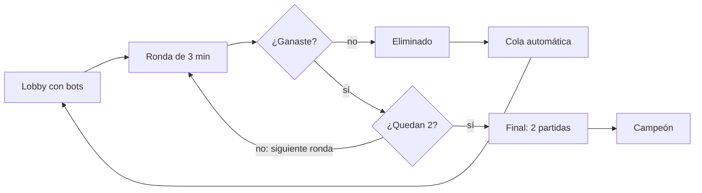

# Documento de diseño — Ajedrez de eliminación

Fecha: 2026-10-13

## Visión y concepto

Un torneo de ajedrez por eliminación en un salón oscuro, donde cualquiera puede hacer trampa y cualquiera puede acusarte. Las partidas duran 3 minutos y quien pierde desaparece del salón, así que la tensión sube conforme se vacía.

Inspiraciones: Final Sentence (muchos jugadores, eliminación constante), El juego del calamar (rondas y eliminaciones a la vista de todos) y la última partida de Gambito de Dama (mesas aisladas bajo una lámpara).

**Pilares de diseño**

- **Tensión creciente:** el salón se vacía y se oscurece con cada eliminación.
- **Trampa física y creíble:** solo trampas que una persona podría hacer en un tablero real.
- **Riesgo contra recompensa:** hacer trampa da ventaja pero te expone; acusar te protege pero puede costarte una advertencia.
- **Accesible:** se puede jugar sabiendo poco ajedrez; la trampa y la vigilancia compensan la diferencia de nivel.

## Flujo de un torneo

Cada ronda empareja a los jugadores que quedan en partidas simultáneas de 3 minutos; los perdedores salen del salón hasta que solo quedan dos.

Los eliminados vuelven a un torneo nuevo por la cola automática; en el prototipo, el resto del salón son bots.

## Reglas de partida

Cada partida tiene siempre un ganador: las tablas las ganan las negras, lo que empuja a las blancas a atacar.

| Concepto | Regla |
| --- | --- |
| Ritmo | 3 minutos por jugador, sin incremento |
| Tablas (ahogado, repetición, 50 jugadas, material insuficiente) | Ganan negras |
| Tiempo agotado | Pierde quien se quedó sin tiempo |
| Colores | Aleatorios en cada ronda |
| Final | Dos partidas con colores invertidos; si quedan 1-1, gana quien sume más tiempo sobrante en el reloj |
| Registro de la jugada | Al soltar la pieza (clic); la animación es visual y no consume reloj |

A probar con bots: dar a blancas algo más de tiempo (por ejemplo 3:00 contra 2:30), como en el Armageddon, si las negras ganan demasiado.

## Sistema de trampas

Cada trampa tarda un tiempo en ejecutarse y deja evidencia: mientras la mano trabaja, el rival puede verla si mira el tablero.

- **Tiempo de ejecución** = tiempo base de la trampa + distancia recorrida en casillas. Mover algo lejos es más lento y más arriesgado.
- **Exposición:** durante la ejecución, si la cámara del rival apunta al tablero, ve la animación completa.
- **Evidencia:** lo que queda después, como una pieza descentrada, una pieza que falta o una pila de capturas distinta. Las trampas sutiles dejan poca; las descaradas, mucha.
- **Solo una mano:** no se puede hacer trampa y mover a la vez.

Lista propuesta (pendiente de selección):

| # | Trampa | Qué hace | Duración | Evidencia |
| --- | --- | --- | --- | --- |
| 1 | Empujoncito | Avanza una pieza propia una casilla | Corta | Baja |
| 2 | Deslizar | Mueve una pieza propia varias casillas en línea | Según distancia | Media |
| 3 | Robar | Quita una pieza enemiga y la esconde en la mano o el regazo | Media | Alta |
| 4 | Mover pieza enemiga | La deja donde puedas capturarla o sin defensa | Según distancia | Media |
| 5 | Resucitar | Regresa al tablero una pieza propia capturada | Media | Alta |
| 6 | Sustitución | Cambia una pieza propia por otra de más valor de la pila | Larga | Alta |
| 7 | Pieza en la manga | Roba una pieza ahora y la suelta en el tablero después | Dos tiempos | Media |
| 8 | Doble jugada | Mueve dos veces antes de pulsar el reloj | Corta | Media |
| 9 | Jugada ilegal disfrazada | Caballo en línea, enroque inválido, alfil que cambia de color | Corta | Media |
| 10 | Pasar turno | Pulsa el reloj sin mover | Muy corta | Baja |
| 11 | Intercambio | Cambia de lugar dos piezas propias | Larga | Media |

Recomendación para el prototipo: 1, 2, 3, 4 y 7, que cubren lo planteado (avanzar ligeramente, quitar y mover piezas enemigas, esconder piezas en la mano).

## Acusaciones y árbitro

La tercera acusación falsa en un torneo te elimina; las dos primeras son advertencias que se arrastran entre partidas.

1. El jugador pulsa "acusar" y llama al árbitro.
2. La acusación solo cubre lo ocurrido desde tu última jugada. Así siempre queda claro si fue falsa.
3. El servidor sabe si hubo trampa en esa ventana:
    - **Acierto:** el tramposo queda eliminado y el acusador gana la partida.
    - **Falsa:** el acusador recibe una advertencia y la partida sigue.
4. Las advertencias se reinician al empezar un torneo nuevo.

Los bots también acusan, con acierto y con errores. Así el jugador ve que acusar tiene riesgo.

## Eventos de distracción

Los eventos existen para que los jugadores aparten la vista del tablero; sin ellos, nadie voltea y nadie puede hacer trampa. Un "director de tensión" en el servidor los dispara, con más frecuencia conforme quedan menos jugadores. Lista propuesta, pendiente de selección:

| # | Evento | Tipo | Efecto |
| --- | --- | --- | --- |
| 1 | Eliminación en otra mesa | Global | Guardias se llevan a un jugador que grita o se resiste |
| 2 | Apagón | Global | Las lámparas parpadean o se apagan unos segundos |
| 3 | Altavoz | Global | Anuncia cuántos jugadores quedan |
| 4 | Ruido detrás | Global | Una puerta se abre, algo cae al suelo |
| 5 | Acusación ajena | Global | Alguien en otra mesa grita "¡trampa!" |
| 6 | Un eliminado escapa | Global | Corre entre las mesas perseguido por guardias |
| 7 | Polilla en la lámpara | Global | Sombras grandes tapan parte del tablero |
| 8 | Lámpara que se balancea | Global | Las sombras se mueven sobre el tablero |
| 9 | Derramar agua | Rival | Obliga a mirar la mesa o el suelo |
| 10 | Tirar una pieza | Rival | Miras abajo o la recoges |
| 11 | Hablar o toser | Rival | Pregunta algo o se queja |
| 12 | Señalar detrás de ti | Rival | Obvio, pero funciona con principiantes |
| 13 | El árbitro pasa detrás | Disuasivo | Mientras está cerca, la trampa es más fácil de ver |

Los eventos del rival tienen tiempo de espera entre usos y son sospechosos en sí mismos: provocar uno es una señal de que tu rival planea algo.

## Ayuda para principiantes

La primera vez que el jugador intenta una jugada que pierde la partida de inmediato, se bloquea y su personaje murmura una advertencia; si insiste, se permite.

- **Qué se considera error grave:** una jugada que regala mucho material (por ejemplo, deja la dama colgada) o permite mate en 1.
- **Reacción:** la mano se detiene y el personaje dice algo como "...no, eso deja la dama colgada" o "espera, ¿y el caballo?".
- **Segundo intento** de la misma jugada: se permite sin comentario.
- **Nunca sugiere** la mejor jugada; solo avisa que esa es mala.
- **Alcance:** en el prototipo siempre activa. En multijugador, solo en el tutorial o en la liga de principiantes, porque es una ventaja frente a otros humanos.

## Ambiente, cámara y sensación

El salón es oscuro y cada mesa vive bajo su propia lámpara cónica; al eliminar a alguien, su lámpara se apaga y el salón se oscurece un poco más.

- **Iluminación:** un foco por mesa, como en la última partida de Gambito de Dama. El tablero siempre se lee bien; el resto queda en sombra.
- **Cámara:** primera persona, sentado. El jugador puede girar la cabeza para ver el salón; mirar a otro lado significa no vigilar el tablero.
- **Sonido:** espacial, para que un ruido te haga voltear hacia él. Relojes, piezas y murmullos que disminuyen conforme se vacía el salón.
- **Animación de la mano:** coherente y física (alcanzar, agarrar, trasladar, soltar, golpear el reloj). Tiembla más con el estrés.
- **La mano del rival es gameplay:** es lo que el jugador vigila. Cada trampa tiene su propia animación reconocible si la ves.

## Bots del prototipo

Los bots deben jugar, distraerse, hacer trampa y vigilar como personas, con errores incluidos.

- **Ajedrez:** nivel bajo y con errores humanos, no un motor perfecto que de pronto regala piezas.
- **Atención:** voltean ante eventos con cierta probabilidad y regresan la vista al tablero tras un rato.
- **Trampa:** la intentan cuando el jugador no mira, más a menudo si van perdiendo.
- **Vigilancia:** si miraban durante una trampa, la detectan con cierta probabilidad; a veces no la notan y a veces acusan sin razón.
- **Personalidades:** combinaciones de esos valores, por ejemplo el honesto, el tramposo nervioso y el paranoico que acusa de más.

## Alcance: prototipo y lanzamiento

El prototipo es un jugador humano contra bots; el lanzamiento añade varios humanos por servidor.

| Aspecto | Prototipo | Lanzamiento |
| --- | --- | --- |
| Jugadores | Un humano + bots | Varios humanos por servidor, bots de relleno |
| Al ser eliminado | Cola automática a un torneo nuevo | Cola automática o modo espectador (por definir) |
| Trampas | Subconjunto elegido | Lista completa |
| Eventos | Subconjunto elegido | Lista completa |
| Ayuda para principiantes | Siempre activa | Tutorial y liga de principiantes |
| Emparejamiento | Aleatorio | Por rating |
| Trampa con motor externo | No se aborda | Revisar tras el lanzamiento |

## Decisiones pendientes

- [ ] Elegir las trampas del prototipo
- [ ] Elegir los eventos de distracción del prototipo
- [ ] Número de jugadores por torneo (por ejemplo 16 o 32) y qué pasa con números impares
- [ ] ¿Se puede hacer trampa en tu turno, en el del rival o en ambos?
- [ ] ¿El reloj se pausa mientras llega el árbitro?
- [ ] ¿Una acusación correcta borra una advertencia?
- [ ] ¿Dar más tiempo a blancas para compensar que las tablas ganan negras?
- [ ] Ventana de acusación: ¿desde tu última jugada o un tiempo fijo (por ejemplo, 10 segundos)?
- [ ] Título del juego
