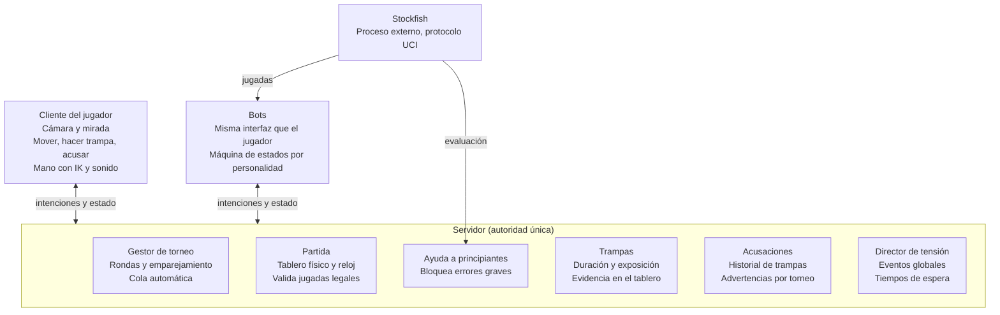

# Documento técnico — Ajedrez de eliminación

Fecha: 2026-10-13

## Resumen técnico

El juego se construye en Godot 4.6 o posterior con GDScript, y desde el prototipo se programa como si hubiera un servidor que manda, aunque todo corra en una sola máquina. Así el paso a multijugador no obliga a reescribir.

| Pieza | Elección | Motivo |
| --- | --- | --- |
| Motor | Godot 4.6+ | Trae IK 3D nativo (TwoBoneIK3D) |
| Lenguaje | GDScript | Rápido para prototipar; C# solo si hace falta rendimiento |
| Renderer | Forward+ | Necesario para niebla volumétrica y sombras de calidad |
| Motor de ajedrez para bots | Stockfish como proceso externo (UCI) | Fuerza ajustable, gratuito |
| Red (lanzamiento) | API de alto nivel de Godot + servidor headless | Suficiente para un juego por turnos |

## Arquitectura

Todo lo que decide el resultado vive en el servidor; el cliente solo captura entradas y dibuja.

En el prototipo, servidor, cliente y bots corren en el mismo proceso, pero se comunican solo por esta frontera.

## Tablero: estado físico y reglas

El punto más delicado del proyecto: las trampas cambian el tablero por fuera de las reglas, así que el estado del tablero es el **físico** (lo que hay sobre la mesa), no el que resultaría de las jugadas legales.

- **Una sola fuente de verdad:** el servidor guarda el tablero físico, la pila de capturas de cada jugador y lo que cada uno esconde en la mano.
- **Las jugadas normales se validan sobre el tablero físico actual.** Si alguien robó un caballo, el rival juega como si ese caballo nunca hubiera estado.
- **Límites de las trampas:** ninguna puede quitar o mover un rey, ni dejar al propio rey en jaque. Sin estos límites la partida queda en estados imposibles.
- **Jaque tras una trampa:** si una trampa deja al rival en jaque, se resuelve en su turno como cualquier jaque.
- **Tablas:** la repetición y la regla de 50 jugadas se calculan sobre posiciones físicas. Una trampa reinicia el contador de 50 jugadas.
- **Historial de trampas:** cada trampa se guarda con el turno y la hora en que ocurrió, para resolver acusaciones.
- **Posición fina:** cada pieza guarda un pequeño desplazamiento dentro de su casilla. Sirve para la evidencia visual (pieza descentrada).

## Animación de manos

El brazo se mueve con IK procedural: el código mueve un objetivo invisible y Godot calcula hombro, codo y muñeca, así que no hace falta animar cada combinación de casillas.

- **Rig:** `Skeleton3D` con un `TwoBoneIK3D` de hombro a muñeca, apuntando a un `Marker3D` (objetivo de la mano). Requiere un objetivo de polo detrás del codo para que el brazo no se doble raro.
- **Trayectorias:** arcos con `Vector3.bezier_interpolate()`, altos para pasar sobre piezas altas.
- **Poses de mano:** abierta, pinza y agarre completo, hechas en Blender y mezcladas con un `AnimationTree` que solo afecta a los dedos.
- **Sujetar la pieza:** un `BoneAttachment3D` en la palma; al agarrar, la pieza pasa a ser hija de ese nodo y al soltar vuelve al tablero.
- **Secuencia:** alcanzar, agarrar, trasladar, soltar y golpear el reloj, como una función con `await` por fase.
- **Casos aparte:** captura (retirar la pieza rival primero), enroque, coronación y cada trampa con su propia animación.
- **Reloj:** la jugada se registra al soltar el clic; la animación es visual y no consume tiempo.
- **Variación humana:** velocidad variable y un temblor que crece con el estrés.

## Trampas

Cada trampa se define como datos (un `Resource`), así que agregar o ajustar una no exige tocar código.

- **Datos por trampa:** tiempo base, tiempo extra por casilla recorrida, nivel de evidencia, animación y qué piezas puede tocar.
- **Ejecución:** el jugador elige la trampa, el servidor valida que esté permitida y calcula la duración; durante ese tiempo la mano está ocupada.
- **Exposición:** mientras dura, el servidor revisa cada pocos fotogramas si el rival mira el tablero. Si lo hizo en algún momento, la trampa queda marcada como "vista". El rival aún tiene que acusar.
- **Evidencia:** al terminar, la pieza puede quedar descentrada o la pila de capturas cambia. Se guarda en el tablero físico.
- **Cancelar:** si el rival voltea a mitad de la trampa, el jugador puede abortar. La animación de regreso también toma tiempo y también es visible.

## Mirada y atención

"Mirar el tablero" se calcula como que el tablero cae dentro de un cono frente a la cámara del jugador; es la variable más importante del juego.

- **Cálculo:** producto punto entre la dirección de la cámara y la dirección al centro del tablero, contra un umbral.
- **Envío:** el cliente manda la orientación de la cámara varias veces por segundo; el servidor decide si mira o no.
- **Bots:** usan el mismo cálculo con una cámara virtual, así comparten código con el jugador.
- **Representación visual:** la cabeza de cada personaje gira según su cámara. Así el jugador ve hacia dónde mira su rival.
- **Consideración para el lanzamiento:** un cliente modificado podría mentir sobre su mirada. Para un juego casual es aceptable; se puede limitar la velocidad de giro en el servidor.

## Acusaciones y advertencias

El servidor resuelve cada acusación revisando su historial de trampas: si hay una del rival desde la última jugada del acusador, la acusación es correcta.

- **Ventana:** desde la última jugada del acusador hasta el momento de acusar.
- **Resultado correcto:** el tramposo queda eliminado y el acusador gana.
- **Resultado falso:** se suma una advertencia al acusador; a la tercera, queda eliminado.
- **Persistencia:** el contador vive en la sesión del jugador dentro del torneo, no en la partida, y se reinicia con cada torneo nuevo.
- **Árbitro:** un personaje que camina a la mesa; la animación da unos segundos de suspenso antes del veredicto.

## Eventos y director de tensión

Un "director de tensión" en el servidor decide cuándo disparar eventos, para que todos los clientes los vean al mismo tiempo.

- **Eventos globales:** el servidor elige evento, mesa de origen y momento, y lo envía a todos. Su frecuencia sube conforme quedan menos jugadores.
- **Eventos del rival:** acciones que el jugador dispara, con tiempo de espera entre usos que controla el servidor.
- **Datos:** cada evento es un `Resource` con duración, posición, sonido y animaciones.
- **Sonido espacial:** `AudioStreamPlayer3D` en el punto de origen, para que el jugador gire la cabeza hacia el ruido de forma natural.
- **Eliminaciones:** al eliminar a alguien, su lámpara se apaga y su personaje sale del salón.

## Bots

Los bots usan las mismas entradas que un jugador (mover, mirar, hacer trampa, acusar), así que el juego no distingue entre humano y bot.

- **Ajedrez:** Stockfish como proceso externo con `OS.execute_with_pipe()`, comunicado por protocolo UCI. Se limita su fuerza con las opciones de nivel o Elo. Si juega poco humano, se puede probar Maia, un modelo entrenado para imitar a jugadores reales.
- **Tiempo de pensar:** pausas variables según la complejidad de la posición, no respuestas instantáneas.
- **Comportamiento:** una máquina de estados (jugar, mirar alrededor, hacer trampa, vigilar) con probabilidades por personalidad.
- **Parámetros por personalidad:** probabilidad de voltear ante un evento, de hacer trampa, de detectar una trampa vista y de acusar sin razón.
- **Un solo proceso de Stockfish** puede atender a muchos bots si se le mandan las posiciones por turnos.

## Ayuda para principiantes

Antes de aceptar la jugada del jugador, el motor la evalúa a poca profundidad y la bloquea si es un error grave; el análisis debe tardar unas décimas de segundo para no notarse.

- **Criterio:** la evaluación cae más de un umbral (por ejemplo, 3 peones) o la jugada permite mate en 1.
- **Memoria:** se guardan las jugadas ya advertidas en esa posición; si el jugador repite la misma, se permite.
- **Respuesta:** la mano se detiene y suena una línea de voz elegida de un banco de frases.
- **Tablero físico:** se evalúa sobre la posición física, con trampas incluidas.
- **Interruptor:** se activa o desactiva por modo de juego (prototipo, tutorial, liga de principiantes).

## Torneo y emparejamiento

Un gestor de torneo en el servidor arma las rondas, espera a que terminen todas las partidas y empareja a los ganadores.

- **Rondas sincronizadas:** la siguiente ronda empieza cuando termina la última partida. Los que acaban antes esperan en su mesa viendo el salón, lo que aumenta la tensión.
- **Números impares:** si sobra un jugador, pasa a la siguiente ronda sin jugar o se completa con un bot.
- **Relleno con bots:** si el lobby no se llena en cierto tiempo, se completa con bots.
- **Cola automática:** el jugador eliminado entra solo a un torneo nuevo.
- **Final:** dos partidas con colores invertidos y desempate por tiempo sobrante.

## Multijugador (lanzamiento)

El servidor es la única autoridad: el cliente solo envía intenciones (mover, mirar, hacer trampa, acusar) y dibuja lo que el servidor le confirma.

- **Servidor:** exportación headless de Godot, con la API de alto nivel (`@rpc`, `MultiplayerSynchronizer` para la mirada y la posición de las manos).
- **Información oculta:** el servidor solo envía la animación de una trampa a quien podría verla. Si la manda a todos, un cliente modificado vería todas las trampas.
- **Latencia:** tolerable porque el juego es por turnos, salvo en la exposición. El servidor decide con su propia línea de tiempo y da un pequeño margen.
- **Desconexiones:** si un jugador se va, su reloj sigue corriendo; si se agota, pierde.
- **Prototipo:** el servidor y el cliente corren en el mismo proceso, pero separados en código, para no reescribir al pasar a red.

## Iluminación y rendimiento

El costo principal son muchas luces con sombra y muchos personajes animados; la mesa propia recibe todo el detalle y las lejanas se simplifican.

- **Lámparas:** un `SpotLight3D` por mesa con niebla volumétrica en `WorldEnvironment`. Solo las mesas cercanas proyectan sombras; las lejanas usan luz sin sombra.
- **Personajes:** niveles de detalle (LOD) por distancia. Las manos lejanas no necesitan IK cada fotograma; pueden actualizarse cada pocos fotogramas o usar animaciones simples.
- **Legibilidad:** el tablero propio siempre bien iluminado, sin importar el ambiente.
- **Meta de rendimiento:** definir pronto un número de mesas y de jugadores visibles, y medirlo en una máquina modesta.

## Riesgos técnicos

El mayor riesgo es que la mano no se sienta creíble; conviene prototiparla primero, antes que la red o los eventos.

| Riesgo | Mitigación |
| --- | --- |
| La mano se ve robótica o atraviesa piezas | Prototiparla primero; grabar referencia real con el celular; arcos altos |
| Las trampas dejan posiciones imposibles | Límites claros: nunca tocar reyes ni dejar al propio rey en jaque |
| Los bots se sienten falsos | Ajustar personalidades con pruebas; probar Maia si Stockfish no convence |
| La detección de mirada se siente injusta | Mostrar claramente hacia dónde mira el rival; ajustar el cono con pruebas |
| Bajo rendimiento con muchas mesas | Sombras solo cercanas, LOD, IK lejano con menos frecuencia |
| Trampas visibles para clientes modificados | Enviar la animación de una trampa solo a quien puede verla |

## Fuentes

- [Inverse kinematics returns to Godot 4.6](https://godotengine.org/article/inverse-kinematics-returns-to-godot-4-6/)
- [TwoBoneIK3D, documentación de Godot](https://docs.godotengine.org/es/4.x/classes/class_twoboneik3d.html)
- [Inverse Kinematics (IK) Return to Godot, GameFromScratch](https://gamefromscratch.com/inverse-kinematics-ik-return-to-godot/)
